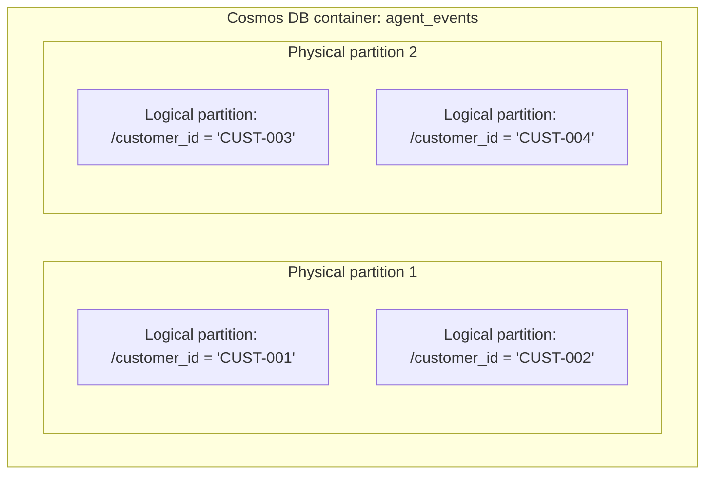

# Azure Cosmos DB NoSQL Partition-Key Design

> **Purpose:** Record the partition-key rationale for document, state, and AI-event storage in Azure Cosmos DB.
> **Historical milestone context:** v0.12.1 — Cosmos DB NoSQL Emulator + Change Feed. Validate service limits and current implementation against authoritative documentation and source before relying on this design.

## 1. Partitioning Concepts

Azure Cosmos DB distributes containers across logical and physical partitions:

1. A **logical partition** groups items that share a partition-key value. The historical design cites a 20 GB per-logical-partition limit; verify current service limits before capacity planning.
2. A **physical partition** is an Azure-managed compute and SSD-storage unit that hosts one or more logical partitions.



## 2. Candidate Comparison

The historical design compares candidates against assumed AegisBank access patterns:

| Criterion | Candidate A: `/customer_id` | Candidate B: `/topic` | Candidate C: `/document_id` |
|---|---|---|---|
| Cardinality | High: potentially many unique customers. | Low: a small fixed topic set such as `creditos`, `cuentas`, and `reclamos`. | Medium: potentially hundreds of knowledge documents. |
| Load distribution | Expected to distribute customer activity; validate skew with real workload evidence (synthetic in this project). | Potentially hot partitions if traffic concentrates in a few topics. | Potentially uneven when popular documents receive disproportionate reads. |
| Point reads (`id` + partition key) | Direct lookup with known customer, e.g. `read_item(id, partition_key="CUST-001")`. | Requires knowing the event topic. | Does not group a customer's conversational context. |
| Tenant/PII isolation | Scopes customer records to a customer partition; authorization is still required in application code. | Mixes customers under the same topic partition. | Does not provide a customer isolation boundary. |
| Example in-partition query | `SELECT * FROM c WHERE c.customer_id = @cust AND c.timestamp >= @ts` | `SELECT * FROM c WHERE c.topic = @top` (cross-customer) | `SELECT * FROM c WHERE c.document_id = @doc` |
| Recorded decision | **Selected as canonical** | Rejected | Rejected |

## 3. Rationale for `/customer_id`

The historical decision favors `/customer_id` because:

1. Agent sessions and banking tools are expected to operate in an authenticated customer context; history, service-request status, and interaction state are naturally filtered by customer.
2. Knowing both item `id` and `customer_id` enables a point read without a cross-partition query.
3. Per-customer logical partitions provide a useful data-access boundary and reduce cross-tenant query risk.

The partition key does **not** replace authentication, deterministic ownership checks, or authorization. Validate workload distribution, hot partitions, capacity, and current service limits before a production design.

## 4. Versioned Document Example

The following synthetic event is an illustrative schema example, not a production record:

```json
{
  "id": "evt_20260901_001_a1b2c3d4",
  "customer_id": "CUST-001",
  "schema_version": "1.0",
  "event_type": "service_request_logged",
  "correlation_id": "corr-f9a8b7c6",
  "timestamp_utc": "2026-09-01T03:00:00Z",
  "payload": {
    "request_id": "SR-2026-0001",
    "request_type": "account_limit_increase",
    "status": "pending_approval"
  },
  "metadata": {
    "channel": "ai_agent_mcp",
    "agent_version": "0.7.0"
  },
  "ttl": 2592000
}
```
