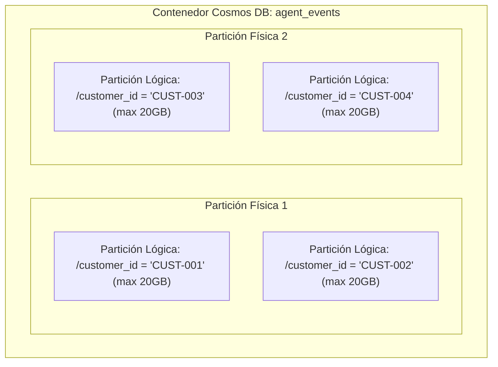

# AegisBank — Diseño de Particionamiento en Azure Cosmos DB NoSQL

> **Propósito:** Justificación arquitectónica y análisis comparativo de claves de partición (*Partition Keys*) para el almacenamiento de documentos, estado y eventos de IA en Azure Cosmos DB.
> **Hito:** v0.12.1 — Cosmos DB NoSQL Emulator + Change Feed.

---

## 1. Principios de Particionamiento en Azure Cosmos DB

Azure Cosmos DB escala horizontalmente dividiendo los contenedores en **particiones lógicas** y **particiones físicas**:
1. **Partición Lógica (*Logical Partition*):** Conjunto de items que comparten el mismo valor de la clave de partición (`partitionKey`). Tiene un límite estricto de **20 GB** de almacenamiento por valor en Azure Cloud.
2. **Partición Física (*Physical Partition*):** Unidad interna de cómputo y almacenamiento SSD administrada y autoescalada por Azure, que aloja una o más particiones lógicas.



---

## 2. Análisis Comparativo de Candidatos a Clave de Partición

Evaluamos los tres candidatos principales según los patrones de acceso dominantes en AegisBank:

| Criterio de Evaluación | Candidato A: `/customer_id` | Candidato B: `/topic` | Candidato C: `/document_id` |
|---|---|---|---|
| **Cardinalidad** | **Alta** (miles/millones de clientes únicos). | **Baja** (5 a 10 tópicos fijos: `creditos`, `cuentas`, `reclamos`, etc.). | **Media** (cientos de documentos de conocimiento). |
| **Distribución de Carga (Anti-Hot Partition)** | **Uniforme:** El volumen transaccional se distribuye equilibradamente entre clientes. | **Pésima:** El 80% del tráfico colapsaría en `creditos` y `reclamos` creando **Hot Partitions**. | **Irregular:** Algunos documentos se consultan 100x más que otros. |
| **Point Reads Eficientes (`id` + `pk`)** | **Óptimo:** Invocaciones de lectura directa de estado (`read_item(id, partition_key="CUST-001")`). | **Inadecuado:** Requiere conocer el tópico del evento para point reads. | **Inadecuado:** No agrupa el contexto conversacional del cliente. |
| **Aislamiento Multi-Tenant / PII** | **Excelente:** Todas las consultas del cliente se acotan a su partición lógica; previene fugas entre clientes. | **Nulo:** Mezcla datos de todos los clientes en la misma partición. | **Nulo:** No provee límites de aislamiento por cliente. |
| **Consultas Dominantes (*In-Partition Queries*)** | `SELECT * FROM c WHERE c.customer_id = @cust AND c.timestamp >= @ts` | `SELECT * FROM c WHERE c.topic = @top` (Cross-customer). | `SELECT * FROM c WHERE c.document_id = @doc` |
| **Decisión Arquitectónica** | **SELECCIONADO COMO CANÓNICO** | **DESCARTADO** | **DESCARTADO** |

---

## 3. Justificación de la Elección Canónica: `/customer_id`

1. **Alineación con el 95%+ de los Patrones de Acceso:**
   - El agente conversacional y las herramientas bancarias siempre operan en el contexto de una sesión de cliente autenticado (`customer_id`).
   - Las consultas de historial, verificación de solicitudes de servicio y estado de interacciones se filtran naturalmente por `customer_id`.
2. **Eficiencia en Costo y Rendimiento (Point Reads):**
   - Conocer `id` y `customer_id` permite resolver lecturas atómicas de 1 RU sin escanear índices cross-partition.
3. **Escalabilidad Horizontal Ilimitada:**
   - Cada cliente dispone de su propia partición lógica de hasta 20 GB, evitando que un cliente de alta actividad degrade el rendimiento de los demás.

---

## 4. Estructura Documental Mínima Versionada

```json
{
  "id": "evt_20260901_001_a1b2c3d4",
  "customer_id": "CUST-001",
  "schema_version": "1.0",
  "event_type": "service_request_logged",
  "correlation_id": "corr-f9a8b7c6",
  "timestamp_utc": "2026-09-01T03:00:00Z",
  "payload": {
    "request_id": "SR-2026-0001",
    "request_type": "account_limit_increase",
    "status": "pending_approval"
  },
  "metadata": {
    "channel": "ai_agent_mcp",
    "agent_version": "0.7.0"
  },
  "ttl": 2592000
}
```
