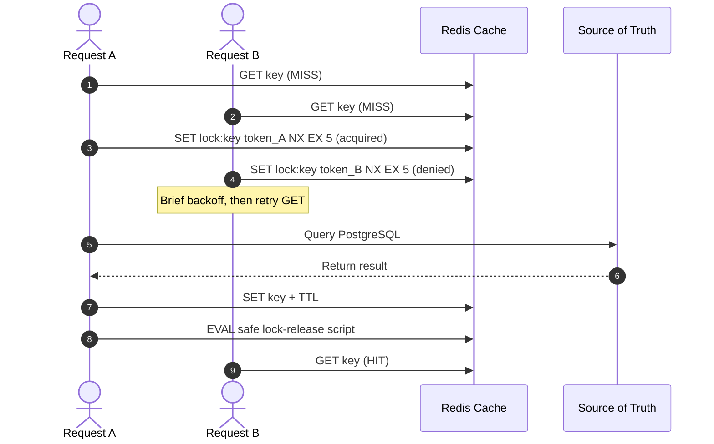

# Redis Cache and In-Memory Data Policy

> **Purpose:** Define documented architectural boundaries, security rules, access patterns, and invalidation guidance for local Redis and the Azure Managed Redis target.
> **Historical milestone context:** v0.12.2 — Redis Cache + Vector/Search Semantics. Verify all implementation and performance claims against current source and tests.

## 1. Cache-Layer Principles

Redis is an in-memory latency accelerator and vector-search laboratory. It must not replace systems of record:

- **PostgreSQL + pgvector:** persistent canonical corpus and vector search.
- **Cosmos DB NoSQL:** documents, agent state, and Change Feed.
- **Mock Core Banking:** transactional financial domain.

The documented access pattern is cache-aside: check Redis, load a miss from the canonical source, then cache eligible results with a TTL.

## 2. Cache Eligibility

| Data category | Policy | Rationale | Documented TTL |
|---|---|---|---|
| RAG retrieval results | Allowed | Stable public or institutional policies; may reduce response latency. Invalidate when the corpus changes. | 300 seconds (5 minutes) |
| Corpus metadata/version | Allowed | Chunk count, active corpus version, and document hashes. | 600 seconds (10 minutes) |
| RAG KNN vector search | Allowed for laboratory evaluation | In-memory RediSearch vectors for low-latency comparative evaluation. | For the laboratory session |
| Account and loan balances | **Prohibited** | Private, dynamic financial data; stale values are unsafe. Always read directly from Core Banking. | 0 seconds |
| Upcoming installments | **Prohibited** | Due dates and amounts can change. Always read directly from Core Banking. | 0 seconds |
| Transaction state and approvals | **Prohibited** | HITL state and outbox transactions require immediate ACID consistency. | 0 seconds |
| Final LLM responses | Deferred: `SEMANTIC_CACHE_DEFERRED` | Small wording differences may change financial or regulatory meaning. Not enabled in this phase. | N/A |

Never cache sensitive financial data, approval state, or final financial answers under this policy.

## 3. Cache Key Design

Keys should be deterministic, versioned, and hierarchical:

$$\text{key} = \text{aegisbank}:\langle\text{domain}\rangle:\text{v}\langle\text{schema version}\rangle:\langle\text{corpus version}\rangle:\langle\text{sha256 digest}\rangle$$

Examples:

- RAG retrieval: `aegisbank:rag:v1:v1.0:a7b8c9d0e1f2...`
- Corpus metadata: `aegisbank:corpus_meta:v1:active_version`
- Single-flight lock: `aegisbank:lock:rag:v1:a7b8c9d0e1f2...`

## 4. Cache-Stampede Protection

Concurrent cache misses after key expiry or cold start can overload the relational source. The documented single-flight pattern uses a Redis distributed lock with a unique token and safety TTL:

## 5. Resilience and Failure Fallback

The documented policy is that Redis unavailability must not interrupt read operations:

1. On Redis connection failure or timeout, the cache manager should record telemetry and fall back directly to the source of truth (PostgreSQL).
2. This fallback increases latency. Do not claim behavior is implemented or tested without current runtime/test evidence.
