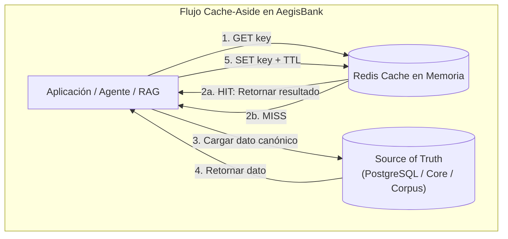
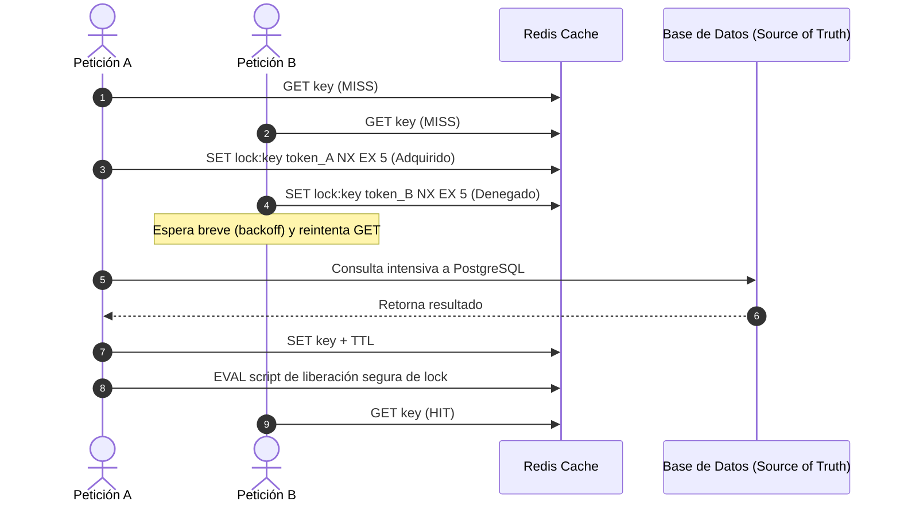

# AegisBank — Política de Caché y Gestión en Memoria con Redis

> **Propósito:** Definir los límites arquitectónicos, directivas de seguridad, patrones de acceso y estrategias de invalidación para la capa de almacenamiento en memoria con Redis (local Open Source y Azure Managed Redis).
> **Hito:** v0.12.2 — Redis Cache + Vector/Search Semantics.

---

## 1. Principios Fundamentales de la Capa de Caché

Redis se incorpora a AegisBank como un **acelerador de baja latencia en memoria** y **laboratorio de búsqueda vectorial**. Bajo ningún concepto sustituye a los sistemas de registro (*Systems of Record*):
* **PostgreSQL + pgvector:** Almacén persistente canónico del corpus y búsqueda vectorial.
* **Cosmos DB NoSQL:** Almacén de documentos, estado de agentes y Change Feed.
* **Mock Core Banking:** Sistema transaccional financiero.

---

## 2. Clasificación de Datos: Cachables vs No Cachables

| Categoría de Datos | Política de Caché | Justificación Técnica y Regulatoria | TTL Máximo Recomendado |
|---|---|---|---|
| **Resultados de Retrieval RAG** | **PERMITIDO (CACHABLE)** | Consultas sobre políticas y normativas públicas o institucionales estables. Acelera la respuesta del agente. | 300 segundos (5 min) / Invalida ante actualización del corpus. |
| **Metadatos y Versión de Corpus** | **PERMITIDO (CACHABLE)** | Conteo de chunks, versión activa del corpus y hashes de documentos. | 600 segundos (10 min). |
| **Búsqueda Vectorial RAG (KNN)** | **PERMITIDO (CACHABLE)** | Vectores indexados en memoria con RediSearch para evaluación comparativa de baja latencia. | Persistido mientras dure la sesión de laboratorio. |
| **Saldos de Cuentas y Préstamos** | **ESTRICTAMENTE PROHIBIDO (NON-CACHEABLE)** | Datos financieros privados altamente dinámicos; riesgo de mostrar saldos desactualizados (*stale balances*). | 0 s (Siempre consulta directa al Core). |
| **Próximas Cuotas a Pagar** | **ESTRICTAMENTE PROHIBIDO (NON-CACHEABLE)** | Fechas de vencimiento y montos sujetos a amortizaciones en tiempo real. | 0 s (Siempre consulta directa al Core). |
| **Estado Transaccional / Aprobaciones** | **ESTRICTAMENTE PROHIBIDO (NON-CACHEABLE)** | Máquina de estados HITL y transacciones del Outbox; exigen consistencia ACID inmediata. | 0 s (Prohibido almacenar en caché). |
| **Respuestas Finales del LLM** | **DIFERIDO POR SEGURIDAD (`SEMANTIC_CACHE_DEFERRED`)** | Variaciones sutiles en la pregunta del cliente podrían cambiar el sentido financiero o regulatorio. | N/A (No habilitado en esta fase). |

---

## 3. Estructura y Espacio de Nombres de Claves (*Cache Key Design*)

Todas las claves almacenadas en Redis deben seguir un esquema determinista, versionado y con prefijos jerárquicos:

$$\text{key} = \text{aegisbank}:\langle\text{dominio}\rangle:\text{v}\langle\text{versión\_esquema}\rangle:\langle\text{versión\_corpus}\rangle:\langle\text{digest\_sha256}\rangle$$

### Ejemplos Canónicos:
* **Retrieval RAG:** `aegisbank:rag:v1:v1.0:a7b8c9d0e1f2...`
* **Metadatos de Corpus:** `aegisbank:corpus_meta:v1:active_version`
* **Bloqueo Single-Flight (Stampede Lock):** `aegisbank:lock:rag:v1:a7b8c9d0e1f2...`

---

## 4. Protección Contra Inundación de Caché (*Cache Stampede / Thundering Herd*)

Cuando expira una clave de alto tráfico o ante un arranque en frío, múltiples peticiones simultáneas podrían obtener un **Cache Miss** y saturar la base de datos relacional.

AegisBank implementa el patrón **Single-Flight** mediante un bloqueo distribuido ligero en Redis con token único y TTL de seguridad:

---

## 5. Política de Resiliencia y Degradación Elegante (*Failure Fallback*)

La indisponibilidad o caída de Redis **nunca debe interrumpir las operaciones de lectura**:
1. Si la conexión a Redis falla o se agota el tiempo de espera (*timeout*), el gestor de caché captura el error, emite telemetría y ejecuta un **fallback directo a la fuente de verdad (PostgreSQL)**.
2. La aplicación continúa funcionando sin degradación funcional, asumiendo únicamente el incremento previsible en la latencia.
