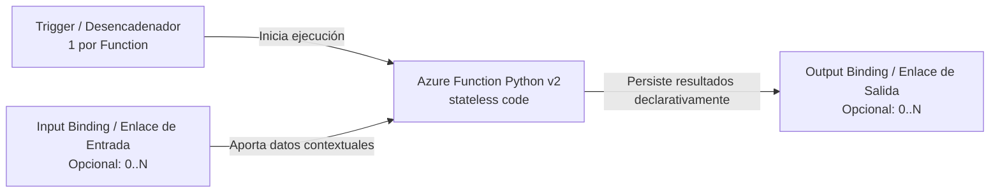

# Guía Pedagógica: Triggers, Bindings y el Modelo Python v2 en Azure Functions

---

## 1. Conceptos Fundamentales: Trigger vs Binding

En **Azure Functions**, la arquitectura de cómputo serverless se basa en dos abstracciones declarativas:



### 1.1. Trigger (Desencadenador)
- **Definición:** El evento único que provoca la invocación de una función.
- **Regla Inmutable:** **Una Azure Function tiene exactamente UN trigger.** No es posible asociar múltiples triggers a una misma función.
- **Ejemplos:** HTTP Request (`@app.route`), Event Grid Event (`@app.event_grid_trigger`), Service Bus Message (`@app.service_bus_queue_trigger`), Timer (`@app.timer_trigger`).

### 1.2. Input Binding (Enlace de Entrada)
- **Definición:** Conexión declarativa que recupera datos adicionales de una fuente externa (Cosmos DB, Blob Storage, Table Storage) y los entrega directamente como parámetro a la función.
- **Ventaja:** Elimina el código repetitivo (*boilerplate*) para autenticar clientes del SDK y consultar el almacén.

### 1.3. Output Binding (Enlace de Salida)
- **Definición:** Conexión declarativa que toma el valor retornado por la función y lo envía automáticamente a un destino externo (e.g. publicar en una cola, guardar un archivo en Blob Storage).
- **Política en AegisBank:** `OUTPUT_BINDING_DEFERRED_NO_JUSTIFIED_USE_CASE`. No agregamos bindings de salida innecesarios cuando el handler es un consumidor de auditoría/observabilidad sin mutaciones de estado secundarias.

---

## 2. Python Programming Model v2

El modelo **Python v2** de Azure Functions estandariza el desarrollo usando decoradores nativos en un archivo central `function_app.py`, eliminando la estructura histórica de carpetas separadas con archivos `function.json`.

```python
import azure.functions as func

# Instancia central de FunctionApp
app = func.FunctionApp(http_auth_level=func.AuthLevel.ANONYMOUS)


# Trigger de Event Grid
@app.event_grid_trigger(arg_name="event")
def service_request_event_handler(event: func.EventGridEvent) -> None:
    # Lógica desacoplada de procesamiento
    pass


# Endpoint HTTP de Salud Operativa
@app.route(route="health", methods=["GET"])
def health_check(req: func.HttpRequest) -> func.HttpResponse:
    return func.HttpResponse("OK", status_code=200)
```

---

## 3. Ciclo de Vida y Principio de Sin Estado (*Statelessness*)

### 3.1. Statelessness (*Sin Estado*)
Las funciones serverless deben diseñarse como **completamente sin estado**:
1. **Sin memoria persistente entre llamadas:** No se debe asumir que dos eventos consecutivos serán atendidos por la misma instancia física o worker.
2. **Sin persistencia local permanente:** El sistema de archivos local (`/tmp` o disco temporal) es efímero y se descarta cuando la instancia se desaprovisiona.
3. **Idempotencia Obligatoria:** Dado que las redes y los brokers entregan eventos bajo la garantía *at-least-once*, el handler debe deduplicar por `id` de evento.

### 3.2. Arranque en Frío (*Cold Start*) vs Instancia Caliente (*Warm Instance*)
- **Cold Start:** Cuando la plataforma escala de 0 a 1 instancia tras un período de inactividad, debe inicializar el contenedor, cargar el runtime de Python e importar dependencias.
- **Warm Instance:** Instancia en memoria que atiende solicitudes subsecuentes con latencia mínima ($<5\text{ ms}$).
