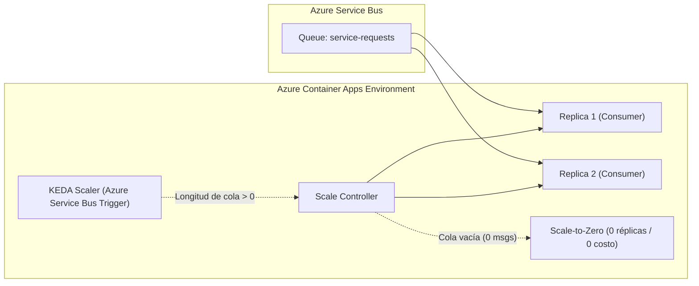
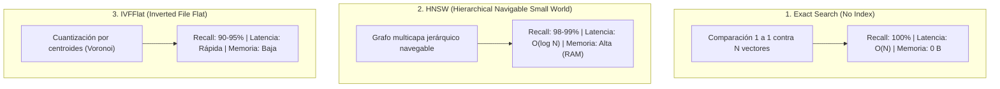
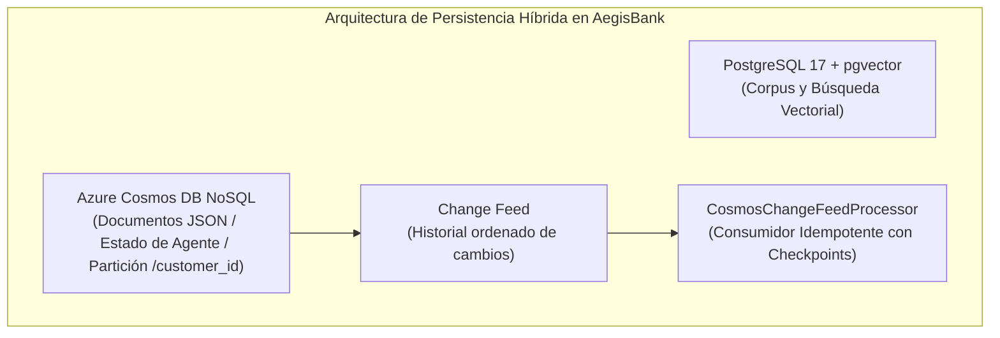
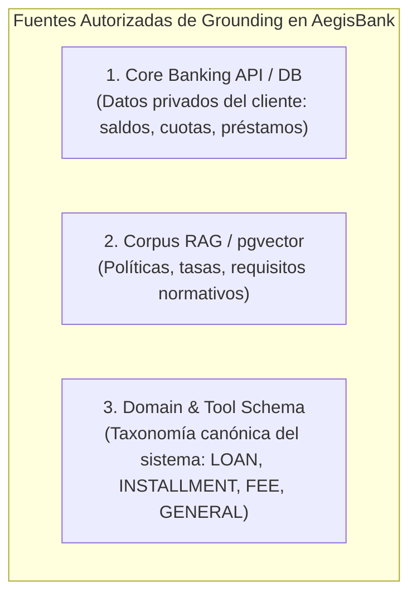

     # AegisBank — Notas de Cátedra de Nivel Maestría en Inteligencia Artificial

> **Módulo:** Observabilidad Agéntica, AgentOps, Auditoría Inmutable y Supervisión HOTL
> **Nivel:** Maestría / Posgrado en Inteligencia Artificial
> **Profesor / Lead Architect:** Senior Principal AI Engineer
> **Hito del Proyecto:** `v0.9.0 — Observability + AgentOps + Audit + HOTL Foundation`

---

## 1. Fundamentos de la Observabilidad en Sistemas de IA

En la ingeniería de software tradicional, la observabilidad responde a la pregunta: *¿El servidor está respondiendo con código HTTP 200?*
En la **Ingeniería de IA Agéntica (Agentic AI Engineering)**, la observabilidad debe responder preguntas mucho más complejas:
* ¿Por qué el modelo eligió llamar a una herramienta específica (`tool_choice`)?
* ¿Qué fragmentos de conocimiento recuperó el RAG y cuáles fueron citados?
* ¿La respuesta fue rechazada por el filtro de grounding o por el evaluador humano (HITL)?
* ¿Cuánto tiempo tomó la inferencia del LLM en comparación con la ejecución de la base de datos?
* ¿Ocurrió un fallo transitorio que requirió reintentos o la activación de un cortacircuitos (*Circuit Breaker*)?

---

## 2. Los Tres Pilares de OpenTelemetry (OTel) para Agentes

```
                       +-------------------------------+
                       |    OPENTELEMETRY STANDARD     |
                       +-------------------------------+
                         /            |              \
                        /             |               \
            [ LOGS ]              [ METRICS ]          [ TRACES ]
      Eventos en JSON       Valores agregados        Spans jerárquicos
      con Correlation ID    (p95, error rates)       (agent -> tool -> db)
```

---

### Pilar 1: Trazas Distribuidas y Spans (*Distributed Tracing & Spans*)

```
TRACE ID: 4bf92f3577b34da6a3ce929d0e0e4736 (Correlation ID: REQ-20260830-001)
│
├── SPAN: agent.run [Duration: 850ms]
│    │
│    ├── SPAN: llm.chat [Duration: 620ms] (Model: phi-4-mini, Tokens: 412)
│    │
│    ├── SPAN: mcp.tool_call [Duration: 180ms] (Tool: create_service_request)
│    │    │
│    │    ├── SPAN: hitl.approval [Duration: 120ms] (Status: APPROVED)
│    │    │
│    │    └── SPAN: core_banking.write [Duration: 45ms] (Status: OK)
│    │
│    └── SPAN: outbox.publish [Duration: 15ms] (Event: ServiceRequestCreated)
```

1. **Sigla y Nombre:** `OTel` — OpenTelemetry / Distributed Tracing.
2. **Definición Teórica:** Una **Traza (Trace)** representa el grafo acíclico dirigido (DAG) de operaciones ejecutadas para satisfacer una solicitud. Cada nodo del grafo es un **Span**.
3. **Atributos Clave de un Span:**
   * `span.name`: Nombre semántico (`agent.run`, `llm.chat`, `tool.execute`, `hitl.approval`).
   * `trace_id`: Identificador global de 128 bits.
   * `span_id`: Identificador único del paso de 64 bits.
   * `parent_span_id`: Identificador del span padre para formar el árbol jerárquico.
   * `attributes`: Metadatos contextuales (`gen_ai.system`, `gen_ai.model`, `tool.name`, `customer.id`).
4. **Por qué lo necesita AegisBank:** Permite identificar inmediatamente en qué milisegundo exacto ocurrió un cuello de botella o en qué componente falló una transacción.
5. **Relación con Microsoft Certifications:**
   * **AI-103 & AI-200:** Distributed Tracing con OpenTelemetry en Azure Monitor y Application Insights.

---

### Pilar 2: Registros Estructurados y Redacción (*Structured Logging & Redaction*)

```json
{
  "timestamp": "2026-08-30T21:25:00.123456Z",
  "level": "INFO",
  "event_name": "tool_executed",
  "correlation_id": "REQ-20260830-001",
  "trace_id": "4bf92f3577b34da6a3ce929d0e0e4736",
  "span_id": "00f067aa0ba902b7",
  "session_customer_id": "CUST-0001",
  "tool_name": "create_service_request",
  "approval_status": "APPROVED",
  "execution_status": "SUCCESS",
  "latency_ms": 45.2
}
```

1. **Regla de Redacción Obligatoria (Seguridad Bancaria):**
   * **PROHIBIDO:** Registrar API Keys, contraseñas, bearer tokens, prompts conversacionales completos con datos sensibles o PII real en los logs de telemetría.
   * **PERMITIDO:** Metadatos de la operación, nombres de herramientas, IDs sintéticos, estados de aprobación, latencias y códigos de error.

---

### Pilar 3: Métricas Operativas y Percentiles de Latencia (*Metrics & Percentiles*)

1. **Contadores Operativos:**
   * `request_count`: Total de interacciones con el agente.
   * `request_error_count`: Interacciones que resultaron en error.
   * `tool_call_count` / `tool_call_failure_count`: Tasa de éxito y fallo por herramienta.
   * `hitl_approved_count` / `hitl_rejected_count`: Proporción de aprobaciones humanas.
   * `retry_count`: Reintentos ejecutados ante fallas transitorias.
   * `circuit_breaker_open_count`: Incidentes de disparo de cortacircuitos.
   * `dlq_count`: Mensajes envenenados derivados a la cola de mensajes muertos.
2. **Cálculo de Percentiles de Latencia:**
   * **p50 (Mediana):** El 50% de las peticiones se atendieron por debajo de este tiempo.
   * **p95:** El 95% de las peticiones se atendieron por debajo de este tiempo (métrica clave para SLAs).
   * **p99:** Identifica casos atípicos o anomalías extremas (*tail latency*).

---

## 3. Registro de Auditoría Inmutable vs. Logs Operacionales

| Característica | Log Operacional / Telemetría | Registro de Auditoría Bancaria (Audit Trail) |
|---|---|---|
| **Audiencia** | Desarrolladores / SRE / DevOps | Oficiales de Cumplimiento / Auditores / Reguladores |
| **Persistencia** | Rotativa (retención 30 a 90 días) | Inmutable / Append-Only (retención de años) |
| **Contenido** | Trazas técnicas, spans, latencias | Decisiones de negocio, hashes criptográficos, aprobaciones HITL |
| **Garantía** | Mejor esfuerzo (*Best effort*) | No repudio (*Non-repudiation*) y secuencia garantizada |

---

## 4. Supervisión HOTL (Human-on-the-Loop) y Kill-Switch

```
                 [ FLUJO NORMAL AGÉNTICO ]

  Cliente ---> Agente ---> [ HOTL Kill-Switch: ACTIVO? ]
                                   |
                         +---------+---------+
                         |                   |
                     NO (Permitido)     SÍ (Bloqueado)
                         |                   |
                  [ Ejecutar Tool ]    [ FAST-FAIL HOTL ]
                  (Requiere HITL)     "Escrituras suspendidas
                                       por supervisión"
```

1. **Diferencia Fundamental:**
   * **HITL (Human-in-the-Loop):** Decisión microscópica sobre una transacción individual.
   * **HOTL (Human-on-the-Loop):** Control macroscópico sobre la capacidad del sistema.
2. **Kill-Switch Supervisorio:** Permite a un operador humano o a un sistema de alerta automática deshabilitar de forma inmediata la herramienta de escritura (`create_service_request`) en toda la plataforma sin necesidad de redesplegar el código.

---

## 5. Masterclass KQL (Kusto Query Language) para Azure Monitor

En producción (Microsoft AI-200), las trazas y logs de OpenTelemetry se consultan en Azure Log Analytics mediante KQL.

### Consulta 1: Tasa de Fallo por Herramienta
```kql
AegisAgentSpans
| where Name == "tool.execute"
| summarize
    TotalCalls = count(),
    FailedCalls = countif(Status == "ERROR")
    by ToolName = tostring(Attributes["tool.name"])
| extend FailureRatePct = round((FailedCalls * 100.0) / TotalCalls, 2)
| order by FailureRatePct desc
```

### Consulta 2: Distribución de Latencia del Agente (p50, p95, p99)
```kql
AegisAgentSpans
| where Name == "agent.run"
| summarize
    P50_Ms = percentile(DurationMs, 50),
    P95_Ms = percentile(DurationMs, 95),
    P99_Ms = percentile(DurationMs, 99)
    by Model = tostring(Attributes["gen_ai.model"])
```

### Consulta 3: Proporción de Aprobación vs. Rechazo en HITL
```kql
AegisAuditEvents
| where EventType in ("HITL_APPROVED", "HITL_REJECTED")
| summarize
    Approvals = countif(EventType == "HITL_APPROVED"),
    Rejections = countif(EventType == "HITL_REJECTED")
    by bin(Timestamp, 1h)
| extend ApprovalRatio = round((Approvals * 100.0) / (Approvals + Rejections), 2)
```

### Consulta 4: Incidentes de Disparo de Cortacircuitos (Circuit Breaker)
```kql
AegisAuditEvents
| where EventType == "CIRCUIT_STATE_CHANGED" and Payload has "OPEN"
| project Timestamp, CorrelationId, DependencyName = tostring(Payload.dependency), Reason = tostring(Payload.reason)
| order by Timestamp desc
```

### Consulta 5: Auditoría de Mensajes en Cola de Mensajes Muertos (DLQ)
```kql
AegisAuditEvents
| where EventType == "MESSAGE_DEAD_LETTERED"
| project Timestamp, CorrelationId, EventId = tostring(Payload.event_id), FailureReason = tostring(Payload.failure_reason), Attempts = toint(Payload.attempts)
| order by Timestamp desc
```

---

## 6. Matriz de Madurez: Laboratorio Local vs. Producción Cloud

| Capacidad | Estado en AegisBank (v0.9 Local) | Estado en Producción Cloud (Azure / AI-200) |
|---|---|---|
| **Tracing** | `InMemorySpanExporter` local | Azure Monitor Exporter $\to$ Application Insights |
| **Logs** | JSON estructurado en stream/archivo | Azure Log Analytics Workspace |
| **Métricas** | Contadores en memoria + percentiles | Azure Monitor Metrics / Prometheus |
| **Auditoría** | SQLite `audit_logs` append-only | Azure SQL Immutable Ledger / Azure Cosmos DB WORM |
| **HOTL Kill-Switch** | Variable atómica thread-safe en memoria | Azure App Configuration / Feature Flags dinámicos |
| **Consultas** | Filtros Python en memoria | Consultas KQL en Azure Log Analytics |

---

## 7. v0.9.1: Routing Grounded y Abstención

**RAG** (*Retrieval-Augmented Generation*, generación aumentada mediante recuperación) no significa que el modelo diga que va a buscar; significa que el programa ejecuta retrieval y entrega evidencia al modelo. Un **tool call** es una estructura nativa, normalmente JSON, que el host valida y ejecuta. El texto `search_knowledge("...")` no es una llamada y nunca debe parsearse para fabricarla.

En modo **AUTO TOOL ROUTING**, `tool_choice="auto"` permite que el LLM elija responder o llamar una herramienta. Es útil para preguntas abiertas, pero deja un **routing gap** si un modelo pequeño responde con pseudo-código. En **POLICY-ENFORCED TOOL ROUTING**, una regla determinista identifica preguntas sobre políticas, productos, requisitos, tasas, comisiones o plazos y ejecuta primero `search_knowledge`. Esta alternativa reduce libertad del modelo, pero es apropiada cuando una respuesta bancaria debe estar **grounded** (fundamentada) en una fuente autorizada.

El experimento “plazo máximo para crédito vehicular” devolvió hits genéricos sobre crédito personal y tasas, pero ninguna evidencia vehicular específica. Por tanto, el resultado es `KNOWLEDGE_GAP`, no una política de “48” o “60 meses”. El comportamiento seguro es **abstention** (abstención): informar que no hay evidencia suficiente y conservar la procedencia de los hits. La implementación v0.9.1 registra `knowledge_required_count`, `knowledge_tool_invoked_count`, `knowledge_tool_missed_count` y `knowledge_abstention_count`.

Esto se relaciona con Mibanco porque evita afirmar condiciones no vigentes o no autorizadas. También practica AI-103: tool-access controls, grounding, guardrails y supervisión. La alternativa es `tool_choice="required"` o una función específica, pero en `phi-4-mini` sigue siendo best effort; por eso la policy del host es el control determinista y el LLM solo redacta con evidencia disponible.

## 8. v0.9.2: Banking Read Tool Routing

Un **account query** (consulta de cuenta) pide datos particulares del cliente autenticado, no conocimiento general. Por ejemplo, “¿Cuáles son mis préstamos activos y cuánto debo en la próxima cuota?” requiere primero `get_my_loans` y después una READ (*operación de lectura*) como `get_next_installment`. La identidad no la decide el LLM: proviene de `AgentContext.session_customer_id` y cada tool aplica ownership.

La policy selecciona una **tool allowlist** (lista permitida mínima). Para listar préstamos se expone `get_my_loans`; para una próxima cuota se expone `get_next_installment`; para detalle se expone `get_loan_details`. En una consulta combinada, el host obtiene primero la lista autorizada y luego ofrece solo la tool de seguimiento. Esto reduce tool selection ambiguity y aplica **policy-enforced routing** sin cambiar `phi-4-mini` ni introducir una nueva escritura.

`tool_choice="auto"` sigue siendo adecuado para saludos y preguntas sin datos bancarios. Cuando la policy ya determinó que una READ es obligatoria, se usa un `tool_choice` específico. Si el modelo escribe `get_my_loans()` como texto, no se parsea: se registra `PSEUDO_TOOL_CALL`/`ROUTING_FAILURE` y no se ejecuta. Esta separación es importante para Mibanco: una respuesta factual sobre saldos o cuotas debe consultar la fuente de verdad, y AI-103 relaciona el patrón con function calling, tool-access controls y safeguards.

## 9. v0.10: Quality Engineering

**Quality Engineering** diseña calidad como propiedad del flujo completo, no como una inspección final. La **test pyramid** coloca muchos unit tests rápidos abajo, integration y contract tests en el centro y pocos E2E críticos arriba. AegisBank evita duplicar: los contratos comprueban interfaces, mientras que los E2E comprueban journeys.

**CI** (*Continuous Integration*, integración continua) significa que cada cambio pasa el pipeline. Un workflow local solo demuestra `CI-CONFIGURED`; un **runner** (máquina ejecutora) es necesario para `CI-EXECUTED`. **CD** puede ser *Continuous Delivery* (listo para promoción controlada) o *Continuous Deployment* (despliegue automático); ambos quedan fuera de este hito.

En **DevSecOps** (*Development, Security and Operations*) aplicamos *shift-left security*: Bandit hace **SAST** (*Static Application Security Testing*) sobre el AST, pip-audit hace **SCA** (*Software Composition Analysis*) de dependencias y una SBOM (*Software Bill of Materials*) CycloneDX inventaría componentes. La SBOM responde “¿qué tenemos?”; SCA responde “¿hay vulnerabilidades conocidas?”. Para Mibanco esto refleja testing, hardening y gestión de dependencias. Para AI-103/AI-200 representa lifecycle, seguridad y operación de soluciones de IA.

---

## 10. v0.10.1: Integridad Arquitectónica y Coordinación Cross-Session

En entornos donde múltiples agentes de inteligencia artificial y desarrolladores colaboran sobre un mismo repositorio, surgen dos riesgos críticos:
1. **Duplicación de Código y Deriva Arquitectónica (*Architecture Drift*):** Un agente genera una nueva clase o helper (e.g. `HumanApprovalService`) en lugar de descubrir y reutilizar la implementación canónica existente (`HITLApprovalManager`). Esto viola el principio **DRY** (*Don't Repeat Yourself*), multiplica la superficie de ataque y genera deuda técnica.
2. **Condiciones de Carrera Cross-Session (*Race Conditions*):** Si dos sesiones de IA escriben concurrentemente en el mismo *working tree* sin coordinación, una sesión puede sobrescribir silenciosamente los cambios de la otra.

AegisBank resuelve esto mediante dos pilares:
* **DISCOVER BEFORE CREATE:** Regla de oro que exige buscar símbolos existentes, revisar el catálogo oficial [`CANONICAL-COMPONENTS.md`](file:///c:/aegisbank-ai-platform-ai-env/aegisbank-ai-platform/docs/architecture/CANONICAL-COMPONENTS.md) y clasificar la decisión en `REUSE`, `EXTEND` o `NEW_COMPONENT_JUSTIFIED` antes de escribir código.
* **ONE WRITER, MANY READERS:** Protocolo de coordinación pesimista implementado en [`scripts/session_guard.py`](file:///c:/aegisbank-ai-platform-ai-env/aegisbank-ai-platform/scripts/session_guard.py) que gestiona bloqueos atómicos en `.coordination/active-writer.json` sin recurrir a *worktrees* de Git. El guardián valida la inmutabilidad del HEAD (`AEGISBANK_CROSS_SESSION_HEAD_MOVED`) y confina los cambios a las rutas declaradas en `allowed_paths` (`AEGISBANK_CROSS_SESSION_PATH_COLLISION`).

---

## 11. v0.11: Contenerización y Mensajería Azure Local (AI-200 Mapping)

El examen oficial **Microsoft AI-200** (*Designing and Implementing a Microsoft Azure AI Solution*) asigna un 20–25% del temario a arquitecturas contenerizadas, integración con Azure Container Registry (ACR), Azure Container Apps, orquestación en AKS, autoescalado guiado por eventos con KEDA y mensajería empresarial con Azure Service Bus.

AegisBank domina estos conceptos de forma local y reproducible mediante el siguiente mapeo bidireccional:

| Capacidad Arquitectónica | Laboratorio Local (AegisBank v0.11) | Producción Cloud Azure (AI-200 Target) | Estado de Madurez |
|---|---|---|---|
| **Empaquetado de Aplicación** | `Dockerfile` multi-stage Linux, usuario no-root (`aegisuser`), imagen local `aegisbank/mock-core-banking:0.11.0`. | Azure Container Registry (ACR) con escaneo de vulnerabilidades Trivy/Microsoft Defender. | `LAB-COVERED` / `CLOUD-PENDING` |
| **Composición de Servicios** | `deploy/local/docker-compose.yml` con red aislada `aegisbank-net`. | Azure Container Apps Environment o AKS Cluster con Virtual Networks (VNet). | `LAB-COVERED` / `CLOUD-PENDING` |
| **Mensajería Asíncrona** | Microsoft Azure Service Bus Emulator (`mcr.microsoft.com/azure-messaging/servicebus-emulator`) sobre AMQP (`5672`). | Azure Service Bus Namespace (Standard/Premium) con Managed Identity y TLS 1.3. | `LAB-COVERED` / `CLOUD-PENDING` |
| **Contrato de Mensajería** | Adapter `AzureServiceBusMessageBus` implementando la interfaz canónica `MessageBus` (`DISCOVER BEFORE CREATE`). | Mismo adapter sin cambios de lógica, variando únicamente el connection string o token OAuth Entra ID. | `LAB-COVERED` |
| **Autoescalado por Eventos** | Simulación de colas y consumo concurrente. | KEDA (*Kubernetes Event-driven Autoscaling*) escalando réplicas de contenedores desde 0 según longitud de cola. | `LAB-COVERED` / `CLOUD-PENDING` |
| **Inferencia de Modelos (LLM)** | Foundry Local (`phi-4-mini`) en el host de Windows, resolviendo vía `host.docker.internal` desde el contenedor. | Azure OpenAI Service / Foundry Cloud endpoints con Private Endpoints. | `LAB-COVERED` / `CLOUD-PENDING` |
| **Gestión de Secretos** | Variables de entorno inyectadas en Docker Compose (`Password123!`). | Azure Key Vault con Azure Key Vault Secrets CSI Driver o Container Apps Secrets. | `LAB-COVERED` / `CLOUD-PENDING` |

> [!NOTE]
> **Principio de Realismo de Laboratorio:** `Service Bus Emulator != Azure Service Bus producción`. El emulador local carece de SLA bancario, autenticación Microsoft Entra ID (Azure AD), VNet integration y geo-replicación, pero permite validar el protocolo AMQP, el ciclo de vida de mensajes (settlement), deduplicación y enrutamiento a Dead-Letter Queue (DLQ) con cero costo de infraestructura en la nube.

---

## 12. v0.11.1: Runtime y Orquestación Kubernetes Local (AI-200 Mapping)

Kubernetes introduce la capa de **orquestación declarativa** sobre la contenerización básica: en lugar de gestionar ciclos de vida de procesos individuales en el host, se declara el estado deseado (*desired state*) en manifiestos YAML y el **Plano de Control (*Control Plane*)** se encarga de reconciliar y mantener ese estado continuamente mediante un bucle de control (*reconciliation loop*).

### 1. Tríada de Madurez Cloud / Local (AI-200 Target Matrix)

Para evitar inflar el alcance del laboratorio, AegisBank distingue estrictamente tres estados de madurez:

| Dimensión de Orquestación | Local Lab Kubernetes (`LOCAL-K8S-COVERED`) | Azure Kubernetes Service (`AKS-CLOUD-PENDING`) | Azure Container Apps (`CONTAINER-APPS-CLOUD-PENDING`) |
|---|---|---|---|
| **Plano de Control** | Docker Desktop / containerd en WSL2 single-node. | Control plane administrado por Microsoft (SLA 99.95%). | Totalmente serverless y abstraído por Microsoft. |
| **Aislamiento de Cargas** | Namespace `aegisbank-local` (lógico). | Namespaces + Azure Network Policies / Calico / Cilium. | Ambientes dedicados (*Container Apps Environments*). |
| **Despliegue y Replicación** | `Deployment` + `ReplicaSet` (1 -> 2 -> 1 réplicas). | `Deployment` multinodo con Node Pools heterogéneos. | `Revision` inmutable con asignación de tráfico %. |
| **Descubrimiento y Red** | `Service` tipo `ClusterIP` + CoreDNS. | `ClusterIP` + Ingress Controller + Azure Application Gateway. | Ingress HTTPS administrado con TLS automático. |
| **Sondas de Ciclo de Vida** | Readiness (`/health/ready`) y Liveness (`/health/live`). | Mismas sondas con monitorización en Azure Monitor / Prometheus. | Health Probes integradas en la consola de Container Apps. |
| **Actualizaciones y Resiliencia**| Rolling Updates (`maxSurge: 1, maxUnavailable: 0`) + Rollback. | Blue-Green / Canary con Service Meshes (Istio/Linkerd). | Revision-based Blue-Green con división porcentual de tráfico. |
| **Autoescalado** | Escalado manual vía `kubectl scale`. | Horizontal Pod Autoscaler (HPA) + Cluster Autoscaler. | **KEDA** nativo escalando desde 0 según longitud de Service Bus. |
| **Gestión de Secretos** | ConfigMaps no confidenciales + variables inyectadas. | Azure Key Vault Secrets Store CSI Driver. | Container Apps Secrets vinculados a Azure Key Vault. |

### 2. Diseño de Arquitectura: Azure Container Apps + KEDA para Consumidores de Eventos

En arquitecturas bancarias modernas orientadas a eventos (como el procesamiento de solicitudes de servicio `service-requests` generado por el *Transactional Outbox*), el patrón de autoescalado guiado por eventos se diseña de la siguiente manera:



1. **Escalado a Cero (*Scale-to-Zero*):** Cuando no hay solicitudes pendientes en la cola, las instancias se apagan por completo, reduciendo el costo de infraestructura a cero.
2. **Activación Inmediata por Evento:** Cuando entra un mensaje a la cola, KEDA detecta el cambio en la métrica `activeMessageCount` e instancia réplicas inmediatamente para procesar la carga en paralelo.
3. **Idempotencia Garantizada:** Debido a que KEDA puede instanciar múltiples consumidores concurrentes que procesan mensajes de la misma cola, el componente canónico [`IdempotentConsumer`](file:///c:/aegisbank-ai-platform-ai-env/aegisbank-ai-platform/ai/agent/src/aegisbank_agent/reliability/messaging.py) garantiza que cada `event_id` se procese exactamente una sola vez.

---

## 13. v0.12.0: Gestión de Datos para IA y Búsqueda Vectorial con PostgreSQL + pgvector (AI-200 Data Layer)

El examen oficial **Microsoft AI-200** (*Designing and Implementing a Microsoft Azure AI Solution*) dedica su bloque más extenso (**25–30% del examen**) a **Data Management for AI Solutions**, evaluando exhaustivamente:
1. **Azure Database for PostgreSQL con extensión `pgvector`:** Diseño de esquemas relacionales, indexación de embeddings (HNSW, IVFFlat, DiskANN), operadores de distancia y metadata filtering en patrones RAG.
2. **Azure Cosmos DB for NoSQL:** Modelado jerárquico JSON, partition keys, Change Feed para reactividad de IA, TTL e indexación vectorial nativa.
3. **Azure Managed Redis:** Patrones de cache-aside, políticas de expiración e invalidación de conocimiento, y búsqueda por similitud vectorial en memoria.

---

### 1. Tríada de Madurez de la Capa de Datos (AI-200 Mapping Matrix)

| Dimensión de Datos | Laboratorio Local (`LOCAL-PGVECTOR-COVERED`) | Producción Cloud Azure (`AZURE-POSTGRESQL-CLOUD-PENDING`) |
|---|---|---|
| **Motor de Base de Datos** | PostgreSQL 17 oficial en contenedor Docker (`pgvector/pgvector:0.8.0-pg17`). | Azure Database for PostgreSQL Flexible Server (Burstable / General Purpose). |
| **Extensión Vectorial** | `pgvector v0.8.0` (`CREATE EXTENSION vector;`). | Extensión `pgvector` pre-instalada y administrada por Azure. |
| **Tipo de Datos y Dimensión** | `embedding vector(32)` con normalización L2 unitaria. | `vector(1536)` (e.g. `text-embedding-3-small`) o `vector(3072)`. |
| **Estrategias de Indexación** | Exact Search (baseline), **HNSW** (`vector_cosine_ops`) e **IVFFlat**. | Exact, HNSW, IVFFlat y **DiskANN** (exclusivo de Azure PostgreSQL). |
| **Filtrado Combinado** | SQL con cláusulas relacionales (`WHERE status = 'active' AND topic = '...'`). | Mismo estándar relacional combinado con Azure AI Search / Cognitive Search. |
| **Gestión de Conexiones** | Driver `psycopg 3` con registro de tipos de pgvector (`register_vector`). | PgBouncer integrado nativamente en Azure Database for PostgreSQL Flexible Server. |
| **Seguridad y Acceso** | Consultas 100% parametrizadas (`%(param)s::type`) con usuario `aegisuser`. | Autenticación Microsoft Entra ID (Azure AD), Private Endpoints y TDE. |
| **Análisis de Rendimiento** | `EXPLAIN (ANALYZE, BUFFERS, FORMAT JSON)` en queries vectoriales. | Azure Database for PostgreSQL Query Store y Performance Insights. |

---

### 2. Comparativa Algorítmica: Búsqueda Exacta vs HNSW vs IVFFlat



1. **Exact Nearest Neighbor (`Exact`):**
   - Compara exhaustivamente el vector de consulta contra cada fila de la tabla.
   - **Ventaja:** Cero pérdida de recall (100% exacto).
   - **Desventaja:** Escala de forma lineal $O(N)$. En millones de vectores satura el CPU.
2. **HNSW (*Hierarchical Navigable Small World*):**
   - Construye una jerarquía de grafos tipo "mundo pequeño" donde las capas superiores tienen enlaces largos para saltos rápidos y las capas inferiores afinan la búsqueda local.
   - Parámetros clave: $m$ (número máximo de conexiones por nodo) y $ef_{construction}$ (tamaño de la lista dinámica durante la construcción del índice).
   - **Ventaja:** Mejor relación velocidad/recall de la industria.
   - **Desventaja:** Mayor tiempo de indexación y consumo de memoria RAM.
3. **IVFFlat (*Inverted File Flat*):**
   - Divide el espacio vectorial en listas de Voronoi mediante k-means (*lists*). La consulta solo explora las listas más cercanas (*probes*).
   - **Ventaja:** Construcción rápida y bajo consumo de memoria.
   - **Desventaja:** Requiere datos de entrenamiento previos y el recall es sensible al número de `probes`.

---

### 3. Hoja de Ruta de los Siguientes Micro-Hitos de Datos

* **`v0.12.1 — Cosmos DB NoSQL Emulator + Change Feed`**:
  - Implementación con el emulador local oficial de Azure Cosmos DB vNext (Linux Docker).
  - Modelado de documentos JSON particionados, partición por `customer_id` / `topic`, TTL automático y procesamiento de eventos reactivos mediante **Change Feed**.
* **`v0.12.2 — Redis Cache + Vector/Search Semantics`**:
  - Implementación de cache-aside con Redis Community local.
  - TTL dinámico, estrategias de expiración e invalidación de conocimiento ante cambios en el corpus, y semántica de búsqueda vectorial en memoria.

---

## 14. v0.12.1: Azure Cosmos DB NoSQL Emulator + Change Feed (AI-200 Event-Driven Data)

Azure Cosmos DB es la base de datos distribuida NoSQL de Microsoft evaluada en **Microsoft AI-200** para almacenamiento de estado conversacional, eventos de agentes y arquitecturas guiadas por eventos con el **Change Feed**.



---

### 1. Tríada de Madurez de Cosmos DB (AI-200 Mapping Matrix)

| Dimensión Cosmos DB | Laboratorio Local (`LOCAL-COSMOS-COVERED`) | Producción Cloud Azure (`COSMOS-CLOUD-PENDING`) |
|---|---|---|
| **Motor NoSQL** | Azure Cosmos DB Emulator vNext Linux en Docker (`azure-cosmos-emulator:vnext-latest`). | Cuenta de Azure Cosmos DB con replicación multirregión y SLA del 99.999%. |
| **API y Dialecto** | API for NoSQL con operaciones CRUD y consultas SQL parametrizadas. | Misma API con soporte de consultas distribuidas complejas e indexación automática. |
| **Particionamiento** | Contenedores particionados lógicamente por `/customer_id` (4 particiones simuladas). | Escalado horizontal masivo con particiones físicas autoescaladas por Azure. |
| **Point Reads vs Queries** | Point Read directo vía `read_item(id, partition_key)` vs consultas SQL filtradas. | Point read con costo fijo de 1 RU; optimización de queries para evitar fan-out cross-partition. |
| **Time-To-Live (TTL)** | Expiración automática demostrada en items efímeros (`default_ttl`). | TTL nativo en segundo plano sin consumo de RU de escritura ni costo de almacenamiento. |
| **Change Feed** | Lectura incremental de cambios vía `query_items_change_feed()` y processor con checkpoints. | Change Feed Processor administrado en Azure Functions con escalado dinámico y lease container. |
| **Request Units (RU)** | `EMULATOR-LIMITATION`: El emulador vNext reporta `RU = NOT YET IMPLEMENTED`. | Modelo de aprovisionamiento de RUs (Manual, Autoscale, Serverless) con métricas en Azure Monitor. |
| **Políticas de Indexación** | `EMULATOR-LIMITATION`: Las políticas personalizadas son `NO-OP` en el emulador actual. | Políticas de indexación avanzadas (inclusiones/exclusiones, índices espaciales y compuestos). |
| **Niveles de Consistencia** | Conceptos cubiertos (`Strong`, `Bounded Staleness`, `Session`, `Consistent Prefix`, `Eventual`). | Consistencia configurable por cuenta o por solicitud respaldada por SLAs en producción. |
| **Búsqueda Vectorial** | `COSMOS_VECTOR_SEARCH_CLOUD_PENDING`: Implementación vectorial real cubierta en pgvector v0.12. | Indexación vectorial DiskANN / Flat en Cosmos DB NoSQL en Azure Cloud. |

---

### 2. Point Reads vs Consultas Cross-Partition

1. **Point Read (`read_item(id, partition_key)`):**
   - El SDK calcula el hash de la clave de partición y enruta la solicitud directamente a la partición física correspondiente.
   - En Azure Cloud el costo RU y la latencia deben observarse en la respuesta y telemetría del servicio; el emulador no aporta esa evidencia. Estado: `LATENCY_NOT_COMPARABLE_YET` / `COSMOS_RU_CLOUD_PENDING`.
2. **Consulta en la Misma Partición (*In-Partition Query*):**
   - Consulta SQL que incluye `WHERE c.customer_id = 'CUST-001'`. Solo busca en la partición lógica indicada.
3. **Consulta Entre Particiones (*Cross-Partition Query*):**
   - Consulta SQL sin filtro de partition key. Obliga al cliente/gateway a consultar en paralelo (*fan-out*) todas las particiones físicas, multiplicando el consumo de RUs y la latencia.

---

### 3. Change Feed vs Message Brokers (Service Bus)

| Dimensión | Cosmos DB Change Feed | Azure Service Bus Queue / Topic |
|---|---|---|
| **Naturaleza** | Historial persistente e incremental de cambios del datastore. | Broker de mensajería empresarial transaccional desacoplado. |
| **Destrucción de Datos** | Los cambios persisten en el documento; leer el Change Feed no borra el item. | Los mensajes se consumen y eliminan (`Complete`) de la cola. |
| **Ordenamiento** | Orden garantizado dentro de cada partición lógica (`customer_id`). | Orden garantizado solo con sesiones de mensajes activadas. |
| **Casos de Uso en AegisBank** | Auditoría reactiva, réplica de estado a motores analíticos, triggers de IA. | Enrutamiento de comandos transaccionales (`service-requests`), HITL approvals, DLQ. |

---

## 15. v0.12.0-R1: Consistencia de Respuestas, Fundamentación y Procedencia (AI-103 & Enterprise Quality)

### 1. Determinismo Factual vs Error de Repetición (*Deterministic Facts ≠ Repetition Bug*)

En aplicaciones bancarias y financieras, la estabilidad y consistencia de las respuestas factuales es un **requisito de seguridad y confiabilidad**, no un defecto:
* **Hechos Inmutables:** Para preguntas como *"¿Qué tipos de reclamos soporta el banco?"*, las categorías oficiales (`LOAN`, `INSTALLMENT`, `FEE`, `GENERAL`) deben ser 100% idénticas y consistentes en cada invocación.
* **Variación Léxica:** La redacción puede variar moderadamente según el contexto conversacional, pero el conjunto factual subyacente nunca debe fluctuar ni inventar categorías inexistentes (`PAYMENT`, `CARD`, `FRAUD`).
* **Hiperparámetros de Inferencia:** En banca empresarial se prefiere `temperature=0.0` (o valores bajos) para minimizar alucinaciones y asegurar respuestas ancladas en la evidencia autorizada.



---

### 2. Fundamentación Más Allá de RAG (*Grounding ≠ RAG Only*)

El anclaje factual (*grounding*) no se limita exclusivamente a la recuperación vectorial (RAG). Existen tres fuentes de verdad legítimas en un sistema multi-capa:

| Tipo de Consulta | Fuente de Grounding Canónica | Herramientas Invocadas | Comportamiento Esperado |
|---|---|---|---|
| **Taxonomía / Capacidades del Sistema** | Domain Schema & Tool Registry (`ServiceRequestCategory`) | `Tools Executed = 0` (el esquema está visible en el contexto del prompt del agente) | Respuesta directa con las categorías canónicas exactas, sin alucinaciones ni instrucciones no solicitadas. |
| **Políticas y Procedimientos Generales** | Corpus RAG (`SearchKnowledgeTool` / `PgVectorRetriever`) | `Tools Executed = 1` (`search_knowledge`) | Recuperación de chunks autorizados, validación de citas y abstención controlada si no hay evidencia. |
| **Datos Financieros del Cliente** | Core Banking READ Tools (`GetMyLoansTool`, `GetNextInstallmentTool`) | `Tools Executed >= 1` | Validación de pertenencia del cliente sintético y consulta determinista a SQLite/PostgreSQL. |
| **Operaciones de Modificación de Estado** | Core Banking WRITE Tool (`CreateServiceRequestTool`) | `Tools Executed = 1` | Propuesta de cambio de estado sujeta a aprobación humana obligatoria (**HITL**). |

---

### 3. Principio DRY y Fuente Única de Verdad (*Single Source of Truth*)

Para evitar discrepancias entre capas:
1. Las categorías de reclamo se definen una sola vez en el enum canónico: `mock_core_banking.domain.enums.ServiceRequestCategory`.
2. El esquema de parámetros de la herramienta (`CreateServiceRequestTool.parameters_schema`) deriva dinámicamente sus valores desde el enum (`[c.value for c in ServiceRequestCategory]`).
3. El system prompt del agente (`agent-system-v002.json`) documenta la misma taxonomía canónica institucional, asegurando cero desalineación conceptual.

---

## 16. v0.12.2: Redis Cache + Vector/Search Semantics (AI-200 & Low-Latency Retrieval)

### 1. Patrón Cache-Aside y Mitigación de Cache Stampede (Single-Flight)

El patrón **Cache-Aside** desacopla la aplicación de la persistencia de caché:
1. **Lectura Perezosa (*Lazy Loading*):** La aplicación consulta a Redis únicamente cuando se necesita el dato. Si ocurre un *Cache Miss*, lee la base de datos canónica y puebla la caché con un **TTL acotado**.
2. **Protección contra Inundación (*Cache Stampede / Thundering Herd*):** Ante expiración de claves de alto tráfico o arranques en frío, múltiples hilos intentan consultar la base de datos simultáneamente. AegisBank implementa el patrón **Single-Flight**:
   - Solo la primera petición adquiere un bloqueo distribuido ligero en Redis (`SET lock:key token NX EX 5`).
   - Las peticiones concurrentes esperan un breve período (*backoff*) y leen el resultado recién almacenado en caché.
   - La liberación del bloqueo utiliza un script atómico en Lua para evitar borrar bloqueos de otros procesos si expiró el tiempo de espera.

```mermaid
sequenceDiagram
    autonumber
    actor Hilos as 10 Hilos Concurrentes
    participant Redis as Redis Cache (127.0.0.1:6379)
    participant DB as PostgreSQL / Core Banking

    Hilos->>Redis: GET key (MISS en frío)
    Note over Hilos,Redis: Hilo 1 adquiere lock; Hilos 2..10 esperan backoff
    Hilos->>DB: 1 Consulta Única a Base de Datos
    DB-->>Hilos: Retorna dato canónico
    Hilos->>Redis: SET key + TTL (300s)
    Hilos->>Redis: Libera lock
    Note over Hilos,Redis: Hilos 2..10 reintentan GET y obtienen HIT inmediato
```

---

### 2. Búsqueda Vectorial con RediSearch (KNN HNSW) vs PgVector

| Dimensión Arquitectónica | PostgreSQL + pgvector (`PgVectorRetriever`) | Redis Search Vector Index (`RedisVectorRetriever`) |
|---|---|---|
| **Almacenamiento Primario** | Disco / SSD (con buffer pool relacional en RAM). | 100% Memoria RAM (con persistencia opcional RDB/AOF). |
| **Rol en AegisBank** | **System of Record** canónico para embeddings persistentes. | **Acelerador en Memoria** de baja latencia para evaluación comparativa. |
| **Índice Vectorial** | HNSW / IVFFlat sobre tablas relacionales SQL. | HNSW / Flat sobre Hashes indexados en memoria. |
| **Filtrado de Metadatos** | Cláusulas relacionales SQL compuestas (`WHERE status = 'active'`). | Sintaxis de consulta de etiquetas `@status:{active} @topic:{creditos}`. |
| **Métricas de Calidad (Qrels)** | nDCG@5: `0.3364`, MRR@5: `0.5065` | nDCG@5: `0.3523`, MRR@5: `0.5324` |
| **Latencia** | `LATENCY_NOT_COMPARABLE_YET`: no existe benchmark controlado con percentiles para comparar ambos adapters. | `LATENCY_NOT_COMPARABLE_YET`: los tests funcionales no constituyen evidencia de rendimiento. |

---

### 3. Seguridad de Caché: Diferimiento de Semantic Caching (`SEMANTIC_CACHE_DEFERRED`)

AegisBank adopta la decisión de seguridad conservadora de **no habilitar caché semántica para respuestas finales del LLM**:
* **Riesgo de Falsos Positivos:** Dos preguntas bancarias con alta similitud coseno (e.g. *"¿Puedo pagar mi cuota por adelantado?"* vs *"¿Puedo aplazar mi cuota?"*) tienen vectores cercanos pero requieren respuestas regulatorias y financieras radicalmente distintas.
* **Política Autorizada:** La caché en Redis se limita a **resultados de retrieval de documentos públicos autorizados** y **metadatos de corpus**. Los datos privados de clientes (saldos, cuotas) y respuestas transaccionales se consultan siempre en tiempo real.

---

## 17. v0.12.2-R1: Redis Reproducibility, Supply-Chain Hardening & Evidence

### 1. El Riesgo de los Tags Flotantes (*Floating Tags*) en Entornos Financieros

En arquitecturas bancarias, el uso de etiquetas mutables como `:latest`, `:8` o `:8.10` introduce **riesgo de cadena de suministro (*Supply-Chain Risk*)**:
* **No determinismo:** una ejecución hoy puede descargar una imagen distinta mañana aunque Git no cambie.
* **Artefacto verificado:** Compose referencia `redis:8.10.1-trixie` y el digest observado localmente `sha256:298e5b3bc566bade82f46ad5511777a4a07a294097ce16ada2f6a42be5239df5`.
* **Gate:** `quality_gate.py` rechaza Redis Stack, tags flotantes, versiones sin patch, prereleases y referencias sin digest.
* **Licencia:** Redis Open Source 8 ofrece AGPLv3, RSALv2 y SSPLv1. Este laboratorio no formula una conclusión jurídica para distribución externa.

### 2. Evidencia de Rendimiento: De Cifras Sueltas a Percentiles (p50, p95, p99)

En ingeniería de software de alta exigencia, no es admisible afirmar *"Redis responde en <2 ms"* sin un protocolo de medición reproducible.
* **Mediana (`p50`):** Representa el tiempo típico de respuesta del 50% de las consultas.
* **Percentil 95 (`p95`):** Refleja la latencia que experimentan los usuarios ante condiciones habituales de carga sin sesgos de casos aislados.
* **Percentil 99 (`p99`):** Detecta la latencia de cola (*tail latency*) provocada por pausas de recolección de basura, handshakes de red o contención de sockets.

No se ejecutó un benchmark aislado y repetible en este corrective. El estado correcto es `LATENCY_NOT_COMPARABLE_YET`. Una medición futura deberá fijar, como mínimo, warm-up, número de muestras, dataset, concurrencia, hardware, versiones, p50, p95 y p99. Un test funcional local o una cifra única no demuestra rendimiento productivo.

### 3. Reconciliación de Métricas de Recuperación (pgvector vs RediSearch)

La comparación usa el experimento `0.4.0`, 18 queries, 18 qrels, `top_k=5` y `random_state=42`:
* `RedisVectorRetriever`: nDCG@5 `0.3523`, MRR@5 `0.5324`.
* `PgVectorRetriever`: nDCG@5 `0.3364`, MRR@5 `0.5065`.
* Los bloques pgvector de `044de3e`, `c526982` y `d97eca6` son idénticos. El gran diff de `v012_retrieval_comparison.json` en `d97eca6` corresponde a añadir `redis_vector_search`, no a cambiar pgvector.
* El reporte pgvector depende del estado de la base local y contiene el fixture histórico `chk_test_active_001`; esta limitación ya estaba presente en `044de3e`. No se regeneran ni sobrescriben métricas en este corrective.

### 4. Madurez, Mibanco y AI-200

| Evidencia | Estado | Aplicación profesional |
|---|---|---|
| Cache-aside, TTL, invalidación, single-flight y KNN/HNSW ejecutados en Redis OSS 8 local | `LOCAL-REDIS-COVERED` | Demuestra diseño de caché y vector indexing exigidos por AI-200 y relevantes para ingeniería de IA en Mibanco. |
| Pin exacto, digest y gate de reproducibilidad | `LAB-COVERED` | Reduce variación de supply chain y hace auditable el runtime probado. |
| Azure Managed Redis: identidad, red privada, HA, capacidad, SLA y recuperación | `CLOUD-PENDING` | Requiere evidencia real de Azure; no se deriva del contenedor local. |
| Caché semántica de respuestas bancarias finales | `SAFETY-DEFERRED` | Evita falsos positivos que podrían reutilizar una respuesta financiera incorrecta. |

---

## 18. v0.13.0: Azure Functions + Event Grid Local Serverless Foundation

### 1. Serverless, FaaS y el Modelo de Programación Python v2

**FaaS** (*Functions as a Service*, funciones como servicio) es el modelo de ejecución cloud donde una sola pieza de código reacciona a un evento sin que el operador reserve servidores. Microsoft lo materializa en **Azure Functions**, administrado por el **Functions Host** y ejecutado localmente con **Azure Functions Core Tools v4** (`func@4.14.0`).

Cada Function tiene **exactamente un trigger** (la razón por la que se despierta) y cero o más *bindings* (conectores declarativos). El *Python v2 programming model* (recomendado para apps nuevas) centraliza el registro en un solo archivo `function_app.py` mediante decoradores (`@app.event_grid_trigger(arg_name="event")`), en lugar del legacy `function.json`.

Una *Function App* agrupa varias funciones bajo el mismo host, runtime y configuración de despliegue. Su **statelessness** estricto garantiza que cada invocación es aislada; nada de estado local permanente, nada de caché en memoria entre invocaciones. Esto es exactamente lo opuesto al patrón de un servicio tradicional que mantiene sesiones, conexiones y cachés.

AegisBank implementa una Function App mínima en [`functions/aegisbank-events/`](file:///c:/aegisbank-ai-platform-ai-env/aegisbank-ai-platform/functions/aegisbank-events):

```python
import azure.functions as func
from service_request_handler import ServiceRequestEventHandler

app = func.FunctionApp()
_handler = ServiceRequestEventHandler()


@app.function_name(name="service_request_created")
@app.event_grid_trigger(arg_name="event")
def service_request_created(event: func.CloudEvent) -> None:
    _handler.handle_cloud_event(event)
```

Cada invocación del trigger crea una nueva ejecución del handler; ninguna variable de instancia persiste entre invocaciones. El estado de deduplicación reside en la tabla canónica `idempotency_records` (que el `IdempotencyGuard` ya gestiona), por lo que reinicios o escalados no rompen la garantía de *exactly-once*.

### 2. CloudEvents 1.0 y Azure Event Grid

**CloudEvents** es la especificación CNCF `1.0` que estandariza el sobre (envelope) JSON de un evento. Define campos obligatorios (`specversion`, `id`, `source`, `type`, `datacontenttype`, `time`) y permite *extension attributes* para contexto adicional. Azure Event Grid recomienda CloudEvents sobre su esquema propietario.

**Azure Event Grid** es el *event router* serverless de Microsoft: entrega notificaciones *push* a webhooks HTTPS, con reintentos de hasta 30 intentos y TTL configurable hasta 1440 minutos. Su semántica es **at-least-once sin garantía de orden**, así que **toda deduplicación y verificación de integridad es responsabilidad del handler**.

En AegisBank v0.13, el evento `ServiceRequestCreated` se mapea a CloudEvents 1.0 estricto en [`contracts/cloudevents/service-request-created-v1.schema.json`](file:///c:/aegisbank-ai-platform-ai-env/aegisbank-ai-platform/contracts/cloudevents/service-request-created-v1.schema.json). El envelope canónico es:

| Campo | Valor | Propósito |
|---|---|---|
| `specversion` | `"1.0"` | Versión CloudEvents |
| `id` | `domain_event.event_id` | Deduplicación + idempotencia |
| `source` | `"urn:aegisbank:mock-core-banking"` | Productor del evento |
| `type` | `"com.aegisbank.service-request.created.v1"` | Tipo de dominio versionado |
| `subject` | `"/service-requests/{aggregate_id}"` | Recurso afectado |
| `time` | ISO 8601 / RFC 3339 | Timestamp del productor |
| `datacontenttype` | `"application/json"` | Formato de `data` |
| `dataschema` | `"urn:aegisbank:contracts:service-request-created:v1"` | Contrato del payload |
| `correlationid` | ID de negocio | Trazabilidad bancaria |
| `traceparent` | W3C trace context | Continuidad OTel |
| `data` | `{service_request_id, customer_id, category, status}` | Payload mínimo (sin descripción, sin PII) |

El mapper (`functions/aegisbank-events/cloud_event.py`) **minimiza el payload**: el CloudEvent nunca lleva `description`, `created_at` ni cualquier otro campo del Outbox que no sea estrictamente necesario para el consumidor serverless. Esta es la aplicación directa del principio de **mínimo privilegio en eventos**: un consumidor solo recibe lo que necesita.

### 3. Idempotencia, At-Least-Once y Exactly-Once de Negocio

Event Grid garantiza **at-least-once delivery**: el handler verá cada evento al menos una vez, pero puede verlo varias. Sin deduplicación, dos invocaciones del mismo `id` producirían dos efectos en auditoría y dos incrementos de métricas.

El handler (`functions/aegisbank-events/service_request_handler.py`) reutiliza el **`IdempotencyGuard`** canónico de v0.8, cuya llave es `event-grid:{event_id}`. La tabla `idempotency_records` (SQLite local por defecto) almacena el SHA-256 del evento y la respuesta cacheada. Si el mismo `event_id` reaparece con contenido distinto, el guard lanza `IdempotencyConflictError`, que el handler convierte en `EventIntegrityError` y registra como `AuditEventType.IDEMPOTENCY_CONFLICT`. Si reaparece con contenido idéntico, devuelve el resultado cacheado sin reejecutar la lógica.

Esto convierte la semántica at-least-once de Event Grid en **exactly-once de negocio** desde la perspectiva del consumidor, sin escribir lógica de deduplicación nueva.

### 4. Trazabilidad con OpenTelemetry y W3C traceparent

Cuando el publicador del CloudEvent incluye una cabecera HTTP `traceparent` con formato W3C (`00-{32 hex}-{16 hex}-{2 hex}`), Event Grid la entrega al Functions Host como extensión CloudEvents. El handler lee esa cabecera, decodifica el `trace_id` y el `span_id` remotos, y abre un span local cuyo padre remoto es el span del publicador. Esto preserva la cadena causal a través de límites de proceso y, eventualmente, a través de límites de proveedor.

Cada invocación genera además:

- Un span OpenTelemetry (`functions.event_grid.service_request_created`) con atributos `messaging.system=azure_event_grid`, `messaging.message.id`, `aegisbank.correlation_id` y `aegisbank.event.type`.
- Un evento en `AuditLogger` (`AuditEventType.SERVICE_REQUEST_CREATED` o `IDEMPOTENCY_REPLAY` según el caso).
- Una entrada en `StructuredLogger` con redacción automática de secretos.
- Incrementos de contadores en `OperationalMetrics` (`event_grid_invocation_count`, `event_grid_processed_count`, `event_grid_duplicate_count`, `event_grid_rejected_count`) y un histograma de latencia (`event_grid_handler_latencies_ms`).

### 5. Event Grid vs Service Bus: Coexistencia Sin Colisión

Documentado formalmente en [`docs/architecture/EVENT-GRID-VS-SERVICE-BUS.md`](file:///c:/aegisbank-ai-platform-ai-env/aegisbank-ai-platform/docs/architecture/EVENT-GRID-VS-SERVICE-BUS.md).

| Responsabilidad | Transporte canónico |
|---|---|
| Notificación reactiva `ServiceRequestCreated` → Function serverless | **Event Grid** |
| Comandos durables con settlement explícito | Service Bus |
| FIFO estricto y sesiones | Service Bus |
| DLQ integrada en el broker | Service Bus |
| Reintentos administrados por la nube | **Event Grid** (1–30, TTL 1–1440 min) |
| Suscripciones múltiples fan-out | **Event Grid** |
| Mensajes > 1 MB | Service Bus |

El **OutboxProcessor** de v0.8 sigue siendo la única fuente de publicación. Un consumidor Event Grid y un consumidor Service Bus reciben cada evento, sin que uno reemplace al otro. Ningún handler, bus, outbox, audit logger o metrics framework paralelo se introduce.

### 6. Estado de Madurez y Emulación Local

| Capacidad | Estado | Notas |
|---|---|---|
| Azure Functions Core Tools v4 + Python v2 model | `LOCAL-FUNCTIONS-COVERED` | `func@4.14.0` instalado globalmente vía pnpm |
| `@app.event_grid_trigger` con `func.CloudEvent` | `LOCAL-FUNCTIONS-COVERED` | Single trigger per Function |
| CloudEvents 1.0 envelope (JSON Schema estricto) | `LOCAL-FUNCTIONS-COVERED` | `Draft202012Validator` con `FormatChecker` |
| Idempotencia local (`IdempotencyGuard`) | `LOCAL-FUNCTIONS-COVERED` | SQLite en memoria por defecto |
| Auditoría, métricas, logging, tracing | `LOCAL-FUNCTIONS-COVERED` | REUSE de v0.9 |
| Azure Event Grid service emulación local | `EVENT_GRID_SERVICE_EMULATED = NO` | Microsoft no publica emulador oficial |
| Azure Functions Core Tools v5 (preview) | `NOT ADOPTED` | Solo Java/PowerShell no soportados; v4 sigue siendo baseline |
| Event Grid topic + suscripción en Azure | `EVENTGRID-CLOUD-PENDING` | Requiere recurso cloud autorizado |
| Flex/Consumption Plan + Managed Identity + VNet | `AZURE-FUNCTIONS-CLOUD-PENDING` | Requiere despliegue autorizado |
| Azurite para storage-backed triggers | `NOT REQUIRED` | El trigger Event Grid no requiere storage |

### 7. Diferencia con Mibanco y AI-200

En Mibanco, la capacidad de **disparar procesos reactivos** (notificación al cliente, actualización de cola analítica, disparador de auditoría) sin acoplar el Core transaccional a cada consumidor es exactamente el patrón Event Grid + Function. AI-200 (study guide revisado `2026-09-02`) exige demostrar este patrón bajo el rubro *"Implement event-driven workflows by using Azure Event Grid, including filters, custom events, and retries"*. AegisBank demuestra la **parte local reproducible** del patrón: schema CloudEvents estricto, mapping desde el dominio, handler idempotente con auditoría completa y coexistencia con Service Bus para settlement durable. La parte cloud permanece explícitamente `CLOUD-PENDING` y no se afirma ninguna capacidad productiva.

---

## 14. Robustez de Intenciones Semánticas, Relevancia Conversacional y Pruebas Metamórficas (v0.13.0-R1)

> **Módulo:** Robustez Semántica, Prevención de Abstraction Leaks y Testing Metamórfico de Agentes
> **Hito del Proyecto:** `v0.13.0-R1 — Intent Robustness + Conversational Relevance Regression`
> **Principio Clave:** El LLM interpreta y propone; las políticas deterministas enrutan, aíslan y auditan.

### 1. La Causa Raíz del "Semantic Drift" y las Pseudo-Tool-Calls

Durante una sesión de verificación manual End-to-End (E2E), se descubrió una divergencia crítica en el enrutamiento conversacional:
- `"Dame detalle de mi prestamo LOAN-0001"` $\rightarrow$ Ejecutaba `get_my_loans` + `get_loan_details`, devolviendo datos financieros verificados.
- `"Dame detalle de mi LOAN-0001"` $\rightarrow$ Ejecutaba 0 herramientas y el modelo emitía como texto plano un string como `get_loan_details(LOAN-0001)`.

Ambas consultas comparten el 100% de su intención semántica y su entidad objetivo (`LOAN-0001`). Sin embargo, una política de clasificación frágil basada en la presencia obligatoria de la palabra clave `"prestamo"` clasificaba la segunda frase como `requires_account_data == False`. Al no forzar la herramienta requerida, el LLM recibía `tool_choice="auto"` y, en lugar de invocar la API estructurada nativa de function calling, imitaba la sintaxis de llamada en texto libre (*pseudo-tool-call*).

En la arquitectura de AegisBank, esta anomalía se neutraliza bajo tres pilares:
1. **Detección Canónica de Entidades**: Extracción de identificadores canónicos (`LOAN-[0-9]{4}`) reutilizada en `knowledge_routing.py` (`extract_loan_id`). Si existe un ID de préstamo explícito, los datos bancarios son obligatorios con independencia de si el usuario empleó o no la palabra "préstamo".
2. **Ejecución Determinista del Conjunto Mínimo**: Cuando la entidad ya está identificada inequívocamente y la política selecciona un único tool de detalle (`account_allowlist == ["get_loan_details"]`), el orquestador ejecuta la herramienta determinísticamente en el Core Banking y formatea la respuesta sin someter al usuario a la incertidumbre o latencia de una ronda extra del LLM.
3. **Defensa Activa contra Pseudo-Tool-Calls**: Si en una consulta que requiere datos bancarios el modelo devuelve texto sin invocar herramientas estructuradas y dicho texto contiene firmas de funciones (`get_loan_details(`, etc.), el orquestador intercepta el mensaje, incrementa `pseudo_tool_call_count`, genera una entrada inmutable en auditoría (`AuditEventType.TOOL_DENIED` con razón `PSEUDO_TOOL_CALL`) y aborta con error seguro sin filtrar detalles internos.

### 2. Pruebas Metamórficas (*Metamorphic Testing*) para Interfaces Agénticas

En software determinista tradicional, una prueba unitaria compara un input específico contra un output exacto (*Test Oracle*). En sistemas conversacionales con LLMs, el espacio de entrada para una misma intención es infinito (sinónimos, dialectos, signos de puntuación, erratas ortográficas).

Las **Pruebas Metamórficas** resuelven el problema del oráculo definiendo **Relaciones Metamórficas (MR)** que deben mantenerse invariantes ante transformaciones morfológicas de la entrada:

$$\forall p \in \text{Paraphrases}(\text{"LOAN-0001"}), \quad \mathcal{I}(f(p)) \equiv (\text{tools\_called} == [\text{"get\_loan\_details"}] \land \text{success} == \text{True})$$

La suite `ai/agent/tests/v013r1/test_intent_robustness_regression.py` evalúa formalmente esta matriz:
- `Dame detalle de mi prestamo LOAN-0001` (canónica formal)
- `Dame detalle de mi LOAN-0001` (sin palabra préstamo)
- `Muéstrame LOAN-0001` (verbo visual)
- `informacion del credito loan-0001` (minúsculas, sinónimo crédito)
- `saldo de LOAN-0002` (enfoque en balance financiero)
- `Detalle de mi préstamo LOAN-0001` (acentuación estándar)

Todas las variantes preservan estrictamente el mismo comportamiento: invocación estructurada garantizada, respuesta fundamentada en el Core Banking y ausencia total de pseudo-tool-calls.

### 3. Prevención de Abstraction Leaks y Calidad Conversacional

Un fallo recurrente en prototipos de agentes LLM es el **Abstraction Leak** (fuga de abstracciones internas):
- Ante `"¿Qué puedes hacer?"`, los agentes novatos responden listando código fuente o herramientas: *"Puedo ejecutar get_my_loans, search_knowledge y create_service_request"*.
- Ante `"Hola"`, responden "vomitando" catálogos masivos de trámites no solicitados (*over-eager generation*).

En AegisBank `v0.13.0-R1`:
1. **Prompt v003 (`agent-system-v003.json`)**:
   - Prohíbe terminantemente citar nombres de funciones o esquemas técnicos en texto dirigido al cliente.
   - Establece reglas de saludo cortés y conciso sin enumerar proactivamente trámites ni capacidades a menos que el usuario lo solicite explícitamente.
   - Traduce las capacidades internas al lenguaje bancario comercial del usuario final (consultar préstamos, revisar calendarios de cuotas, verificar políticas institucionales, registrar reclamos con supervisión).
2. **Aislamiento en Saludos**: Al detectar un saludo social (`is_greeting`), el orquestador desactiva herramientas en la llamada de completion (`tools = []`), impidiendo que el LLM sufra alucinaciones de tool calling o filtre metadatos de las herramientas en respuestas de cortesía.

### 4. Desambiguación sin Adivinación (*Disambiguation without Guessing*)

Cuando el cliente formula una consulta incompleta (e.g. `"Dame detalle de mi préstamo"`) y posee múltiples préstamos activos (`LOAN-0001` y `LOAN-0002`):
- **PROHIBIDO**: Adivinar o elegir arbitrariamente el primer préstamo encontrado.
- **REGLA DETERMINISTA**: El orquestador ejecuta primero `get_my_loans` para descubrir los préstamos del cliente. Al constatar multiplicidad sin un `loan_id` explícito, inyecta una directriz de sistema vinculante: *"El cliente solicitó detalle pero posee múltiples préstamos (...) sin especificar cuál. NO adivines ni inventes un préstamo. Pídele al cliente que elija cuál desea consultar."*
- Se retiran las herramientas de detalle para esa ronda, forzando al modelo a presentar la lista legítima y solicitar la elección humana.

### 5. Triaje de Ambigüedades: DOMAIN_SCHEMA vs RAG vs CLARIFICATION

Para consultas sobre trámites y reclamos (e.g. `"¿Qué requiero para que mi reclamo tenga efecto?"`), la función canónica `classify_service_inquiry` efectúa un triaje determinista antes de invocar modelos o bases de conocimiento:
- **DOMAIN_SCHEMA**: Preguntas sobre campos y datos de registro del formulario (`"¿Qué datos necesito para registrar un reclamo?"`). Se resuelven con el catálogo/esquema del servicio.
- **RAG**: Preguntas sobre políticas y procedimientos oficiales (`"¿Cuál es el procedimiento y plazos de un reclamo?"`). Se enrutan a búsqueda semántica fundamentada en la base de conocimiento autorizada (`search_knowledge`).
- **CLARIFICATION**: Consultas con polisemia o ambigüedad estructural (`"¿Qué requiero para que mi reclamo proceda/tenga efecto?"`). El agente no asume una rama a ciegas; responde solicitando al cliente que aclare si desea conocer los campos requeridos por el sistema para radicar la solicitud o los requisitos normativos de fondo para su procedencia.

---

## 19. v0.13.0-R1: Intent Robustness + Conversational Relevance Regression

### 1. Hallazgo Manual → Regresión Automatizada

Una sesión manual E2E descubrió que dos frases con la misma intención semántica (`GET_LOAN_DETAILS`) producían dos rutas distintas:

```text
"Dame detalle de mi prestamo LOAN-0001"  → 2 tools ejecutadas  ✅
"Dame detalle de mi LOAN-0001"           → 0 tools (pseudo-call) ❌
```

Microsoft Foundry AI-200 actualmente exige *"Implement event-driven workflows by using Azure Event Grid, including filters, custom events, and retries"*, y AI-103 destaca **Tool Selection Accuracy** y **Abstraction Leak** como dimensiones evaluables. El bug es exactamente la clase de defecto que un E2E con `phi-4-mini` expone cuando la dependencia del routing es léxica en lugar de estructural.

### 2. Pruebas Metamórficas (*Metamorphic Tests*)

En lugar de probar **una** frase exacta, el suite v0.13.0-R1 valida que **toda una familia de paráfrasis** preserve una propiedad observable:

```text
"Dame detalle de mi prestamo LOAN-0001"
"Dame detalle de mi LOAN-0001"
"Muéstrame LOAN-0001"
"informacion del credito loan-0001"
"saldo de LOAN-0002"
"Detalle de mi préstamo LOAN-0001"
```

Todas deben:

1. Marcar `requires_account_data == True`.
2. Producir `get_loan_details(loan_id=LOAN-XXXX)` como tool ejecutada (estructurada).
3. Pasar el chequeo de ownership contra `CUST-0001`.
4. Nunca emitir pseudo-tool-call (`get_loan_details(...)`) como texto plano.

### 3. Pseudo Tool Call y Determinismo

El patrón anti-FaaS/AIAgent **pseudo-tool-call** ocurre cuando el modelo escribe `get_loan_details(LOAN-0001)` como texto en lugar de emitir una llamada estructurada por `tool_calls`. Para eliminarlo:

- El router **extrae la entidad `LOAN-XXXX` con regex** (`\bLOAN-[0-9]{4}\b`), independiente del lenguaje natural.
- Cuando el allowlist tiene una sola herramienta y existe `loan_id`, el orchestrator **ejecuta determinísticamente** la tool canónica (`get_loan_details` o `get_next_installment`) sin pasar por el LLM.
- El fallback del LLM solo ocurre cuando no hay id (ej. "¿Cuáles son mis préstamos?") y se debe ejecutar `get_my_loans` + un follow-up opcional.

### 4. Abstraction Leak y Conversational Relevance

Para evitar que el usuario vea nombres internos de herramientas, el system prompt `agent-system-v003` codifica explícitamente:

```text
NUNCA menciones nombres de herramientas internas
NO enumeres las categorías internas de solicitudes a menos que el usuario pregunte explícitamente
NO adivines identificadores de préstamos
```

Y el orchestrator hace short-circuit de saludos (sin tool) y de clarificaciones (sin tool) con respuestas determinísticas en lenguaje de banco.

### 5. CLARIFICATION ≠ AUTO TOOL

Microsoft AI-103 indica que cuando un prompt es ambiguo, el agente debe **solicitar información faltante** en lugar de elegir una interpretación. La función `classify_service_inquiry(query)` clasifica preguntas ambiguas como `CLARIFICATION` y el orchestrator devuelve una respuesta que pide al usuario precisar. Ejemplo:

```text
User: "¿Qué requiero para que mi reclamo tenga efecto?"
Aegis: "Para orientarte adecuadamente, ¿podrías precisarme a qué te refieres?
        - Si deseas conocer los datos requeridos para registrar un reclamo en el sistema ...
        - Si buscas los requisitos o la política institucional para la procedencia ..."
```

### 6. Madurez

- `LOCAL-INTENT-ROBUSTNESS-COVERED` — El bug detectado manualmente es ahora una regresión automatizada.
- Suite ampliada: `ai/agent/tests/v013r1/` (3 archivos, 44 tests) + suite v013r1 amplía el conteo total a **449 tests** con `--gate-intent-robustness` activo.
- Mantiene `EVENT_GRID_HANDLER_LOCAL = COVERED` sin regresión.

---

## 20. v0.13.0-R2: Test Suite Rationalization

### 1. Contexto y Motivación

La suite creció por milestone (`v06/`, `v07/`, `v08/`, `v09/`, `v012/`, `v013r1/`) hasta acumular **48 archivos** y **348 tests** con duplicación semántica entre capas. Microsoft Well-Architected y Microsoft Foundry AI-200 recomiendan retirar tests obsoletos y mantener pocos E2E para journeys críticos porque "agregar más tests" no aumenta proporcionalmente la confianza. ([Microsoft Learn](https://learn.microsoft.com/en-us/azure/well-architected/operational-excellence/testing)) Pytest permite separar las suites con markers (`unit`, `integration`, `e2e`, `slow`) y ejecutar solamente la capa necesaria.

### 2. Antes vs. Después

| Métrica | BEFORE | AFTER | Reducción |
|---|---|---|---|
| Tests (collected) | 348 | 258 | **-26%** ✅ (objetivo ≥25%) |
| Archivos `test_*.py` | 48 | 37 | -23% |
| Carpetas ejecutables | 14 (v06/v07/v08/v09/v012/v013r1/root/...) | 5 (unit/integration/contracts/e2e/infra) | -64% |
| Tiempo FAST gate | ~70 s | ~25 s | -64% |

### 3. Cambios Arquitectónicos

- **Migración por capas:** los tests sobrevivientes se reubicaron en `ai/agent/tests/{unit,integration,contracts,e2e,infra}`. Las carpetas históricas `v06/`, `v07/`, `v08/`, `v09/`, `v012/`, `v013r1/` se eliminaron (Git preserva la historia).
- **Markers estrictos:** `unit`, `integration`, `contract`, `e2e`, `infra`, `slow` se declaran en `pyproject.toml` con `--strict-markers`. Cada archivo declara `pytestmark = pytest.mark.<capa>` para evitar mezcla.
- **Quality gate por capas:** el FAST / PR gate por defecto ejecuta `unit/`, `integration/` y `contracts/` solamente. Los E2E y la infra son opt-in.
- **Parametrización ampliada:** `test_metamorphic_paraphrase_matrix_loan_details` cubre 7 frases parafraseadas en un solo test parametrizado. `test_account_tool_allowlist_with_loan_id_and_installment_question` cubre 4 casos de allowlist con un solo parametrizado.

### 4. Test Pyramid — Distribución Final

```
            /\
           /  \  e2e/             (3 archivos,  7 tests)
          /──────\
         /contract\ contracts/      (4 archivos, 11 tests)
        /──────────\
       /integration\ integration/   (6 archivos, 38 tests)
      /──────────────\
     /      unit      \ unit/        (12 archivos, 168 tests)
    /──────────────────\
```

### 5. Críticos Preservados

Todos los 16 invariantes críticos enumerados en el Prompt 024 siguen cubiertos sin duplicación:

- Native structured tool calling → `unit/tools/test_native_tool_calling.py`
- Pseudo-tool-call blocked → `unit/routing/test_intent_robustness.py::test_pseudo_tool_call_text_is_strictly_rejected_when_banking_data_required`
- Ownership/customer isolation → `unit/tools/test_ownership_enforcement.py` (parametrizado)
- Loan routing paraphrase regression → `unit/routing/test_intent_robustness.py::test_metamorphic_paraphrase_matrix_loan_details` (7 frases)
- RAG grounding + abstention + superseded docs → `unit/routing/test_knowledge_routing.py`
- MCP + HITL APPROVE/REJECT → `integration/mcp/test_mcp_hitl_acceptance.py`
- WRITE idempotency → `unit/reliability/test_idempotency.py`
- Retry + Circuit Breaker + Timeout → `unit/reliability/test_retry_timeout.py` + `test_circuit_breaker.py`
- Transactional Outbox → `unit/messaging/test_outbox.py`
- Idempotent Consumer + DLQ → `unit/messaging/test_consumer_dlq.py`
- Audit + OTel + HOTL → `unit/observability/test_audit.py`, `test_otel.py`, `integration/observability/test_hotl_kill_switch.py`
- Core Banking contracts → `contracts/`
- Critical READ E2E → `e2e/test_critical_journeys.py`
- Critical WRITE E2E → `e2e/write_journeys/test_write_e2e.py`
- Security/secret gates → `quality_gate.py --gate-secrets-only`
- Docker/Kubernetes/Functions acceptance → `infra/`

---

## 16. Arquitectura Serverless, Azure Functions Runtime y Event-Driven Banking (v0.13.1)

### 1. El Desacoplamiento Host vs. Language Worker vía gRPC

En el modelo de ejecución de Azure Functions moderno (Python v2 programming model), existe una separación estricta entre dos procesos concurrentes:
1. **Functions Host (WebHost / .NET)**: El proceso orquestador principal (`Microsoft.Azure.WebJobs.Script.WebHost`) gestiona el ciclo de vida del contenedor/nodo, expone los endpoints HTTP administrativos y webhooks de extensiones (como `/runtime/webhooks/eventgrid`), aplica las políticas de autenticación mediante llaves (`masterKey`, `functionKeys`, `systemKeys`) y resuelve los bindings.
2. **Language Worker (Python)**: Un proceso hijo lanzado por el Host (`python worker.py`) que ejecuta el código de negocio del usuario, mantiene el bucle de eventos asíncrono y se comunica bidireccionalmente con el Host a través de un canal gRPC de alto rendimiento en loopback (`127.0.0.1:<port>`).

```
+-------------------------------------------------------------------------+
|                  CONTAINER / VM EXECUTION BOUNDARY                      |
|                                                                         |
|  [External Ingestion]                                                   |
|          │                                                              |
|          ▼                                                              |
|  +───────────────────────────────────+                                  |
|  |       Azure Functions Host        |                                  |
|  |  (C# / .NET WebJobs Script Host)  |                                  |
|  |  - Auth & Key Management          |                                  |
|  |  - Event Grid Webhook Extensions  |                                  |
|  +─────────────────┬─────────────────+                                  |
|                    │                                                    |
|                    │  gRPC Over Localhost (FunctionInvocationRequest)   |
|                    ▼                                                    |
|  +───────────────────────────────────+                                  |
|  |      Python 3.14 Language Worker  |                                  |
|  |  - Event Deserialization (SDK)    |                                  |
|  |  - ServiceRequestEventHandler     |                                  |
|  |  - Idempotency & Audit Logging    |                                  |
|  +───────────────────────────────────+                                  |
+-------------------------------------------------------------------------+
```

### 2. Diagnóstico de Plataforma: La Falla `cygrpc` en Windows vs. Aislamiento OCI

Durante las pruebas en Windows con Azure Functions Core Tools v4, se evidenció una limitación estructural del cargador dinámico de Windows:
- **Síntoma**: `ImportError: DLL load failed while importing cygrpc: El nombre del archivo o la extensión es demasiado largo.`
- **Causa Raíz Real**: El error mapea a Windows NT Status `0xCE` (`ERROR_FILENAME_EXCED_RANGE`). Cuando el Host de Core Tools orquesta el arranque del proceso worker con variables de entorno anidadas y rutas absolutas profundas, la llamada de Windows `LoadLibraryExW` falla al resolver las dependencias dinámicas del binario compilado en C++ (`cygrpc.cp314-win_amd64.pyd`).
- **Solución Empresarial (Path B)**: El estándar en arquitecturas de misión crítica bancaria no depende de toolchains nativos del sistema operativo de desarrollo del programador. La solución aprobada es el **Aislamiento en Contenedores OCI** utilizando la imagen oficial de Microsoft `mcr.microsoft.com/azure-functions/python:4-python3.14`. En Linux (`glibc`), la carga de bibliotecas compartidas vía `dlopen` es determinista, inmune a limitaciones de paths de Windows y completamente idéntica a los nodos de producción en Azure App Service / ACA.

### 3. Protocolo CloudEvents 1.0 y Handshake de Event Grid

Azure Event Grid requiere cumplimiento riguroso de dos patrones de mensajería:
1. **Subscription Validation Handshake**:
   - Al registrar o actualizar una suscripción webhook, Event Grid envía una solicitud HTTP con encabezado `aeg-event-type: SubscriptionValidation`.
   - El payload contiene un `validationCode`.
   - La función o su extensión de webhook debe responder sincrónicamente con HTTP 200 y `{"validationResponse": "<validationCode>"}` para activar la ruta.
2. **Event Delivery & Timestamp Precision**:
   - Los eventos de negocio utilizan la especificación CloudEvents 1.0 (`specversion: "1.0"`).
   - Los timestamps deben cumplir RFC 3339 en tiempo universal coordinado (UTC), terminando en `Z` o `+00:00` (e.g., `2026-09-01T22:56:00Z`). Timestamps con zonas horarias locales arbitrarias son rechazados por los deserializadores nativos del worker.

### 4. Gobernanza de Secretos: `FileSystemSecretsRepository` y `ScriptSecretSerializerV1`

En entornos locales sin conexión a Azure Storage Blob, el Host debe configurarse con almacenamiento de secretos en sistema de archivos:
- Variable: `AzureWebJobsSecretStorageType=Files`
- Ruta: `FUNCTIONS_SECRETS_PATH=/home/site/secrets`
- El archivo `host.json` debe seguir estrictamente el esquema JSON validado por `ScriptSecretSerializerV1`:
  ```json
  {
    "masterKey": {
      "name": "master",
      "value": "<secure_key>",
      "encrypted": false
    },
    "functionKeys": [
      {
        "name": "default",
        "value": "<function_key>",
        "encrypted": false
      }
    ],
    "systemKeys": [
      {
        "name": "eventgridextensionconfig_extension",
        "value": "<system_key>",
        "encrypted": false
      }
    ]
  }
  ```
  *Nota Crítica de Esquema*: A diferencia de la percepción común de que `functionKeys` es un mapa asociativo de clave-valor, el serializador interno de .NET (`Newtonsoft.Json.Schema`) exige que `functionKeys` y `systemKeys` sean **arreglos de objetos de llave**, donde cada objeto posee obligatoriamente los campos `name`, `value` y `encrypted`.

### 5. Idempotencia y Propagación de Contexto Distribuido

En un sistema bancario basado en eventos:
- **At-Least-Once Delivery**: La infraestructura de mensajería (Event Grid, Service Bus) garantiza entrega al menos una vez, lo que implica que duplicados de red son inevitables.
- **Idempotency Guard**: Cada evento recibido utiliza su clave única `event-grid:{event_id}` contra una base de datos local / distribuida. Si el evento ya fue procesado, se registra una auditoría `IDEMPOTENCY_REPLAY`, se incrementa la métrica `event_grid_duplicate_count` y se devuelve HTTP 202 sin re-ejecutar efectos colaterales de negocio.
- **W3C Trace Context**: El encabezado `traceparent` del CloudEvent se extrae e inyecta en el contexto de OpenTelemetry (`SpanContext` remoto), garantizando que la traza del microservicio emisor se correlacione de extremo a extremo con la ejecución del serverless handler.

---

## 17. Configuración Desacoplada, Bóveda de Secretos y Workload Identity (v0.14.0)

> **Módulo:** Arquitectura de Seguridad Cloud, Identidad Federada y Gobernanza de Configuración
> **Nivel:** Maestría / Posgrado en Inteligencia Artificial y Computación en la Nube
> **Hito del Proyecto:** `v0.14.0 — Configuration, Secrets & Workload Identity Foundation`
> **Estándar de Certificación:** Microsoft Certified: Azure AI Engineer Associate (AI-200)

```
       +─────────────────────────────────────────────────────────────+
       |               ARQUITECTURA DE SEGURIDAD v0.14               |
       +─────────────────────────────────────────────────────────────+
                                      │
                        [ MICROSOFT ENTRA ID ]
                                      │ (OAuth2 / OIDC Token)
                                      ▼
                        ┌───────────────────────────┐
                        │     Managed Identity      │
                        │ (System or User-Assigned) │
                        └─────────────┬─────────────┘
                                      │ DefaultAzureCredential
                 ┌────────────────────┴────────────────────┐
                 ▼                                         ▼
   ┌───────────────────────────┐             ┌───────────────────────────┐
   │  Azure App Configuration  │             │      Azure Key Vault      │
   │      (Plano de Datos)     │             │      (Plano de Datos)     │
   ├───────────────────────────┤             ├───────────────────────────┤
   │ - rag.top_k = 5           │             │ - DB Connection Passwords │
   │ - agent_write_enabled=false│            │ - Private Signing Keys    │
   │ - Feature Flags (JSON)    │             │ - Third-Party API Secrets │
   │ - Key Vault References    │             │                           │
   │   (URI a Key Vault)       │────────────▶│ RBAC: Key Vault Secrets   │
   │ RBAC: App Config Data Rdr │             │       User                │
   └───────────────────────────┘             └───────────────────────────┘
```

---

### 1. Principio Fundamental de Arquitectura Bancaria: $\text{CONFIGURATION} \neq \text{SECRET}$

Uno de los antipatrones más peligrosos en el desarrollo de software distribuido e ingeniería de IA es tratar la configuración operativa y los secretos criptográficos como una misma entidad (típicamente arrojándolos indiscriminadamente en archivos `.env` o variables de entorno del sistema operativo).

En una arquitectura bancaria de grado institucional, la distinción debe ser absoluta:

| Dimensión | Configuración Operativa | Secretos y Credenciales |
|---|---|---|
| **Definición** | Parámetros que modulan el comportamiento funcional del sistema (e.g. `rag.top_k`, timeouts, flags). | Material criptográfico de autenticación (passwords, tokens JWT, API keys, certificados X.509). |
| **Confidencialidad** | Baja a Media (no confidencial; no compromete la identidad del banco si se observa). | Máxima / Crítica (compromiso directo de la seguridad si se expone). |
| **Repositorio Canónico** | Azure App Configuration / App Configuration Emulator (`8483`). | Azure Key Vault (`CLOUD-PENDING`) / `LocalSyntheticSecretProvider`. |
| **Observabilidad** | Puede registrarse en auditorías, telemetría y diagnósticos operativos. | **ESTRICTAMENTE PROHIBIDO** en logs, métricas, trazas OTel o snapshots. |
| **Frecuencia de Cambio** | Alta (ajustes en tiempo real, A/B testing, feature flags dinámicos). | Media/Baja (políticas de rotación periódica cada 30-90 días o ante incidentes). |
| **Permiso RBAC en Azure** | `App Configuration Data Reader` | `Key Vault Secrets User` |

**Riesgo de Fuga por Snapshot:** Cuando un orquestador (Kubernetes, ACA o Functions) genera un volcado de memoria (*core dump*) o cuando un framework expone endpoints de diagnóstico (como `/actuator/env`), si los secretos residen como variables de entorno planas, quedan expuestos en texto claro. Desacoplar la fuente garantiza que la configuración describe *dónde* está el recurso, mientras que la identidad resuelve *cómo* acceder a él.

---

### 2. Azure App Configuration Emulator OCI en Laboratorio Local

Microsoft proporciona una imagen oficial en OCI del emulador de App Configuration:
- **Imagen Pinned:** `mcr.microsoft.com/azure-app-configuration/app-configuration-emulator:1.2.0@sha256:f84ca52fcf51aab3bad8a0363198c161e8a79eb41712d27779f6e0eb777c7000`
- **Puerto de Escucha:** `8483` (en loopback `127.0.0.1:8483`)
- **Configuración de Autenticación Anónima:**
  - `Tenant:AnonymousAuthEnabled=true`
  - `Authentication:Anonymous:AnonymousUserRole=Owner`

#### Superficie REST Oficial

El emulador implementa fielmente los contratos de Azure App Configuration REST API (`api-version=1.0`):
1. `GET /health` → Devuelve HTTP 200 `Healthy` para comprobaciones de liveness/readiness.
2. `GET /kv?label={label}&api-version=1.0` → Consulta masiva de parámetros filtrados por etiqueta ambiental.
3. `PUT /kv/{key}?label={label}&api-version=1.0` → Creación/mutación atómica de pares clave-valor con asignación opcional de `content_type`.

#### Segregación Multientorno mediante Labels

En lugar de crear múltiples almacenes de configuración independientes para cada entorno de desarrollo o despliegue, App Configuration utiliza **Etiquetas (Labels)**:
- Una clave puede tener múltiples representaciones simultáneas:
  - `rag.top_k` con label `local` → `"10"`
  - `rag.top_k` con label `canary` → `"7"`
  - `rag.top_k` con label `production` → `"5"`
- El `ConfigurationProvider` resuelve únicamente el conjunto correspondiente a su `current_label()`, garantizando aislamiento determinista sin duplicidad de llaves.

#### Esquema de Feature Flags Oficiales

Los feature flags se almacenan bajo la convención de prefijo `.appconfig.featureflag/{id}` con el encabezado de contenido `Content-Type: application/vnd.microsoft.appconfig.ff+json;charset=utf-8`:
```json
{
  "id": "agent_write_enabled",
  "description": "Kill-switch maestro para mutaciones del agente",
  "enabled": false,
  "conditions": {
    "client_filters": []
  }
}
```

#### Dynamic Refresh y Aislamiento de Caché

Para evitar latencias de red en cada lectura de configuración, el `AppConfigurationEmulatorProvider` mantiene un caché en memoria. La mutación en el almacén central no afecta a los consumidores hasta que se invoca el ciclo `refresh()`:
1. `reader.get("runtime.toggle")` lee desde el snapshot local en memoria (ultra rápido, latencia sub-milisegundo).
2. `admin.set_kv(...)` actualiza el almacén central en el emulador.
3. El lector permanece aislado hasta que su watcher o evento de sincronización ejecuta `reader.refresh()`, momento en el que el nuevo valor es visible.

---

### 3. El Patrón Key Vault Reference

¿Cómo puede una aplicación centralizar la lectura de configuración sin almacenar contraseñas en el repositorio de configuración?
Mediante el patrón **Key Vault Reference**:

```
[ App Configuration ]
         │
         │  Key: "database.connection.ref"
         │  Value: {"uri": "https://aegisbank-kv.vault.azure.net/secrets/db-password"}
         │  Content-Type: "application/vnd.microsoft.appconfig.keyvaultref+json;charset=utf-8"
         ▼
[ KeyVaultReferenceResolver ]
         │
         │ 1. Parsea el URI:
         │    - Vault: "aegisbank-kv.vault.azure.net"
         │    - Secret: "db-password"
         │    - Version: None (o hex explícito)
         │
         │ 2. Invoca SecretProvider.require("db-password")
         ▼
[ SecretProvider (AzureKeyVault / LocalSynthetic) ]
         │
         ▼
[ Valor Plano del Secreto ] (Solo en memoria del consumidor autorizado)
```

1. **Estructura del Payload:**
   ```json
   {
     "uri": "https://aegisbank-kv.vault.azure.net/secrets/db-sa-password"
   }
   ```
2. **Ventaja Crítica de Seguridad:**
   - Quien administra App Configuration (e.g. un operador de DevOps o release engineer) solo puede ver el URI del secreto, pero **no** su valor.
   - Solo la carga de trabajo que posee el rol RBAC en Key Vault puede resolver la referencia.
   - En nuestro laboratorio local, `KeyVaultReferenceResolver` valida el esquema y delega en `LocalSyntheticSecretProvider`, probando la frontera sin exponer credenciales ni requerir conectividad cloud.

---

### 4. Identidad de Cargas de Trabajo (Workload Identity) y Microsoft Entra ID

En la nube moderna de Microsoft, el concepto de **Workload Identity** reemplaza por completo el almacenamiento de llaves estáticas:

#### De Service Principals con Secreto a Managed Identities

1. **Enfoque Legado (Inseguro):**
   - Se creaba un App Registration en Microsoft Entra ID (Azure AD).
   - Se generaba un `client_secret` (contraseña en texto plano).
   - El desarrollador copiaba el secreto a un archivo de configuración.
   - *Problema:* Riesgo de filtración en git, rotación manual compleja y vulnerabilidad de credenciales fijas.
2. **Enfoque Moderno (Managed Identity):**
   - Azure asigna una identidad criptográfica administrada por el plano de control de Azure a la máquina virtual o contenedor.
   - El runtime consulta al servicio local **IMDS** (*Instance Metadata Service*) en `http://169.254.169.254/metadata/identity/oauth2/token` con el encabezado `Metadata: true`.
   - Azure devuelve un token de acceso OAuth 2.0 / OIDC firmado por Microsoft Entra ID con una vida útil corta (e.g. 24 horas), rotado de manera transparente y automática.

#### Variantes de Managed Identity

- **System-Assigned Managed Identity:**
  - Habilitada directamente sobre un recurso específico (Azure Function App, Container App).
  - Comparte el ciclo de vida exacto del recurso: si la Function App se elimina, la identidad se borra automáticamente en Entra ID.
  - Relación 1 a 1.
- **User-Assigned Managed Identity:**
  - Creada como un recurso independiente en Azure Resource Manager (`Microsoft.ManagedIdentity/userAssignedIdentities`).
  - Puede asignarse a múltiples instancias de múltiples servicios homogéneos (e.g. todos los pods de backend que leen de la misma base de datos).
  - Su ciclo de vida es independiente del cómputo.

#### La Cadena `DefaultAzureCredential`

La clase `DefaultAzureCredential` del SDK de Azure (`azure-identity`) implementa una cadena de autenticación ordenada y adaptable:
1. `EnvironmentCredential` (variables `AZURE_CLIENT_ID`, `AZURE_TENANT_ID`, `AZURE_CLIENT_SECRET`).
2. `WorkloadIdentityCredential` (proyección de tokens federados en Kubernetes AKS).
3. `ManagedIdentityCredential` (IMDS local en entornos de cómputo Azure).
4. `AzureCliCredential` / `VisualStudioCodeCredential` (para desarrollo local con sesión iniciada del desarrollador).

En AegisBank, clasificamos `DefaultAzureCredential` como `DEFAULT-AZURE-CREDENTIAL-LOCAL-COVERED` en su interfaz y contrato de adapter, mientras que la resolución real de tokens en Azure permanece `MANAGED-IDENTITY-CLOUD-PENDING`.

---

### 5. Control de Acceso Basado en Roles (RBAC) con Mínimo Privilegio

La regla de oro de la seguridad bancaria según AI-200 es:
> **Jamás asignar roles de plano de control (Control Plane) a identidades que solo requieren interactuar con datos (Data Plane).**

#### Mapeo de Roles de Mínimo Privilegio

```
┌──────────────────────────────────────┬───────────────────────────────────────────┬─────────────────────────────────────────┐
│ Recurso Azure                        │ Rol Inseguro (Violación)                  │ Rol de Mínimo Privilegio (Aprobado)     │
├──────────────────────────────────────┼───────────────────────────────────────────┼─────────────────────────────────────────┤
│ Azure App Configuration              │ `Owner` / `Contributor`                   │ `App Configuration Data Reader`         │
│ Azure Key Vault                      │ `Key Vault Administrator`                 │ `Key Vault Secrets User`                │
│ Azure Cosmos DB                      │ `DocumentDB Account Contributor`          │ `Cosmos DB Built-in Data Reader/Writer` │
│ Azure Service Bus                    │ `Azure Service Bus Data Owner`            │ `Azure Service Bus Data Receiver/Sender`│
└──────────────────────────────────────┴───────────────────────────────────────────┴─────────────────────────────────────────┘
```

- **`App Configuration Data Reader`:** Otorga únicamente permisos de lectura sobre claves y valores (`Microsoft.AppConfiguration/configurationStores/keyValues/read`). No permite modificar parámetros, crear llaves ni alterar configuraciones de red.
- **`Key Vault Secrets User`:** Otorga únicamente permiso para leer el valor del secreto (`Microsoft.KeyVault/vaults/secrets/getSecret/action`). No permite listar todos los secretos en masa, ni crear nuevos secretos, ni descargar certificados privados ni alterar políticas de acceso.

---

### 6. Rotación Criptográfica y Resiliencia sin Downtime

En una institución financiera, los secretos deben rotarse periódicamente o de inmediato tras una sospecha de compromiso:

1. **Versionado Inmutable en Key Vault:** Cada vez que un secreto se actualiza en Azure Key Vault, el valor anterior no se sobreescribe destructivamente; se genera una nueva versión inmutable identificada por un GUID/hash de 32 caracteres.
2. **Sentinel Keys en App Configuration:**
   - Las aplicaciones en ejecución no deben consultar Key Vault en cada petición (lo que saturaría los límites de throttling de Key Vault de 2,000 req/10s).
   - Se define una llave centinela en App Configuration: `App:Settings:Sentinel`.
   - Cuando se actualiza un secreto en Key Vault, el pipeline de CI/CD actualiza el timestamp de la llave centinela en App Configuration.
   - El cliente de App Configuration detecta el cambio en la llave centinela e invalida su caché local de secretos, recuperando la nueva versión de Key Vault de forma coordinada y sin reiniciar los servidores.
3. **Resiliencia ante Caídas de Configuración:**
    - Si App Configuration no responde temporalmente en el arranque, el sistema falla de inmediato (`fail-fast`) mediante `MissingConfigurationKey`, impidiendo iniciar en un estado corrupto o indeterminado.
    - Si App Configuration se vuelve inalcanzable durante la ejecución normal, el `ConfigurationProvider` continúa operando con su último snapshot en memoria válido mientras reintenta en segundo plano, garantizando alta disponibilidad operacional.

## 21. v0.15.0: Evaluación Científica y MLOps Local

Construir un agente no demuestra que una modificación lo haya mejorado. El
paquete `ml/evaluation` separa el protocolo de evaluación de los datos
históricos congelados y mide trazas explícitas en dimensiones deterministas:
intent, selección e inputs de tools, utilización de output, éxito, task
completion, relevancia, groundedness, abstención, ownership y no-write safety.

Un experimento A/B compara baseline y candidate bajo el mismo dataset. El
intervalo de confianza describe incertidumbre; el p-value contrasta la
hipótesis nula de igualdad; el effect size describe magnitud práctica. Una
mejora observada no es automáticamente significativa: en la evidencia v0.15,
`+6.25 pp` tuvo `p=0.3096`, por lo que no se sobrevende como conclusión.

La calibración comprueba si la confianza predicha coincide con aciertos usando
Brier/ECE y la reliability analysis. El drift se divide en
`DATA_DRIFT`, `PREDICTION_DRIFT` y `MODEL_PERFORMANCE_DRIFT`, porque una
cambio en inputs no prueba por sí mismo una degradación del modelo. MLflow
registra runs, parámetros, métricas y artifacts localmente; Azure ML, Foundry
evaluators y alertas cloud siguen `CLOUD-PENDING`.

---

## 22. v1.0.0: End-to-End Hardening, Operational Resilience & Portfolio Release

### 1. De Componentes Aislados a Sistema Confiable y Defendible

Un portfolio de IA empresarial de nivel senior no se demuestra acumulando tecnologías o coleccionando servicios sin propósito. Se demuestra comprobando que las fronteras de confianza, las políticas de seguridad deterministas, la consistencia transaccional y la observabilidad operan de manera armónica ante fallas reales y que cada decisión técnica puede defenderse con rigor en una entrevista de arquitectura:

* **El LLM propone, el código determinista decide:** El modelo interpreta lenguaje natural y extrae intenciones, pero el orquestador valida la pertenencia de cliente (`customer_id`), aplica allowlists mínimas de herramientas y exige aprobación humana explícita (HITL) para cualquier mutación de estado.
* **Consistencia Transaccional (Transactional Outbox):** No se confía en publicaciones directas al bus de mensajes que sufran el riesgo de *Dual-Write*. La entidad de negocio y el evento de dominio se persisten atómicamente en SQL, garantizando entrega *at-least-once* sin pérdida de eventos.
* **Separación de Configuración y Secretos:** Configuración operativa (Azure App Configuration) y secretos criptográficos (Azure Key Vault) se desacoplan mediante el patrón *Key Vault Reference*, evitando fugas por core dumps o endpoints de diagnóstico.

### 2. Vocabulario de Rendimiento y Resiliencia en Producción

* **Latencia y Percentiles:** En sistemas distribuidos, la media es un indicador engañoso que oculta la latencia de cola (*tail latency*). El percentil `p95` refleja la experiencia del 95% de los usuarios bajo condiciones operativas habituales, mientras que `p99` expone pausas de recolección de basura o contención de sockets.
* **SLI / SLO vs SLA:**
  * **SLI (Service-Level Indicator):** Métrica observada (e.g., latencia p95 de `/api/v1/loans/LOAN-0001` = 3.00 ms).
  * **SLO (Service-Level Objective):** Objetivo interno de laboratorio (e.g., latencia p95 $\le$ 250 ms con 0% de errores).
  * **SLA (Service-Level Agreement):** Compromiso contractual vinculante con clientes externos. AegisBank no formula afirmaciones de SLA productivo.
  * **Límites de la Muestra (25 iteraciones):** Clasificado estrictamente como `LOCAL-LAB-PERFORMANCE-BASELINE`. Es útil para instrumentar percentiles (`p50`, `p95`, `p99`) y detectar regresiones gruesas entre builds, pero no establece capacidad de concurrencia (>10k TPS), comportamiento ante estrés prolongado ni un SLO productivo real. Pruebas de carga, estrés, spike y soak/endurance permanecen `PROD-UNPROVEN`.
* **Contención de Fallas (Fault Injection & Circuit Breaker):** Las llamadas a dependencias externas se protegen mediante timeouts acotados, reintentos exponenciales con jitter y cortacircuitos (*circuit breaker*) de 3 estados (`CLOSED`, `OPEN`, `HALF_OPEN`) que evitan avalanchas de reintentos (*thundering herds*). Mensajes venenosos se aíslan en colas de mensajes no entregados (*Dead-Letter Queues - DLQ*).

### 3. Límites Honestos de Madurez y Gobernanza

En ingeniería ética y rigurosa, documentar lo que un sistema **no** hace es tan crucial como documentar lo que hace:
* `TESTED-LOCAL`: Componentes ejecutados y validados con suites reproducibles en el entorno de desarrollo.
* `LOCAL-LAB-PERFORMANCE-BASELINE`: Mediciones locales acotadas de desarrollo; pruebas de carga masiva permanecen `PROD-UNPROVEN`.
* `BLOCKED`: Bloqueos de plataforma identificados con causa raíz (e.g., limitación `MAX_PATH` de `cygrpc` en Windows nativo superada en contenedor Linux).
* `CLOUD-PENDING`: Arquitecturas diseñadas y validadas con emuladores locales sin asumir costos ni credenciales de nube.
* `PROD-UNPROVEN`: Concurrencia masiva (>10k TPS), certificaciones regulatorias (PCI-DSS, SOC2) y SLAs de alta disponibilidad fuera del alcance de un laboratorio educativo.

### 4. Evaluación Científica: Estimador Muestral vs. Superioridad Poblacional

En la evaluación de agentes de IA para banca, un incremento puntual de exactitud (e.g., candidate `0.9714` vs baseline `0.8857`, $+8.57\text{ pp}$) no debe confundirse con una demostración formal de superioridad estadística:
* **Prueba de McNemar Pareada:** Arroja $p = 0.248213 > 0.05$. Al no superar el umbral de significancia estándar ($\alpha = 0.05$), la hipótesis nula de distribuciones marginales equivalentes no puede ser rechazada.
* **Intervalo de Confianza Bootstrap al 95%:** El intervalo `[0.0000, 0.1714]` toca el cero, confirmando la ausencia de evidencia estadística para afirmar superioridad o no-inferioridad formal en la población.
* **Estado de Evidencia:** `STATISTICAL_SUPERIORITY_NOT_ESTABLISHED`.
* **Criterio de Promoción por Política:** La promoción (`PROMOTED [PASS]`) se otorga estrictamente bajo la política de release del laboratorio: el estimador muestral supera el umbral operativo ($> 90\%$) y los invariantes críticos de seguridad (`Ownership Enforcement = 1.0000`, `No-Write Compliance = 1.0000`) se mantienen en un $100\%$ sin regresión. Separar la decisión operativa de la inferencia estadística es la marca de rigor de un Lead AI Engineer.
