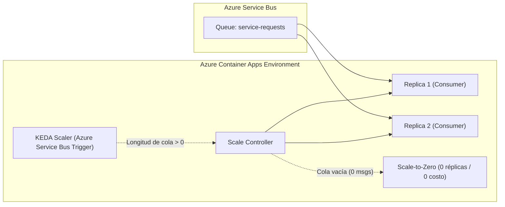
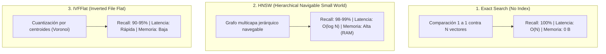
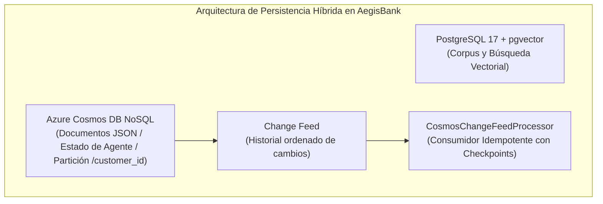
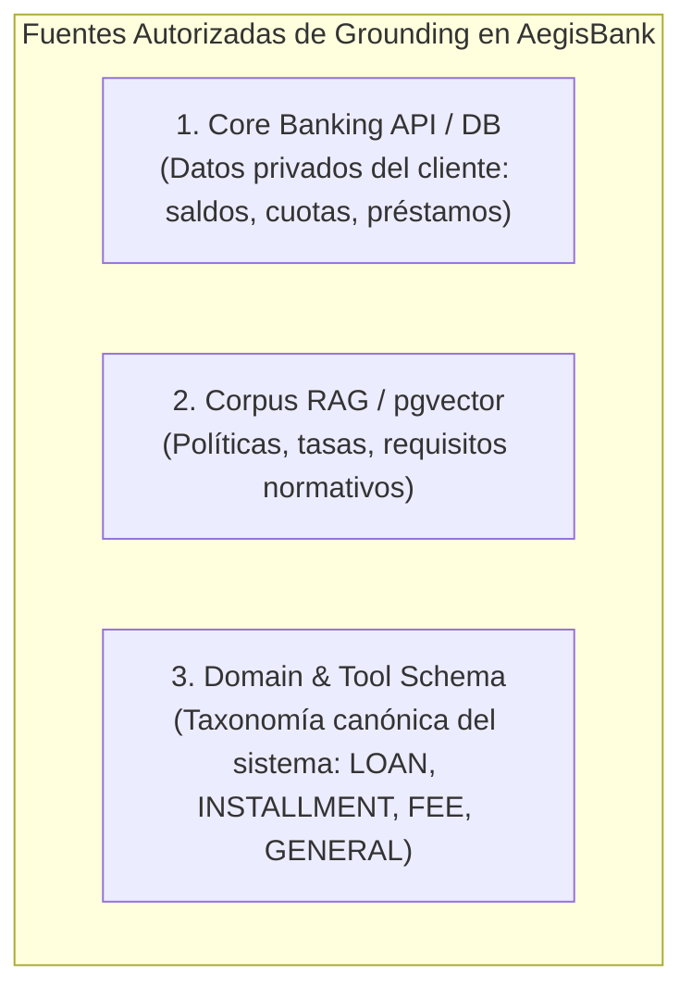

# AegisBank — Notas de Cátedra de Nivel Maestría en Inteligencia Artificial

> **Módulo:** Observabilidad Agéntica, AgentOps, Auditoría Inmutable y Supervisión HOTL
> **Nivel:** Maestría / Posgrado en Inteligencia Artificial  
> **Profesor / Lead Architect:** Senior Principal AI Engineer  
> **Hito del Proyecto:** `v0.9.0 — Observability + AgentOps + Audit + HOTL Foundation`

---

## 1. Fundamentos de la Observabilidad en Sistemas de IA

En la ingeniería de software tradicional, la observabilidad responde a la pregunta: *¿El servidor está respondiendo con código HTTP 200?*
En la **Ingeniería de IA Agéntica (Agentic AI Engineering)**, la observabilidad debe responder preguntas mucho más complejas:
* ¿Por qué el modelo eligió llamar a una herramienta específica (`tool_choice`)?
* ¿Qué fragmentos de conocimiento recuperó el RAG y cuáles fueron citados?
* ¿La respuesta fue rechazada por el filtro de grounding o por el evaluador humano (HITL)?
* ¿Cuánto tiempo tomó la inferencia del LLM en comparación con la ejecución de la base de datos?
* ¿Ocurrió un fallo transitorio que requirió reintentos o la activación de un cortacircuitos (*Circuit Breaker*)?

---

## 2. Los Tres Pilares de OpenTelemetry (OTel) para Agentes

```
                       +-------------------------------+
                       |    OPENTELEMETRY STANDARD     |
                       +-------------------------------+
                         /            |              \
                        /             |               \
            [ LOGS ]              [ METRICS ]          [ TRACES ]
      Eventos en JSON       Valores agregados        Spans jerárquicos
      con Correlation ID    (p95, error rates)       (agent -> tool -> db)
```

---

### Pilar 1: Trazas Distribuidas y Spans (*Distributed Tracing & Spans*)

```
TRACE ID: 4bf92f3577b34da6a3ce929d0e0e4736 (Correlation ID: REQ-20260830-001)
│
├── SPAN: agent.run [Duration: 850ms]
│    │
│    ├── SPAN: llm.chat [Duration: 620ms] (Model: phi-4-mini, Tokens: 412)
│    │
│    ├── SPAN: mcp.tool_call [Duration: 180ms] (Tool: create_service_request)
│    │    │
│    │    ├── SPAN: hitl.approval [Duration: 120ms] (Status: APPROVED)
│    │    │
│    │    └── SPAN: core_banking.write [Duration: 45ms] (Status: OK)
│    │
│    └── SPAN: outbox.publish [Duration: 15ms] (Event: ServiceRequestCreated)
```

1. **Sigla y Nombre:** `OTel` — OpenTelemetry / Distributed Tracing.
2. **Definición Teórica:** Una **Traza (Trace)** representa el grafo acíclico dirigido (DAG) de operaciones ejecutadas para satisfacer una solicitud. Cada nodo del grafo es un **Span**.
3. **Atributos Clave de un Span:**
   * `span.name`: Nombre semántico (`agent.run`, `llm.chat`, `tool.execute`, `hitl.approval`).
   * `trace_id`: Identificador global de 128 bits.
   * `span_id`: Identificador único del paso de 64 bits.
   * `parent_span_id`: Identificador del span padre para formar el árbol jerárquico.
   * `attributes`: Metadatos contextuales (`gen_ai.system`, `gen_ai.model`, `tool.name`, `customer.id`).
4. **Por qué lo necesita AegisBank:** Permite identificar inmediatamente en qué milisegundo exacto ocurrió un cuello de botella o en qué componente falló una transacción.
5. **Relación con Microsoft Certifications:**
   * **AI-103 & AI-200:** Distributed Tracing con OpenTelemetry en Azure Monitor y Application Insights.

---

### Pilar 2: Registros Estructurados y Redacción (*Structured Logging & Redaction*)

```json
{
  "timestamp": "2026-08-30T21:25:00.123456Z",
  "level": "INFO",
  "event_name": "tool_executed",
  "correlation_id": "REQ-20260830-001",
  "trace_id": "4bf92f3577b34da6a3ce929d0e0e4736",
  "span_id": "00f067aa0ba902b7",
  "session_customer_id": "CUST-0001",
  "tool_name": "create_service_request",
  "approval_status": "APPROVED",
  "execution_status": "SUCCESS",
  "latency_ms": 45.2
}
```

1. **Regla de Redacción Obligatoria (Seguridad Bancaria):**
   * **PROHIBIDO:** Registrar API Keys, contraseñas, bearer tokens, prompts conversacionales completos con datos sensibles o PII real en los logs de telemetría.
   * **PERMITIDO:** Metadatos de la operación, nombres de herramientas, IDs sintéticos, estados de aprobación, latencias y códigos de error.

---

### Pilar 3: Métricas Operativas y Percentiles de Latencia (*Metrics & Percentiles*)

1. **Contadores Operativos:**
   * `request_count`: Total de interacciones con el agente.
   * `request_error_count`: Interacciones que resultaron en error.
   * `tool_call_count` / `tool_call_failure_count`: Tasa de éxito y fallo por herramienta.
   * `hitl_approved_count` / `hitl_rejected_count`: Proporción de aprobaciones humanas.
   * `retry_count`: Reintentos ejecutados ante fallas transitorias.
   * `circuit_breaker_open_count`: Incidentes de disparo de cortacircuitos.
   * `dlq_count`: Mensajes envenenados derivados a la cola de mensajes muertos.
2. **Cálculo de Percentiles de Latencia:**
   * **p50 (Mediana):** El 50% de las peticiones se atendieron por debajo de este tiempo.
   * **p95:** El 95% de las peticiones se atendieron por debajo de este tiempo (métrica clave para SLAs).
   * **p99:** Identifica casos atípicos o anomalías extremas (*tail latency*).

---

## 3. Registro de Auditoría Inmutable vs. Logs Operacionales

| Característica | Log Operacional / Telemetría | Registro de Auditoría Bancaria (Audit Trail) |
|---|---|---|
| **Audiencia** | Desarrolladores / SRE / DevOps | Oficiales de Cumplimiento / Auditores / Reguladores |
| **Persistencia** | Rotativa (retención 30 a 90 días) | Inmutable / Append-Only (retención de años) |
| **Contenido** | Trazas técnicas, spans, latencias | Decisiones de negocio, hashes criptográficos, aprobaciones HITL |
| **Garantía** | Mejor esfuerzo (*Best effort*) | No repudio (*Non-repudiation*) y secuencia garantizada |

---

## 4. Supervisión HOTL (Human-on-the-Loop) y Kill-Switch

```
                 [ FLUJO NORMAL AGÉNTICO ]

  Cliente ---> Agente ---> [ HOTL Kill-Switch: ACTIVO? ]
                                   |
                         +---------+---------+
                         |                   |
                     NO (Permitido)     SÍ (Bloqueado)
                         |                   |
                  [ Ejecutar Tool ]    [ FAST-FAIL HOTL ]
                  (Requiere HITL)     "Escrituras suspendidas
                                       por supervisión"
```

1. **Diferencia Fundamental:**
   * **HITL (Human-in-the-Loop):** Decisión microscópica sobre una transacción individual.
   * **HOTL (Human-on-the-Loop):** Control macroscópico sobre la capacidad del sistema.
2. **Kill-Switch Supervisorio:** Permite a un operador humano o a un sistema de alerta automática deshabilitar de forma inmediata la herramienta de escritura (`create_service_request`) en toda la plataforma sin necesidad de redesplegar el código.

---

## 5. Masterclass KQL (Kusto Query Language) para Azure Monitor

En producción (Microsoft AI-200), las trazas y logs de OpenTelemetry se consultan en Azure Log Analytics mediante KQL.

### Consulta 1: Tasa de Fallo por Herramienta
```kql
AegisAgentSpans
| where Name == "tool.execute"
| summarize
    TotalCalls = count(),
    FailedCalls = countif(Status == "ERROR")
    by ToolName = tostring(Attributes["tool.name"])
| extend FailureRatePct = round((FailedCalls * 100.0) / TotalCalls, 2)
| order by FailureRatePct desc
```

### Consulta 2: Distribución de Latencia del Agente (p50, p95, p99)
```kql
AegisAgentSpans
| where Name == "agent.run"
| summarize
    P50_Ms = percentile(DurationMs, 50),
    P95_Ms = percentile(DurationMs, 95),
    P99_Ms = percentile(DurationMs, 99)
    by Model = tostring(Attributes["gen_ai.model"])
```

### Consulta 3: Proporción de Aprobación vs. Rechazo en HITL
```kql
AegisAuditEvents
| where EventType in ("HITL_APPROVED", "HITL_REJECTED")
| summarize
    Approvals = countif(EventType == "HITL_APPROVED"),
    Rejections = countif(EventType == "HITL_REJECTED")
    by bin(Timestamp, 1h)
| extend ApprovalRatio = round((Approvals * 100.0) / (Approvals + Rejections), 2)
```

### Consulta 4: Incidentes de Disparo de Cortacircuitos (Circuit Breaker)
```kql
AegisAuditEvents
| where EventType == "CIRCUIT_STATE_CHANGED" and Payload has "OPEN"
| project Timestamp, CorrelationId, DependencyName = tostring(Payload.dependency), Reason = tostring(Payload.reason)
| order by Timestamp desc
```

### Consulta 5: Auditoría de Mensajes en Cola de Mensajes Muertos (DLQ)
```kql
AegisAuditEvents
| where EventType == "MESSAGE_DEAD_LETTERED"
| project Timestamp, CorrelationId, EventId = tostring(Payload.event_id), FailureReason = tostring(Payload.failure_reason), Attempts = toint(Payload.attempts)
| order by Timestamp desc
```

---

## 6. Matriz de Madurez: Laboratorio Local vs. Producción Cloud

| Capacidad | Estado en AegisBank (v0.9 Local) | Estado en Producción Cloud (Azure / AI-200) |
|---|---|---|
| **Tracing** | `InMemorySpanExporter` local | Azure Monitor Exporter $\to$ Application Insights |
| **Logs** | JSON estructurado en stream/archivo | Azure Log Analytics Workspace |
| **Métricas** | Contadores en memoria + percentiles | Azure Monitor Metrics / Prometheus |
| **Auditoría** | SQLite `audit_logs` append-only | Azure SQL Immutable Ledger / Azure Cosmos DB WORM |
| **HOTL Kill-Switch** | Variable atómica thread-safe en memoria | Azure App Configuration / Feature Flags dinámicos |
| **Consultas** | Filtros Python en memoria | Consultas KQL en Azure Log Analytics |

---

## 7. v0.9.1: Routing Grounded y Abstención

**RAG** (*Retrieval-Augmented Generation*, generación aumentada mediante recuperación) no significa que el modelo diga que va a buscar; significa que el programa ejecuta retrieval y entrega evidencia al modelo. Un **tool call** es una estructura nativa, normalmente JSON, que el host valida y ejecuta. El texto `search_knowledge("...")` no es una llamada y nunca debe parsearse para fabricarla.

En modo **AUTO TOOL ROUTING**, `tool_choice="auto"` permite que el LLM elija responder o llamar una herramienta. Es útil para preguntas abiertas, pero deja un **routing gap** si un modelo pequeño responde con pseudo-código. En **POLICY-ENFORCED TOOL ROUTING**, una regla determinista identifica preguntas sobre políticas, productos, requisitos, tasas, comisiones o plazos y ejecuta primero `search_knowledge`. Esta alternativa reduce libertad del modelo, pero es apropiada cuando una respuesta bancaria debe estar **grounded** (fundamentada) en una fuente autorizada.

El experimento “plazo máximo para crédito vehicular” devolvió hits genéricos sobre crédito personal y tasas, pero ninguna evidencia vehicular específica. Por tanto, el resultado es `KNOWLEDGE_GAP`, no una política de “48” o “60 meses”. El comportamiento seguro es **abstention** (abstención): informar que no hay evidencia suficiente y conservar la procedencia de los hits. La implementación v0.9.1 registra `knowledge_required_count`, `knowledge_tool_invoked_count`, `knowledge_tool_missed_count` y `knowledge_abstention_count`.

Esto se relaciona con Mibanco porque evita afirmar condiciones no vigentes o no autorizadas. También practica AI-103: tool-access controls, grounding, guardrails y supervisión. La alternativa es `tool_choice="required"` o una función específica, pero en `phi-4-mini` sigue siendo best effort; por eso la policy del host es el control determinista y el LLM solo redacta con evidencia disponible.

## 8. v0.9.2: Banking Read Tool Routing

Un **account query** (consulta de cuenta) pide datos particulares del cliente autenticado, no conocimiento general. Por ejemplo, “¿Cuáles son mis préstamos activos y cuánto debo en la próxima cuota?” requiere primero `get_my_loans` y después una READ (*operación de lectura*) como `get_next_installment`. La identidad no la decide el LLM: proviene de `AgentContext.session_customer_id` y cada tool aplica ownership.

La policy selecciona una **tool allowlist** (lista permitida mínima). Para listar préstamos se expone `get_my_loans`; para una próxima cuota se expone `get_next_installment`; para detalle se expone `get_loan_details`. En una consulta combinada, el host obtiene primero la lista autorizada y luego ofrece solo la tool de seguimiento. Esto reduce tool selection ambiguity y aplica **policy-enforced routing** sin cambiar `phi-4-mini` ni introducir una nueva escritura.

`tool_choice="auto"` sigue siendo adecuado para saludos y preguntas sin datos bancarios. Cuando la policy ya determinó que una READ es obligatoria, se usa un `tool_choice` específico. Si el modelo escribe `get_my_loans()` como texto, no se parsea: se registra `PSEUDO_TOOL_CALL`/`ROUTING_FAILURE` y no se ejecuta. Esta separación es importante para Mibanco: una respuesta factual sobre saldos o cuotas debe consultar la fuente de verdad, y AI-103 relaciona el patrón con function calling, tool-access controls y safeguards.

## 9. v0.10: Quality Engineering

**Quality Engineering** diseña calidad como propiedad del flujo completo, no como una inspección final. La **test pyramid** coloca muchos unit tests rápidos abajo, integration y contract tests en el centro y pocos E2E críticos arriba. AegisBank evita duplicar: los contratos comprueban interfaces, mientras que los E2E comprueban journeys.

**CI** (*Continuous Integration*, integración continua) significa que cada cambio pasa el pipeline. Un workflow local solo demuestra `CI-CONFIGURED`; un **runner** (máquina ejecutora) es necesario para `CI-EXECUTED`. **CD** puede ser *Continuous Delivery* (listo para promoción controlada) o *Continuous Deployment* (despliegue automático); ambos quedan fuera de este hito.

En **DevSecOps** (*Development, Security and Operations*) aplicamos *shift-left security*: Bandit hace **SAST** (*Static Application Security Testing*) sobre el AST, pip-audit hace **SCA** (*Software Composition Analysis*) de dependencias y una SBOM (*Software Bill of Materials*) CycloneDX inventaría componentes. La SBOM responde “¿qué tenemos?”; SCA responde “¿hay vulnerabilidades conocidas?”. Para Mibanco esto refleja testing, hardening y gestión de dependencias. Para AI-103/AI-200 representa lifecycle, seguridad y operación de soluciones de IA.

---

## 10. v0.10.1: Integridad Arquitectónica y Coordinación Cross-Session

En entornos donde múltiples agentes de inteligencia artificial y desarrolladores colaboran sobre un mismo repositorio, surgen dos riesgos críticos:
1. **Duplicación de Código y Deriva Arquitectónica (*Architecture Drift*):** Un agente genera una nueva clase o helper (e.g. `HumanApprovalService`) en lugar de descubrir y reutilizar la implementación canónica existente (`HITLApprovalManager`). Esto viola el principio **DRY** (*Don't Repeat Yourself*), multiplica la superficie de ataque y genera deuda técnica.
2. **Condiciones de Carrera Cross-Session (*Race Conditions*):** Si dos sesiones de IA escriben concurrentemente en el mismo *working tree* sin coordinación, una sesión puede sobrescribir silenciosamente los cambios de la otra.

AegisBank resuelve esto mediante dos pilares:
* **DISCOVER BEFORE CREATE:** Regla de oro que exige buscar símbolos existentes, revisar el catálogo oficial [`CANONICAL-COMPONENTS.md`](file:///c:/aegisbank-ai-platform-ai-env/aegisbank-ai-platform/docs/architecture/CANONICAL-COMPONENTS.md) y clasificar la decisión en `REUSE`, `EXTEND` o `NEW_COMPONENT_JUSTIFIED` antes de escribir código.
* **ONE WRITER, MANY READERS:** Protocolo de coordinación pesimista implementado en [`scripts/session_guard.py`](file:///c:/aegisbank-ai-platform-ai-env/aegisbank-ai-platform/scripts/session_guard.py) que gestiona bloqueos atómicos en `.coordination/active-writer.json` sin recurrir a *worktrees* de Git. El guardián valida la inmutabilidad del HEAD (`AEGISBANK_CROSS_SESSION_HEAD_MOVED`) y confina los cambios a las rutas declaradas en `allowed_paths` (`AEGISBANK_CROSS_SESSION_PATH_COLLISION`).

---

## 11. v0.11: Contenerización y Mensajería Azure Local (AI-200 Mapping)

El examen oficial **Microsoft AI-200** (*Designing and Implementing a Microsoft Azure AI Solution*) asigna un 20–25% del temario a arquitecturas contenerizadas, integración con Azure Container Registry (ACR), Azure Container Apps, orquestación en AKS, autoescalado guiado por eventos con KEDA y mensajería empresarial con Azure Service Bus.

AegisBank domina estos conceptos de forma local y reproducible mediante el siguiente mapeo bidireccional:

| Capacidad Arquitectónica | Laboratorio Local (AegisBank v0.11) | Producción Cloud Azure (AI-200 Target) | Estado de Madurez |
|---|---|---|---|
| **Empaquetado de Aplicación** | `Dockerfile` multi-stage Linux, usuario no-root (`aegisuser`), imagen local `aegisbank/mock-core-banking:0.11.0`. | Azure Container Registry (ACR) con escaneo de vulnerabilidades Trivy/Microsoft Defender. | `LAB-COVERED` / `CLOUD-PENDING` |
| **Composición de Servicios** | `deploy/local/docker-compose.yml` con red aislada `aegisbank-net`. | Azure Container Apps Environment o AKS Cluster con Virtual Networks (VNet). | `LAB-COVERED` / `CLOUD-PENDING` |
| **Mensajería Asíncrona** | Microsoft Azure Service Bus Emulator (`mcr.microsoft.com/azure-messaging/servicebus-emulator`) sobre AMQP (`5672`). | Azure Service Bus Namespace (Standard/Premium) con Managed Identity y TLS 1.3. | `LAB-COVERED` / `CLOUD-PENDING` |
| **Contrato de Mensajería** | Adapter `AzureServiceBusMessageBus` implementando la interfaz canónica `MessageBus` (`DISCOVER BEFORE CREATE`). | Mismo adapter sin cambios de lógica, variando únicamente el connection string o token OAuth Entra ID. | `LAB-COVERED` |
| **Autoescalado por Eventos** | Simulación de colas y consumo concurrente. | KEDA (*Kubernetes Event-driven Autoscaling*) escalando réplicas de contenedores desde 0 según longitud de cola. | `LAB-COVERED` / `CLOUD-PENDING` |
| **Inferencia de Modelos (LLM)** | Foundry Local (`phi-4-mini`) en el host de Windows, resolviendo vía `host.docker.internal` desde el contenedor. | Azure OpenAI Service / Foundry Cloud endpoints con Private Endpoints. | `LAB-COVERED` / `CLOUD-PENDING` |
| **Gestión de Secretos** | Variables de entorno inyectadas en Docker Compose (`Password123!`). | Azure Key Vault con Azure Key Vault Secrets CSI Driver o Container Apps Secrets. | `LAB-COVERED` / `CLOUD-PENDING` |

> [!NOTE]
> **Principio de Realismo de Laboratorio:** `Service Bus Emulator != Azure Service Bus producción`. El emulador local carece de SLA bancario, autenticación Microsoft Entra ID (Azure AD), VNet integration y geo-replicación, pero permite validar el protocolo AMQP, el ciclo de vida de mensajes (settlement), deduplicación y enrutamiento a Dead-Letter Queue (DLQ) con cero costo de infraestructura en la nube.

---

## 12. v0.11.1: Runtime y Orquestación Kubernetes Local (AI-200 Mapping)

Kubernetes introduce la capa de **orquestación declarativa** sobre la contenerización básica: en lugar de gestionar ciclos de vida de procesos individuales en el host, se declara el estado deseado (*desired state*) en manifiestos YAML y el **Plano de Control (*Control Plane*)** se encarga de reconciliar y mantener ese estado continuamente mediante un bucle de control (*reconciliation loop*).

### 1. Tríada de Madurez Cloud / Local (AI-200 Target Matrix)

Para evitar inflar el alcance del laboratorio, AegisBank distingue estrictamente tres estados de madurez:

| Dimensión de Orquestación | Local Lab Kubernetes (`LOCAL-K8S-COVERED`) | Azure Kubernetes Service (`AKS-CLOUD-PENDING`) | Azure Container Apps (`CONTAINER-APPS-CLOUD-PENDING`) |
|---|---|---|---|
| **Plano de Control** | Docker Desktop / containerd en WSL2 single-node. | Control plane administrado por Microsoft (SLA 99.95%). | Totalmente serverless y abstraído por Microsoft. |
| **Aislamiento de Cargas** | Namespace `aegisbank-local` (lógico). | Namespaces + Azure Network Policies / Calico / Cilium. | Ambientes dedicados (*Container Apps Environments*). |
| **Despliegue y Replicación** | `Deployment` + `ReplicaSet` (1 -> 2 -> 1 réplicas). | `Deployment` multinodo con Node Pools heterogéneos. | `Revision` inmutable con asignación de tráfico %. |
| **Descubrimiento y Red** | `Service` tipo `ClusterIP` + CoreDNS. | `ClusterIP` + Ingress Controller + Azure Application Gateway. | Ingress HTTPS administrado con TLS automático. |
| **Sondas de Ciclo de Vida** | Readiness (`/health/ready`) y Liveness (`/health/live`). | Mismas sondas con monitorización en Azure Monitor / Prometheus. | Health Probes integradas en la consola de Container Apps. |
| **Actualizaciones y Resiliencia**| Rolling Updates (`maxSurge: 1, maxUnavailable: 0`) + Rollback. | Blue-Green / Canary con Service Meshes (Istio/Linkerd). | Revision-based Blue-Green con división porcentual de tráfico. |
| **Autoescalado** | Escalado manual vía `kubectl scale`. | Horizontal Pod Autoscaler (HPA) + Cluster Autoscaler. | **KEDA** nativo escalando desde 0 según longitud de Service Bus. |
| **Gestión de Secretos** | ConfigMaps no confidenciales + variables inyectadas. | Azure Key Vault Secrets Store CSI Driver. | Container Apps Secrets vinculados a Azure Key Vault. |

### 2. Diseño de Arquitectura: Azure Container Apps + KEDA para Consumidores de Eventos

En arquitecturas bancarias modernas orientadas a eventos (como el procesamiento de solicitudes de servicio `service-requests` generado por el *Transactional Outbox*), el patrón de autoescalado guiado por eventos se diseña de la siguiente manera:



1. **Escalado a Cero (*Scale-to-Zero*):** Cuando no hay solicitudes pendientes en la cola, las instancias se apagan por completo, reduciendo el costo de infraestructura a cero.
2. **Activación Inmediata por Evento:** Cuando entra un mensaje a la cola, KEDA detecta el cambio en la métrica `activeMessageCount` e instancia réplicas inmediatamente para procesar la carga en paralelo.
3. **Idempotencia Garantizada:** Debido a que KEDA puede instanciar múltiples consumidores concurrentes que procesan mensajes de la misma cola, el componente canónico [`IdempotentConsumer`](file:///c:/aegisbank-ai-platform-ai-env/aegisbank-ai-platform/ai/agent/src/aegisbank_agent/reliability/messaging.py) garantiza que cada `event_id` se procese exactamente una sola vez.

---

## 13. v0.12.0: Gestión de Datos para IA y Búsqueda Vectorial con PostgreSQL + pgvector (AI-200 Data Layer)

El examen oficial **Microsoft AI-200** (*Designing and Implementing a Microsoft Azure AI Solution*) dedica su bloque más extenso (**25–30% del examen**) a **Data Management for AI Solutions**, evaluando exhaustivamente:
1. **Azure Database for PostgreSQL con extensión `pgvector`:** Diseño de esquemas relacionales, indexación de embeddings (HNSW, IVFFlat, DiskANN), operadores de distancia y metadata filtering en patrones RAG.
2. **Azure Cosmos DB for NoSQL:** Modelado jerárquico JSON, partition keys, Change Feed para reactividad de IA, TTL e indexación vectorial nativa.
3. **Azure Managed Redis:** Patrones de cache-aside, políticas de expiración e invalidación de conocimiento, y búsqueda por similitud vectorial en memoria.

---

### 1. Tríada de Madurez de la Capa de Datos (AI-200 Mapping Matrix)

| Dimensión de Datos | Laboratorio Local (`LOCAL-PGVECTOR-COVERED`) | Producción Cloud Azure (`AZURE-POSTGRESQL-CLOUD-PENDING`) |
|---|---|---|
| **Motor de Base de Datos** | PostgreSQL 17 oficial en contenedor Docker (`pgvector/pgvector:0.8.0-pg17`). | Azure Database for PostgreSQL Flexible Server (Burstable / General Purpose). |
| **Extensión Vectorial** | `pgvector v0.8.0` (`CREATE EXTENSION vector;`). | Extensión `pgvector` pre-instalada y administrada por Azure. |
| **Tipo de Datos y Dimensión** | `embedding vector(32)` con normalización L2 unitaria. | `vector(1536)` (e.g. `text-embedding-3-small`) o `vector(3072)`. |
| **Estrategias de Indexación** | Exact Search (baseline), **HNSW** (`vector_cosine_ops`) e **IVFFlat**. | Exact, HNSW, IVFFlat y **DiskANN** (exclusivo de Azure PostgreSQL). |
| **Filtrado Combinado** | SQL con cláusulas relacionales (`WHERE status = 'active' AND topic = '...'`). | Mismo estándar relacional combinado con Azure AI Search / Cognitive Search. |
| **Gestión de Conexiones** | Driver `psycopg 3` con registro de tipos de pgvector (`register_vector`). | PgBouncer integrado nativamente en Azure Database for PostgreSQL Flexible Server. |
| **Seguridad y Acceso** | Consultas 100% parametrizadas (`%(param)s::type`) con usuario `aegisuser`. | Autenticación Microsoft Entra ID (Azure AD), Private Endpoints y TDE. |
| **Análisis de Rendimiento** | `EXPLAIN (ANALYZE, BUFFERS, FORMAT JSON)` en queries vectoriales. | Azure Database for PostgreSQL Query Store y Performance Insights. |

---

### 2. Comparativa Algorítmica: Búsqueda Exacta vs HNSW vs IVFFlat



1. **Exact Nearest Neighbor (`Exact`):**
   - Compara exhaustivamente el vector de consulta contra cada fila de la tabla.
   - **Ventaja:** Cero pérdida de recall (100% exacto).
   - **Desventaja:** Escala de forma lineal $O(N)$. En millones de vectores satura el CPU.
2. **HNSW (*Hierarchical Navigable Small World*):**
   - Construye una jerarquía de grafos tipo "mundo pequeño" donde las capas superiores tienen enlaces largos para saltos rápidos y las capas inferiores afinan la búsqueda local.
   - Parámetros clave: $m$ (número máximo de conexiones por nodo) y $ef_{construction}$ (tamaño de la lista dinámica durante la construcción del índice).
   - **Ventaja:** Mejor relación velocidad/recall de la industria.
   - **Desventaja:** Mayor tiempo de indexación y consumo de memoria RAM.
3. **IVFFlat (*Inverted File Flat*):**
   - Divide el espacio vectorial en listas de Voronoi mediante k-means (*lists*). La consulta solo explora las listas más cercanas (*probes*).
   - **Ventaja:** Construcción rápida y bajo consumo de memoria.
   - **Desventaja:** Requiere datos de entrenamiento previos y el recall es sensible al número de `probes`.

---

### 3. Hoja de Ruta de los Siguientes Micro-Hitos de Datos

* **`v0.12.1 — Cosmos DB NoSQL Emulator + Change Feed`**:
  - Implementación con el emulador local oficial de Azure Cosmos DB vNext (Linux Docker).
  - Modelado de documentos JSON particionados, partición por `customer_id` / `topic`, TTL automático y procesamiento de eventos reactivos mediante **Change Feed**.
* **`v0.12.2 — Redis Cache + Vector/Search Semantics`**:
  - Implementación de cache-aside con Redis Community local.
  - TTL dinámico, estrategias de expiración e invalidación de conocimiento ante cambios en el corpus, y semántica de búsqueda vectorial en memoria.

---

## 14. v0.12.1: Azure Cosmos DB NoSQL Emulator + Change Feed (AI-200 Event-Driven Data)

Azure Cosmos DB es la base de datos distribuida NoSQL de Microsoft evaluada en **Microsoft AI-200** para almacenamiento de estado conversacional, eventos de agentes y arquitecturas guiadas por eventos con el **Change Feed**.



---

### 1. Tríada de Madurez de Cosmos DB (AI-200 Mapping Matrix)

| Dimensión Cosmos DB | Laboratorio Local (`LOCAL-COSMOS-COVERED`) | Producción Cloud Azure (`COSMOS-CLOUD-PENDING`) |
|---|---|---|
| **Motor NoSQL** | Azure Cosmos DB Emulator vNext Linux en Docker (`azure-cosmos-emulator:vnext-latest`). | Cuenta de Azure Cosmos DB con replicación multirregión y SLA del 99.999%. |
| **API y Dialecto** | API for NoSQL con operaciones CRUD y consultas SQL parametrizadas. | Misma API con soporte de consultas distribuidas complejas e indexación automática. |
| **Particionamiento** | Contenedores particionados lógicamente por `/customer_id` (4 particiones simuladas). | Escalado horizontal masivo con particiones físicas autoescaladas por Azure. |
| **Point Reads vs Queries** | Point Read directo vía `read_item(id, partition_key)` vs consultas SQL filtradas. | Point read con costo fijo de 1 RU; optimización de queries para evitar fan-out cross-partition. |
| **Time-To-Live (TTL)** | Expiración automática demostrada en items efímeros (`default_ttl`). | TTL nativo en segundo plano sin consumo de RU de escritura ni costo de almacenamiento. |
| **Change Feed** | Lectura incremental de cambios vía `query_items_change_feed()` y processor con checkpoints. | Change Feed Processor administrado en Azure Functions con escalado dinámico y lease container. |
| **Request Units (RU)** | `EMULATOR-LIMITATION`: El emulador vNext reporta `RU = NOT YET IMPLEMENTED`. | Modelo de aprovisionamiento de RUs (Manual, Autoscale, Serverless) con métricas en Azure Monitor. |
| **Políticas de Indexación** | `EMULATOR-LIMITATION`: Las políticas personalizadas son `NO-OP` en el emulador actual. | Políticas de indexación avanzadas (inclusiones/exclusiones, índices espaciales y compuestos). |
| **Niveles de Consistencia** | Conceptos cubiertos (`Strong`, `Bounded Staleness`, `Session`, `Consistent Prefix`, `Eventual`). | Consistencia configurable por cuenta o por solicitud respaldada por SLAs en producción. |
| **Búsqueda Vectorial** | `COSMOS_VECTOR_SEARCH_CLOUD_PENDING`: Implementación vectorial real cubierta en pgvector v0.12. | Indexación vectorial DiskANN / Flat en Cosmos DB NoSQL en Azure Cloud. |

---

### 2. Point Reads vs Consultas Cross-Partition

1. **Point Read (`read_item(id, partition_key)`):**
   - El SDK calcula el hash de la clave de partición y enruta la solicitud directamente a la partición física correspondiente.
   - En Azure Cloud tiene un costo determinista de **1 RU** (para items < 1 KB) y latencia < 2 ms.
2. **Consulta en la Misma Partición (*In-Partition Query*):**
   - Consulta SQL que incluye `WHERE c.customer_id = 'CUST-001'`. Solo busca en la partición lógica indicada.
3. **Consulta Entre Particiones (*Cross-Partition Query*):**
   - Consulta SQL sin filtro de partition key. Obliga al cliente/gateway a consultar en paralelo (*fan-out*) todas las particiones físicas, multiplicando el consumo de RUs y la latencia.

---

### 3. Change Feed vs Message Brokers (Service Bus)

| Dimensión | Cosmos DB Change Feed | Azure Service Bus Queue / Topic |
|---|---|---|
| **Naturaleza** | Historial persistente e incremental de cambios del datastore. | Broker de mensajería empresarial transaccional desacoplado. |
| **Destrucción de Datos** | Los cambios persisten en el documento; leer el Change Feed no borra el item. | Los mensajes se consumen y eliminan (`Complete`) de la cola. |
| **Ordenamiento** | Orden garantizado dentro de cada partición lógica (`customer_id`). | Orden garantizado solo con sesiones de mensajes activadas. |
| **Casos de Uso en AegisBank** | Auditoría reactiva, réplica de estado a motores analíticos, triggers de IA. | Enrutamiento de comandos transaccionales (`service-requests`), HITL approvals, DLQ. |

---

## 15. v0.12.0-R1: Consistencia de Respuestas, Fundamentación y Procedencia (AI-103 & Enterprise Quality)

### 1. Determinismo Factual vs Error de Repetición (*Deterministic Facts ≠ Repetition Bug*)

En aplicaciones bancarias y financieras, la estabilidad y consistencia de las respuestas factuales es un **requisito de seguridad y confiabilidad**, no un defecto:
* **Hechos Inmutables:** Para preguntas como *"¿Qué tipos de reclamos soporta el banco?"*, las categorías oficiales (`LOAN`, `INSTALLMENT`, `FEE`, `GENERAL`) deben ser 100% idénticas y consistentes en cada invocación.
* **Variación Léxica:** La redacción puede variar moderadamente según el contexto conversacional, pero el conjunto factual subyacente nunca debe fluctuar ni inventar categorías inexistentes (`PAYMENT`, `CARD`, `FRAUD`).
* **Hiperparámetros de Inferencia:** En banca empresarial se prefiere `temperature=0.0` (o valores bajos) para minimizar alucinaciones y asegurar respuestas ancladas en la evidencia autorizada.



---

### 2. Fundamentación Más Allá de RAG (*Grounding ≠ RAG Only*)

El anclaje factual (*grounding*) no se limita exclusivamente a la recuperación vectorial (RAG). Existen tres fuentes de verdad legítimas en un sistema multi-capa:

| Tipo de Consulta | Fuente de Grounding Canónica | Herramientas Invocadas | Comportamiento Esperado |
|---|---|---|---|
| **Taxonomía / Capacidades del Sistema** | Domain Schema & Tool Registry (`ServiceRequestCategory`) | `Tools Executed = 0` (el esquema está visible en el contexto del prompt del agente) | Respuesta directa con las categorías canónicas exactas, sin alucinaciones ni instrucciones no solicitadas. |
| **Políticas y Procedimientos Generales** | Corpus RAG (`SearchKnowledgeTool` / `PgVectorRetriever`) | `Tools Executed = 1` (`search_knowledge`) | Recuperación de chunks autorizados, validación de citas y abstención controlada si no hay evidencia. |
| **Datos Financieros del Cliente** | Core Banking READ Tools (`GetMyLoansTool`, `GetNextInstallmentTool`) | `Tools Executed >= 1` | Validación de pertenencia del cliente sintético y consulta determinista a SQLite/PostgreSQL. |
| **Operaciones de Modificación de Estado** | Core Banking WRITE Tool (`CreateServiceRequestTool`) | `Tools Executed = 1` | Propuesta de cambio de estado sujeta a aprobación humana obligatoria (**HITL**). |

---

### 3. Principio DRY y Fuente Única de Verdad (*Single Source of Truth*)

Para evitar discrepancias entre capas:
1. Las categorías de reclamo se definen una sola vez en el enum canónico: `mock_core_banking.domain.enums.ServiceRequestCategory`.
2. El esquema de parámetros de la herramienta (`CreateServiceRequestTool.parameters_schema`) deriva dinámicamente sus valores desde el enum (`[c.value for c in ServiceRequestCategory]`).
3. El system prompt del agente (`agent-system-v002.json`) documenta la misma taxonomía canónica institucional, asegurando cero desalineación conceptual.

---

## 16. v0.12.2: Redis Cache + Vector/Search Semantics (AI-200 & Low-Latency Retrieval)

### 1. Patrón Cache-Aside y Mitigación de Cache Stampede (Single-Flight)

El patrón **Cache-Aside** desacopla la aplicación de la persistencia de caché:
1. **Lectura Perezosa (*Lazy Loading*):** La aplicación consulta a Redis únicamente cuando se necesita el dato. Si ocurre un *Cache Miss*, lee la base de datos canónica y puebla la caché con un **TTL acotado**.
2. **Protección contra Inundación (*Cache Stampede / Thundering Herd*):** Ante expiración de claves de alto tráfico o arranques en frío, múltiples hilos intentan consultar la base de datos simultáneamente. AegisBank implementa el patrón **Single-Flight**:
   - Solo la primera petición adquiere un bloqueo distribuido ligero en Redis (`SET lock:key token NX EX 5`).
   - Las peticiones concurrentes esperan un breve período (*backoff*) y leen el resultado recién almacenado en caché.
   - La liberación del bloqueo utiliza un script atómico en Lua para evitar borrar bloqueos de otros procesos si expiró el tiempo de espera.

```mermaid
sequenceDiagram
    autonumber
    actor Hilos as 10 Hilos Concurrentes
    participant Redis as Redis Cache (127.0.0.1:6379)
    participant DB as PostgreSQL / Core Banking

    Hilos->>Redis: GET key (MISS en frío)
    Note over Hilos,Redis: Hilo 1 adquiere lock; Hilos 2..10 esperan backoff
    Hilos->>DB: 1 Consulta Única a Base de Datos
    DB-->>Hilos: Retorna dato canónico
    Hilos->>Redis: SET key + TTL (300s)
    Hilos->>Redis: Libera lock
    Note over Hilos,Redis: Hilos 2..10 reintentan GET y obtienen HIT inmediato
```

---

### 2. Búsqueda Vectorial con RediSearch (KNN HNSW) vs PgVector

| Dimensión Arquitectónica | PostgreSQL + pgvector (`PgVectorRetriever`) | Redis Search Vector Index (`RedisVectorRetriever`) |
|---|---|---|
| **Almacenamiento Primario** | Disco / SSD (con buffer pool relacional en RAM). | 100% Memoria RAM (con persistencia opcional RDB/AOF). |
| **Rol en AegisBank** | **System of Record** canónico para embeddings persistentes. | **Acelerador en Memoria** de baja latencia para evaluación comparativa. |
| **Índice Vectorial** | HNSW / IVFFlat sobre tablas relacionales SQL. | HNSW / Flat sobre Hashes indexados en memoria. |
| **Filtrado de Metadatos** | Cláusulas relacionales SQL compuestas (`WHERE status = 'active'`). | Sintaxis de consulta de etiquetas `@status:{active} @topic:{creditos}`. |
| **Métricas de Calidad (Qrels)** | nDCG@5: `0.3364`, MRR@5: `0.5065` | nDCG@5: `0.3523`, MRR@5: `0.5324` |
| **Latencia** | `LATENCY_NOT_COMPARABLE_YET`: no existe benchmark controlado con percentiles para comparar ambos adapters. | `LATENCY_NOT_COMPARABLE_YET`: los tests funcionales no constituyen evidencia de rendimiento. |

---

### 3. Seguridad de Caché: Diferimiento de Semantic Caching (`SEMANTIC_CACHE_DEFERRED`)

AegisBank adopta la decisión de seguridad conservadora de **no habilitar caché semántica para respuestas finales del LLM**:
* **Riesgo de Falsos Positivos:** Dos preguntas bancarias con alta similitud coseno (e.g. *"¿Puedo pagar mi cuota por adelantado?"* vs *"¿Puedo aplazar mi cuota?"*) tienen vectores cercanos pero requieren respuestas regulatorias y financieras radicalmente distintas.
* **Política Autorizada:** La caché en Redis se limita a **resultados de retrieval de documentos públicos autorizados** y **metadatos de corpus**. Los datos privados de clientes (saldos, cuotas) y respuestas transaccionales se consultan siempre en tiempo real.

---

## 17. v0.12.2-R1: Redis Reproducibility, Supply-Chain Hardening & Evidence

### 1. El Riesgo de los Tags Flotantes (*Floating Tags*) en Entornos Financieros

En arquitecturas bancarias, el uso de etiquetas mutables como `:latest`, `:8` o `:8.10` introduce **riesgo de cadena de suministro (*Supply-Chain Risk*)**:
* **No determinismo:** una ejecución hoy puede descargar una imagen distinta mañana aunque Git no cambie.
* **Artefacto verificado:** Compose referencia `redis:8.10.1-trixie` y el digest observado localmente `sha256:298e5b3bc566bade82f46ad5511777a4a07a294097ce16ada2f6a42be5239df5`.
* **Gate:** `quality_gate.py` rechaza Redis Stack, tags flotantes, versiones sin patch, prereleases y referencias sin digest.
* **Licencia:** Redis Open Source 8 ofrece AGPLv3, RSALv2 y SSPLv1. Este laboratorio no formula una conclusión jurídica para distribución externa.

### 2. Evidencia de Rendimiento: De Cifras Sueltas a Percentiles (p50, p95, p99)

En ingeniería de software de alta exigencia, no es admisible afirmar *"Redis responde en <2 ms"* sin un protocolo de medición reproducible.
* **Mediana (`p50`):** Representa el tiempo típico de respuesta del 50% de las consultas.
* **Percentil 95 (`p95`):** Refleja la latencia que experimentan los usuarios ante condiciones habituales de carga sin sesgos de casos aislados.
* **Percentil 99 (`p99`):** Detecta la latencia de cola (*tail latency*) provocada por pausas de recolección de basura, handshakes de red o contención de sockets.

No se ejecutó un benchmark aislado y repetible en este corrective. El estado correcto es `LATENCY_NOT_COMPARABLE_YET`. Una medición futura deberá fijar, como mínimo, warm-up, número de muestras, dataset, concurrencia, hardware, versiones, p50, p95 y p99. Un test funcional local o una cifra única no demuestra rendimiento productivo.

### 3. Reconciliación de Métricas de Recuperación (pgvector vs RediSearch)

La comparación usa el experimento `0.4.0`, 18 queries, 18 qrels, `top_k=5` y `random_state=42`:
* `RedisVectorRetriever`: nDCG@5 `0.3523`, MRR@5 `0.5324`.
* `PgVectorRetriever`: nDCG@5 `0.3364`, MRR@5 `0.5065`.
* Los bloques pgvector de `044de3e`, `c526982` y `d97eca6` son idénticos. El gran diff de `v012_retrieval_comparison.json` en `d97eca6` corresponde a añadir `redis_vector_search`, no a cambiar pgvector.
* El reporte pgvector depende del estado de la base local y contiene el fixture histórico `chk_test_active_001`; esta limitación ya estaba presente en `044de3e`. No se regeneran ni sobrescriben métricas en este corrective.

### 4. Madurez, Mibanco y AI-200

| Evidencia | Estado | Aplicación profesional |
|---|---|---|
| Cache-aside, TTL, invalidación, single-flight y KNN/HNSW ejecutados en Redis OSS 8 local | `LOCAL-REDIS-COVERED` | Demuestra diseño de caché y vector indexing exigidos por AI-200 y relevantes para ingeniería de IA en Mibanco. |
| Pin exacto, digest y gate de reproducibilidad | `LAB-COVERED` | Reduce variación de supply chain y hace auditable el runtime probado. |
| Azure Managed Redis: identidad, red privada, HA, capacidad, SLA y recuperación | `CLOUD-PENDING` | Requiere evidencia real de Azure; no se deriva del contenedor local. |
| Caché semántica de respuestas bancarias finales | `SAFETY-DEFERRED` | Evita falsos positivos que podrían reutilizar una respuesta financiera incorrecta. |
