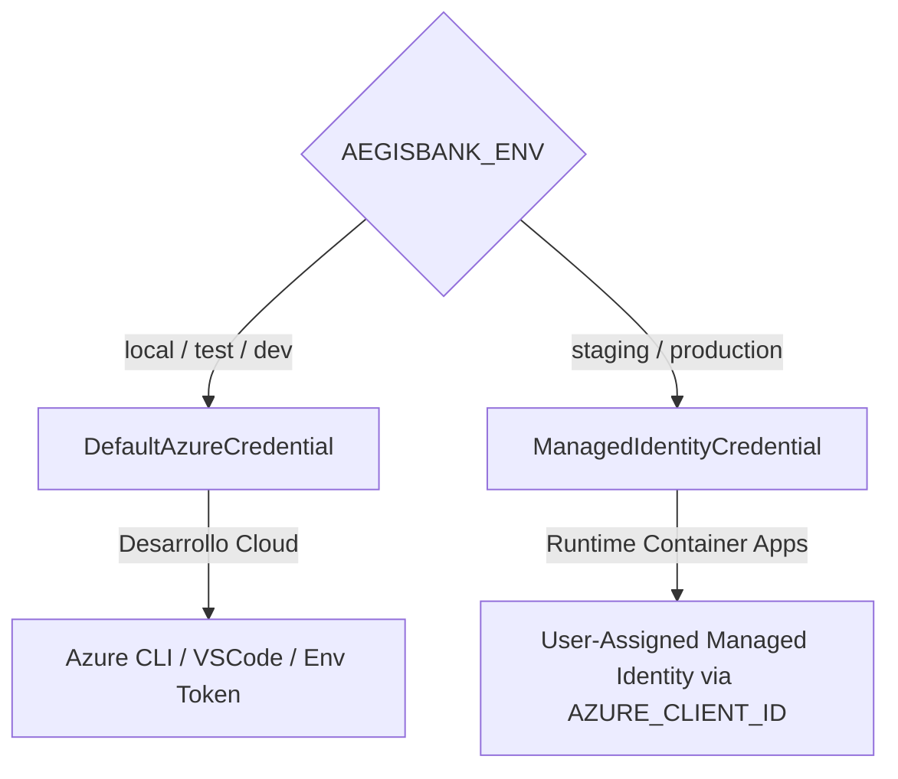

# Guía de Diagnóstico y Resolución de Problemas de Identidad (Microsoft Entra ID)

> **Estado:** `DOCUMENTED` · `CLOUD_UNVALIDATED`.
> **Ámbito:** Entornos de ejecución Azure Staging y Producción para AegisBank AI Platform.
> En desarrollo local y pruebas unitarias, la resolución opera con credenciales sintéticas y emuladores sin llamadas de red a Microsoft Entra ID.

---

## 1. Arquitectura de Identidad Dual y Precedencia de Credenciales

AegisBank implementa una arquitectura dual estricta gestionada por `resolve_azure_credential`:



### Regla de Oro
En **staging** y **producción**, `ManagedIdentityCredential` es determinista y no realiza sondas a credenciales locales de desarrollador (Azure CLI, PowerShell, Visual Studio, token cache). Si la identidad de carga de trabajo no está asociada al contenedor o falta `AZURE_CLIENT_ID`, la resolución **falla cerrado** inmediatamente.

---

## 2. Matriz de Errores Comunes y Procedimientos de Diagnóstico

### A. CredentialUnavailableError / ManagedIdentityCredential Failure
- **Síntoma:** `ClientAuthenticationError: ManagedIdentityCredential authentication unavailable. Connection to IMDS endpoint cannot be established.`
- **Causa Raíz:**
  1. El código se ejecuta fuera de Azure Container Apps sin `DefaultAzureCredential` local.
  2. El contenedor no tiene asignada la User-Assigned Managed Identity en la plantilla Bicep/ARM.
  3. La variable `AZURE_CLIENT_ID` no coincide con el Client ID de la identidad asignada.
- **Procedimiento de Diagnóstico:**
  ```bash
  # Verificar que el Container App tiene la identidad asignada
  az containerapp show \
    --name <container-app-name> \
    --resource-group <resource-group> \
    --query "identity"

  # Verificar las variables de entorno inyectadas
  az containerapp show \
    --name <container-app-name> \
    --resource-group <resource-group> \
    --query "template.containers[0].env"
  ```
- **Remediación:** Asegurar que `identity.type == "UserAssigned"` y que `AZURE_CLIENT_ID` esté configurado con el valor de `workloadIdentity.properties.clientId`.

---

### B. App Configuration Data Reader (403 Forbidden)
- **Síntoma:** `HttpResponseError: Operation returned an invalid status 'Forbidden'` al inicializar `AppConfigurationCloudProvider`.
- **Causa Raíz:** La identidad administrada carece del rol `App Configuration Data Reader` (`516239f1-63e1-4d78-a4de-a74fb236a071`) en el almacén de configuración.
- **Procedimiento de Diagnóstico:**
  ```bash
  az role assignment list \
    --assignee <workload-identity-client-id> \
    --scope <app-config-resource-id> \
    --output table
  ```
- **Remediación:** Asignar el rol explícito de plano de datos:
  ```bash
  az role assignment create \
    --assignee <principal-id> \
    --role "App Configuration Data Reader" \
    --scope <app-config-resource-id>
  ```

---

### C. Key Vault Secret Access Denied (403 Forbidden vs 404 Not Found)
- **Síntoma 1 (403):** `SecretAccessDenied: Access to secret '<name>' was denied by policy or firewall`.
  - **Causa:** Falta el rol `Key Vault Secrets User` (`4633458b-17de-408a-b874-0445c86b69ea`) o las reglas de red privada bloquean la IP de origen.
  - **Remediación:** Verificar asignación de rol RBAC en el Key Vault y validar configuración de private endpoint.
- **Síntoma 2 (404):** `MissingSecret: Secret '<name>' not found in Key Vault`.
  - **Causa:** El nombre del secreto no existe o la versión solicitada fue purgada/deshabilitada.
  - **Remediación:** Verificar el catálogo de secretos requeridos. Key Vault nunca debe almacenar secretos falsos en staging/producción.

---

### D. Service Bus Passwordless Authorization Failure
- **Síntoma:** `ServiceBusAuthenticationError: Put token failed. status-code: 401, status-description: Unauthorized.`
- **Causa Raíz:**
  1. Falta el rol `Azure Service Bus Data Sender` (`69a216fc-b8fb-44d8-bc22-1f3c2cd27a39`) para el emisor.
  2. Falta el rol `Azure Service Bus Data Receiver` (`4f6d3a01-5356-424a-9274-02e06e644125`) para el consumidor.
  3. Se intentó usar cadena de conexión con claves SAS en un entorno cloud donde `disableLocalAuth: true` está activo.
- **Remediación:** En entornos cloud, usar exclusivamente `AEGISBANK_SERVICEBUS_FQDN` con `resolve_azure_credential()`.

---

### E. PostgreSQL Flexible Server Entra ID Authentication Failure
- **Síntoma:** `psycopg.OperationalError: FATAL: PAM authentication failed for user "aegis_workload_identity"`.
- **Causa Raíz:**
  1. El usuario de base de datos no fue aprovisionado con el tipo Microsoft Entra en PostgreSQL:
     ```sql
     SELECT * FROM pgaadauth_list_principals(true);
     ```
  2. El token adquirido no usó la audiencia correcta (`https://ossrdbms-aad.database.windows.net/.default`).
  3. No se especificó `sslmode=require` en la conexión.
- **Remediación:** Registrar el principal administrado dentro del motor PostgreSQL:
  ```sql
  CREATE ROLE "aegis_workload_identity" WITH LOGIN IN ROLE pgaadauth_users;
  ```

---

### F. Core Banking Service-to-Service HTTP Authentication
- **Síntoma:** `HTTP 401 Unauthorized: Authentication required: valid Bearer token missing in cloud environment`.
- **Causa Raíz:**
  1. El cliente `CoreBankingHttpClient` no incluyó el encabezado `Authorization: Bearer <token>`.
  2. La llamada directa a base de datos (`create_default_database`) fue bloqueada por la guardia cloud (`Direct database access is blocked in cloud environments`).
- **Remediación:**
  1. Configurar `EntraServiceAuthHandler` con la audiencia correspondiente a la App Registration de Core Banking (`api://aegisbank-core-banking/.default`).
  2. Nunca intentar puentear la API consumiendo SQLite o PostgreSQL directamente desde las herramientas del agente.

---

### G. Azure AI Foundry / Azure OpenAI Inference Failure
- **Síntoma:** `openai.AuthenticationError: 401 Unauthorized - Access denied due to invalid subscription key or wrong API version`.
- **Causa Raíz:**
  1. La identidad administrada carece del rol `Cognitive Services OpenAI User` (`5e6ce059-de30-45e8-b8e7-e898950d9990`) sobre el recurso de IA.
  2. El endpoint no utiliza HTTPS o tiene un nombre de despliegue inexistente.
- **Remediación:** Asignar el rol `Cognitive Services OpenAI User` al recurso Cognitive Services correspondiente.

---

## 3. Lista de Verificación Pre-Vuelo para Staging

Antes de autorizar el despliegue del contenedor a Azure Staging:
1. [ ] `az bicep build --file deploy/azure/main.bicep` compila con 0 errores.
2. [ ] La identidad `id-aegisbank-staging-workload` tiene los 4 roles RBAC asignados por Bicep:
   - `App Configuration Data Reader`
   - `Key Vault Secrets User`
   - `Azure Service Bus Data Sender`
   - `Azure Service Bus Data Receiver`
3. [ ] `AEGISBANK_ENV=staging` está presente en la definición de variables de Container App.
4. [ ] No existen variables `.env` ni cadenas de conexión hardcodeadas en la imagen del contenedor.
5. [ ] El puerto de exposición 8000 responde exitosamente en `/health/live` y `/health/ready`.
