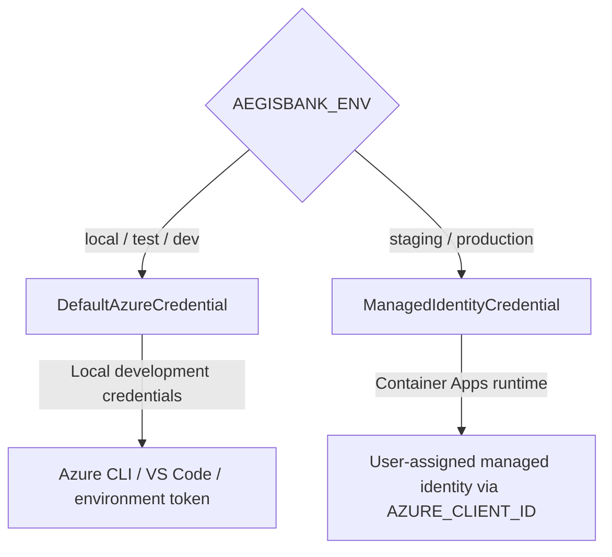

# Microsoft Entra ID Troubleshooting Guide

> **Recorded status:** `DOCUMENTED`; `CLOUD_UNVALIDATED`.
> **Scope:** Azure staging/production runtime design. Local development and unit tests use synthetic credentials and emulators without Microsoft Entra ID network calls.
>
> Diagnostic commands may reveal resource configuration. Role assignment, secret access, and other cloud changes require explicit authorization. Verify target subscription, resource group, identity, and scope before running any command.

## 1. Dual Identity Model and Credential Precedence

The documented `resolve_azure_credential` contract is:



### Operational rule

In staging and production, `ManagedIdentityCredential` is intended to be deterministic and not probe developer credentials such as Azure CLI, PowerShell, Visual Studio, or token cache. If the workload identity is not attached to the container or `AZURE_CLIENT_ID` is missing, the documented behavior is to fail closed. Verify this behavior in current code and tests.

## 2. Common Errors and Diagnostic Guidance

### A. `CredentialUnavailableError` / managed identity failure

- **Symptom:** `ManagedIdentityCredential authentication unavailable. Connection to IMDS endpoint cannot be established.`
- **Possible causes:** running outside Container Apps without local credentials; missing user-assigned identity on the Bicep/ARM resource; `AZURE_CLIENT_ID` does not match the assigned identity.
- **Read-only diagnostics:** inspect the Container App identity and injected environment variable names/values. Treat output as sensitive and redact before sharing.

```bash
az containerapp show --name <container-app-name> --resource-group <resource-group> --query "identity"
az containerapp show --name <container-app-name> --resource-group <resource-group> --query "template.containers[0].env"
```

Expected configuration is `identity.type == "UserAssigned"` and an `AZURE_CLIENT_ID` matching `workloadIdentity.properties.clientId`.

### B. App Configuration `403 Forbidden`

- **Symptom:** `HttpResponseError: Operation returned an invalid status 'Forbidden'` while initializing `AppConfigurationCloudProvider`.
- **Possible cause:** the managed identity lacks `App Configuration Data Reader` (`516239f1-63e1-4d78-a4de-a74fb236a071`) on the store.
- **Read-only diagnostic:**

```bash
az role assignment list --assignee <workload-identity-client-id> --scope <app-config-resource-id> --output table
```

Creating a role assignment changes cloud state and requires an authorized operator; do not apply a role based solely on this guide.

### C. Key Vault access denied: `403` vs. `404`

- **403 `SecretAccessDenied`:** possible missing `Key Vault Secrets User` (`4633458b-17de-408a-b874-0445c86b69ea`) or private-network rule blocking the source. Verify RBAC scope and Private Endpoint/network configuration.
- **404 `MissingSecret`:** the secret name may not exist or the requested version may be purged/disabled. Check the approved secret catalog. Never place fake secrets in staging or production Key Vault.

### D. Service Bus passwordless authorization failure

- **Symptom:** `ServiceBusAuthenticationError` with `401 Unauthorized`.
- **Possible causes:** sender lacks `Azure Service Bus Data Sender`; consumer lacks `Azure Service Bus Data Receiver`; SAS connection-string authentication was attempted where `disableLocalAuth: true` is active.
- **Documented cloud contract:** use `AEGISBANK_SERVICEBUS_FQDN` with `resolve_azure_credential()`. Verify role IDs and implementation against current authoritative configuration before changing access.

### E. PostgreSQL Flexible Server Entra authentication failure

- **Symptom:** `psycopg.OperationalError: FATAL: PAM authentication failed for user "aegis_workload_identity"`.
- **Possible causes:** the database principal was not provisioned as a Microsoft Entra principal; the token audience is not `https://ossrdbms-aad.database.windows.net/.default`; `sslmode=require` is missing.
- **Diagnostic SQL:**

```sql
SELECT * FROM pgaadauth_list_principals(true);
```

Creating a database role changes database state and requires database-owner approval; do not run it as an automatic troubleshooting step.

### F. Core Banking service-to-service HTTP authentication

- **Symptom:** `HTTP 401 Unauthorized: Authentication required: valid Bearer token missing in cloud environment`.
- **Possible causes:** `CoreBankingHttpClient` omitted `Authorization: Bearer <token>`; direct database access was blocked by the cloud guard.
- **Boundary:** configure `EntraServiceAuthHandler` with the registered Core Banking audience (documented as `api://aegisbank-core-banking/.default`). Never bypass the API by reading SQLite or PostgreSQL directly from agent tools.

### G. Azure AI Foundry / Azure OpenAI inference failure

- **Symptom:** `401 Unauthorized` or an invalid subscription/API-version error.
- **Possible causes:** the identity lacks `Cognitive Services OpenAI User` (`5e6ce059-de30-45e8-b8e7-e898950d9990`) on the AI resource; the endpoint is not HTTPS; the deployment name is invalid.
- **Next step:** verify endpoint/deployment configuration and current role assignment. Role changes require explicit authorization.

## 3. Staging Preflight Checklist

Before separately authorizing any Azure staging deployment, verify:

- [ ] `az bicep build --file deploy/azure/main.bicep` completes with zero errors.
- [ ] The `id-aegisbank-staging-workload` identity has only the required roles, including App Configuration Data Reader, Key Vault Secrets User, and the required Service Bus data-plane roles.
- [ ] `AEGISBANK_ENV=staging` is present in the Container App configuration.
- [ ] The image contains no `.env` files or hard-coded connection strings.
- [ ] Port 8000 health endpoints `/health/live` and `/health/ready` are verified.

This checklist is not deployment evidence or permission to deploy.
