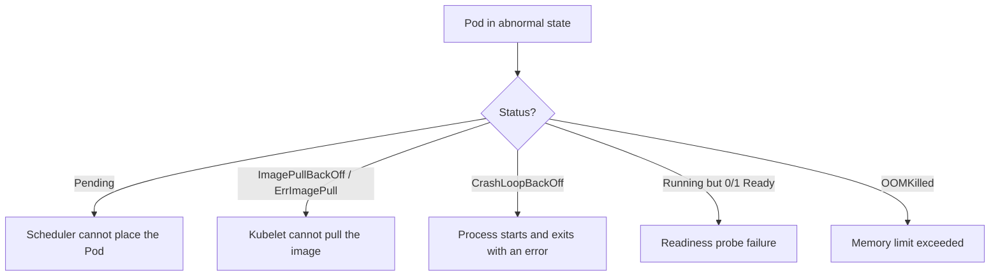

# Kubernetes Operations and Troubleshooting Guide

> **Purpose:** Diagnostic and operational guidance for local laboratory Kubernetes and a possible future AKS environment.
> **Historical milestone context:** v0.11.1 — Local Kubernetes Runtime + Orchestration Acceptance. This guide does not establish a live cluster or authorize deployment.

## 1. Read-Only Diagnostic Commands

Verify the current Kubernetes context and namespace before querying a cluster. Treat command output as potentially sensitive and redact it before sharing.

| Operation | Command | What it shows |
|---|---|---|
| List Pods with IPs and nodes | `kubectl get pods -n <namespace> -o wide` | Readiness, status, restarts, Pod IP, and assigned node. |
| Inspect a Pod | `kubectl describe pod <pod-name> -n <namespace>` | Lifecycle events, state transitions, mount failures, and probe failures. |
| Follow container logs | `kubectl logs <pod-name> -n <namespace> -f` | Container `stdout`/`stderr` stream. |
| Read previous container logs | `kubectl logs <pod-name> -n <namespace> --previous` | Logs from before the last container restart. |
| List namespace events | `kubectl get events -n <namespace> --sort-by='.metadata.creationTimestamp'` | Scheduling warnings, image-pull failures, and probe alerts. |
| Forward a local port | `kubectl port-forward svc/<service-name> <local-port>:<svc-port> -n <namespace>` | Temporary local access to a Service or Pod without creating a public LoadBalancer. |

Port forwarding changes local network exposure; use it only for an authorized, controlled diagnostic session.

## 2. Pod-State Decision Guide



## 3. Common Pod Failures

### `ImagePullBackOff` / `ErrImagePull`

**Likely cause:** the node runtime cannot find the requested image or lacks registry credentials.

**Diagnostic:**

```powershell
kubectl describe pod <pod-name> -n <namespace>
```

Inspect Events for `Failed to pull image` or `NotFound`. In the local laboratory, confirm the image exists with `docker images aegisbank/mock-core-banking:0.11.0`. Setting `imagePullPolicy: IfNotPresent` is a manifest change; review and test it before applying.

### `CrashLoopBackOff`

**Likely cause:** the container's main process exits non-zero and Kubernetes retries with exponential backoff.

```powershell
kubectl logs <pod-name> -n <namespace> --previous
```

Review the prior logs for Python import errors, missing dependencies, or undeclared environment variables. Also verify filesystem permissions when running as `USER 10001:10001`.

### `Pending`

**Likely cause:** no node has enough requested CPU/memory or scheduling constraints (such as affinity, taints, or tolerations) cannot be satisfied.

```powershell
kubectl describe pod <pod-name> -n <namespace>
```

Review scheduling events such as `Insufficient memory`. Changing `resources.requests` alters scheduling behavior and should be reviewed rather than applied automatically.

### `Running` but `0/1 Ready`

**Likely cause:** `/health/ready` returns HTTP `5xx` or does not respond within `timeoutSeconds`. Kubernetes removes the Pod IP from Service endpoints while it is not ready.

```powershell
kubectl describe pod <pod-name> -n <namespace>
```

Inspect readiness-probe events, then verify required dependencies and service configuration.

### `OOMKilled`

**Likely cause:** process memory exceeded `resources.limits.memory`; exit code `137` is common.

```powershell
kubectl describe pod <pod-name> -n <namespace>
```

Confirm `Last State: Terminated`, `Reason: OOMKilled`, and the configured memory limit. Increasing the limit changes resource consumption; obtain approval and investigate leaks before doing so.

## 4. Network and Service Diagnostics

1. **Cluster DNS:** Services should resolve as `<service-name>.<namespace>.svc.cluster.local`.
2. **Service endpoints:**

   ```powershell
   kubectl get endpoints mock-core-banking-service -n aegisbank-local
   ```

   An empty `ENDPOINTS` value (`<none>`) usually means no Pod matches `selector.matchLabels` or the matching Pods are not `Ready`.

These commands are diagnostic examples. Do not run mutation commands such as `kubectl apply`, delete, scale, or rollout operations without explicit authorization and a verified context.
