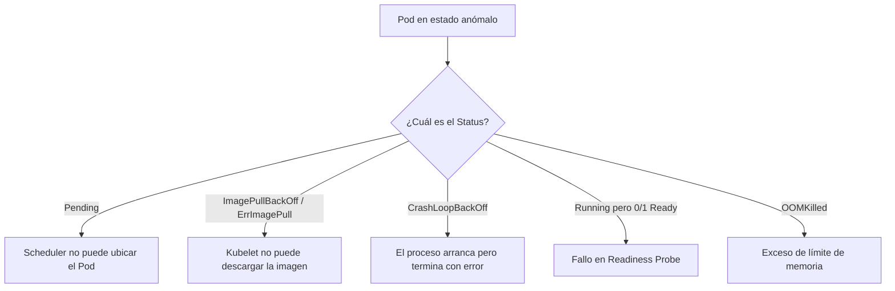

# AegisBank — Guía de Operaciones y Troubleshooting en Kubernetes

> **Propósito:** Procedimientos estandarizados para diagnóstico, resolución de problemas y observabilidad operativa en clústeres Kubernetes (Local Lab y futuro Azure Kubernetes Service - AKS).
> **Hito:** v0.11.1 — Local Kubernetes Runtime + Orchestration Acceptance.

---

## 1. Comandos Esenciales de Diagnóstico

| Operación | Comando `kubectl` | Utilidad Operativa |
|---|---|---|
| **Listar Pods con IPs y Nodos** | `kubectl get pods -n <namespace> -o wide` | Muestra estado (`Ready`, `Status`), reinicios (`Restarts`), IP interna del Pod y nodo asignado. |
| **Detalle Exhaustivo del Objeto** | `kubectl describe pod <pod-name> -n <namespace>` | Inspecciona eventos del ciclo de vida, transiciones de estado, fallos de montaje y de sondas. |
| **Logs en Tiempo Real** | `kubectl logs <pod-name> -n <namespace> -f` | Transmite la salida estándar (`stdout`/`stderr`) del proceso contenedor. |
| **Logs del Contenedor Previo (Post-Crash)** | `kubectl logs <pod-name> -n <namespace> --previous` | Muestra los logs emitidos antes de que el contenedor se reiniciara por fallo. |
| **Eventos del Namespace** | `kubectl get events -n <namespace> --sort-by='.metadata.creationTimestamp'` | Muestra advertencias de scheduling, fallos de pull de imagen y alertas de probes. |
| **Túnel de Acceso Directo** | `kubectl port-forward svc/<service-name> <local-port>:<svc-port> -n <namespace>` | Expone un Service o Pod internamente para pruebas sin crear LoadBalancer público. |

---

## 2. Árbol de Decisión y Estados Críticos del Pod



---

## 3. Diagnóstico Detallado de Errores Comunes

### 1. `ImagePullBackOff` / `ErrImagePull`
- **Causa:** El runtime del nodo no encuentra la imagen solicitada o no tiene credenciales de autenticación para el registro OCI.
- **Diagnóstico:**
  ```powershell
  kubectl describe pod <pod-name> -n <namespace>
  ```
  Observar la sección `Events`: `Failed to pull image "..."` o `rpc error: code = NotFound`.
- **Solución en Laboratorio Local:**
  - Asegurar que la imagen fue construida localmente: `docker images aegisbank/mock-core-banking:0.11.0`.
  - Configurar `imagePullPolicy: IfNotPresent` en el Deployment para evitar descargas externas.

---

### 2. `CrashLoopBackOff`
- **Causa:** El proceso principal del contenedor (e.g. `uvicorn` o script de inicio) finaliza con código de salida distinto de cero (`exit code 1, 2, 137`), y Kubernetes intenta reiniciarlo con backoff exponencial (10s, 20s, 40s...).
- **Diagnóstico:**
  ```powershell
  kubectl logs <pod-name> -n <namespace> --previous
  ```
- **Solución:**
  - Corregir errores de importación de Python, dependencias faltantes o variables de entorno no declaradas.
  - Verificar permisos del sistema de archivos cuando se usa `USER 10001:10001`.

---

### 3. `Pending`
- **Causa:** El planificador (*kube-scheduler*) no encuentra un nodo con capacidad suficiente de CPU/Memoria (`requests`), o existen restricciones de afinidad (*taints/tolerations*).
- **Diagnóstico:**
  ```powershell
  kubectl describe pod <pod-name> -n <namespace>
  ```
  Observar: `0/1 nodes are available: 1 Insufficient memory`.
- **Solución:**
  - Reducir los valores de `resources.requests.cpu` y `resources.requests.memory` en `deployment.yaml`.

---

### 4. `Running pero 0/1 Ready` (Fallo de Sonda de Preparación)
- **Causa:** El contenedor está ejecutándose, pero el endpoint `/health/ready` devuelve HTTP `5xx` o no responde dentro del `timeoutSeconds`.
- **Consecuencia:** El Service de Kubernetes retira la IP del Pod de sus endpoints y deja de enviarle tráfico.
- **Diagnóstico:**
  ```powershell
  kubectl describe pod <pod-name> -n <namespace>
  # Buscar: Warning Unhealthy: Readiness probe failed: HTTP probe failed with statuscode: 503
  ```
- **Solución:**
  - Validar dependencias internas (e.g. conexión SQLite/SQL Server en Core Banking).

---

### 5. `OOMKilled` (*Out Of Memory*)
- **Causa:** El proceso dentro del contenedor consumió más memoria de la estipulada en `resources.limits.memory` (e.g. `256Mi`), y el kernel de Linux envía la señal `SIGKILL` (exit code `137`).
- **Diagnóstico:**
  ```powershell
  kubectl describe pod <pod-name> -n <namespace>
  # Buscar: Last State: Terminated, Reason: OOMKilled, Exit Code: 137
  ```
- **Solución:**
  - Incrementar el límite en el Deployment o investigar fugas de memoria (*memory leaks*).

---

## 4. Troubleshooting de Red y Servicios

1. **Verificar resolución DNS dentro del clúster:**
   Los Pods deben resolver nombres de servicio en formato `<service-name>.<namespace>.svc.cluster.local`.
2. **Inspeccionar Endpoints del Service:**
   ```powershell
   kubectl get endpoints mock-core-banking-service -n aegisbank-local
   ```
   Si la lista `ENDPOINTS` está vacía (`<none>`), significa que ningún Pod coincide con los `selector.matchLabels` o los Pods no están en estado `Ready`.
