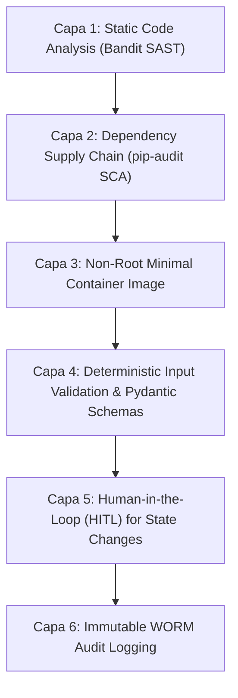

# AegisBank — Container Security & Hardening Standards

> **Propósito:** Definir los controles de seguridad, directrices de endurecimiento (*hardening*) y análisis de riesgos para las imágenes y contenedores de AegisBank AI Platform.
> **Hito:** v0.11.0 — Containerization + Local Azure Messaging Foundation.

---

## 1. Controles Obligatorios de Endurecimiento en Contenedores

| Control de Seguridad | Implementación en AegisBank | Justificación y Riesgo Mitigado |
|---|---|---|
| **Ejecución como Usuario No-Root** | `USER aegisuser` (UID/GID `10001:10001`) declarado en `services/mock-core-banking/Dockerfile`. | **Escape de Contenedor:** Si un atacante compromete la aplicación vía RCE, no obtiene privilegios de `root` en el host subyacente. |
| **Imágenes Base Mínimas y Seguras** | `python:3.12-slim` (Debian Bookworm slim) como base oficial mantenida. | **Reducción de Superficie de Ataque:** Evita utilidades innecesarias (compiladores, shells avanzadas, herramientas de depuración) en la imagen final de runtime. |
| **Construcción Multi-Etapa (*Multi-stage Build*)** | Etapa 1 `builder` compila dependencias; Etapa 2 `runtime` solo copia el virtualenv `/opt/venv`. | **Aislamiento de Toolchain:** Impide que herramientas de compilación (`gcc`, `make`) queden presentes en el artefacto desplegable final. |
| **Exclusión de Secretos y Metadatos** | `.dockerignore` exhaustivo excluyendo `.git`, `.venv`, `.env*`, `*.db`, caches y llaves privadas. | **Fuga de Credenciales:** Garantiza que ningún secreto, token o historial de control de versiones sea horneado en las capas inmutables de la imagen. |
| **Aislamiento de Red** | Red explícita `aegisbank-net` (bridge local) con mapeo de puertos estricto (`8000:8000`, `5672:5672`). | **Exposición Indebida:** Evita que servicios internos (como la base de datos SQL del emulador en puerto 1433) sean accesibles fuera del entorno de desarrollo. |
| **Verificación Automatizada de Salud** | Directiva `HEALTHCHECK` consultando `/health` cada 5s con timeout de 3s. | **Degradación Silenciosa:** Permite al orquestador detectar fallos de servicio y reiniciar contenedores que no respondan. |
| **Permisos Mínimos de Sistema de Archivos** | Directorio `/app/data/local` con permisos específicos para `aegisuser`; el resto del sistema de archivos permanece inalterable. | **Tampering / Modificación de Binarios:** Previene que un proceso comprometido altere el código Python o las dependencias instaladas. |

---

## 2. Análisis de Seguridad: ¿Por qué un Contenedor NO es un Límite de Seguridad Perfecto?

> [!WARNING]
> Un contenedor proporciona **aislamiento de procesos y recursos**, **NO** una frontera de seguridad estanca equivalente a una máquina virtual con hipervisor hardware dedicado.

### Razones Técnicas:
1. **Kernel Compartido:**
   A diferencia de las máquinas virtuales, todos los contenedores comparten el mismo kernel del sistema operativo host (Linux kernel en WSL2 / Azure Linux). Una vulnerabilidad en una llamada al sistema (*syscall*) del kernel (e.g. *Dirty COW*, *Dirty Pipe*) puede permitir a un atacante escapar del contenedor y comprometer el host.
2. **Capacidades de Linux (*Capabilities*):**
   Si un contenedor se ejecuta en modo privilegiado (`--privileged`) o con capacidades como `CAP_SYS_ADMIN` o `CAP_NET_ADMIN`, puede eludir el aislamiento de *cgroups* y *namespaces*. En AegisBank está estrictamente prohibido el modo privilegiado.
3. **Acceso al Docker Socket:**
   Montar `/var/run/docker.sock` dentro de un contenedor otorga acceso de administrador total sobre el daemon de Docker, permitiendo instanciar contenedores con acceso root al sistema de archivos del host. AegisBank prohíbe el montaje del Docker socket en cualquier servicio.

---

## 3. Principio de Defensa en Profundidad (*Defense-in-Depth*)

Para compensar los límites del aislamiento de contenedores, AegisBank implementa múltiples capas de seguridad convergentes:

