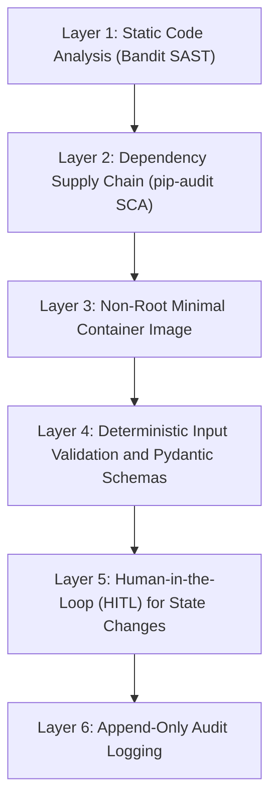

# AegisBank Container Security and Hardening Standards

> **Purpose:** Describe security controls, hardening guidance, and risk considerations for AegisBank AI Platform container images.
> **Historical milestone context:** v0.11.0 — Containerization and Local Azure Messaging Foundation. Verify every implementation claim against the current checkout; this document is not deployment evidence.

## 1. Container Hardening Controls

| Control | Documented implementation | Purpose and risk reduced |
|---|---|---|
| **Non-root execution** | `USER 10001:10001` in `services/mock-core-banking/Dockerfile`. | Limits host-level privilege if an attacker compromises the application. |
| **Minimal base image** | `python:3.14-slim` is documented as the project-compatible base. Pin and verify the image digest before any cloud target. | Reduces unnecessary runtime utilities and attack surface. |
| **Runtime dependencies** | The image recipe installs the Core Banking wheel and excludes the toolchain, tests, and caches. | Keeps build-only content out of the runtime artifact. |
| **Secrets and metadata exclusion** | `.dockerignore` excludes `.git`, `.venv`, `.env*`, `*.db`, caches, and private keys. | Reduces the risk of baking credentials or repository history into image layers. |
| **Network isolation** | The documented local bridge network is `aegisbank-net`, with explicit port mappings (`8000:8000`, `5672:5672`). | Limits unintended exposure of development services, including the emulator SQL port `1433`. |
| **Health checks** | `HEALTHCHECK` queries `/health/live`; Compose also queries `/health/ready`. | Allows the runtime to detect an unhealthy service. Restart behavior depends on the runtime configuration. |
| **Filesystem least privilege** | The process uses UID 10001; `/app/data` is the writable volume and Compose uses a read-only root filesystem. | Reduces the ability of a compromised process to alter application files. |

These are documented design/configuration claims, not proof that a current image was built or deployed. Verify Dockerfile and Compose files before relying on them.

## 2. A Container Is Not a Perfect Security Boundary

> [!WARNING]
> Containers isolate processes and resources. They are not equivalent to a virtual machine with a dedicated hardware hypervisor boundary.

1. **Shared kernel:** Containers share the host operating-system kernel. A kernel vulnerability may enable container escape and host compromise.
2. **Linux capabilities:** Privileged mode (`--privileged`) or capabilities such as `CAP_SYS_ADMIN` and `CAP_NET_ADMIN` can weaken namespace and cgroup isolation. The documented project policy prohibits privileged mode.
3. **Docker socket:** Mounting `/var/run/docker.sock` into a container can grant administrative control over the Docker daemon and host resources. The documented policy prohibits this mount.

## 3. Defense in Depth

The documented defense-in-depth model layers static analysis, dependency scanning, a minimal non-root image, deterministic input validation, human approval for state changes, and append-only audit logging. Each control has a distinct purpose; none alone establishes production security.

