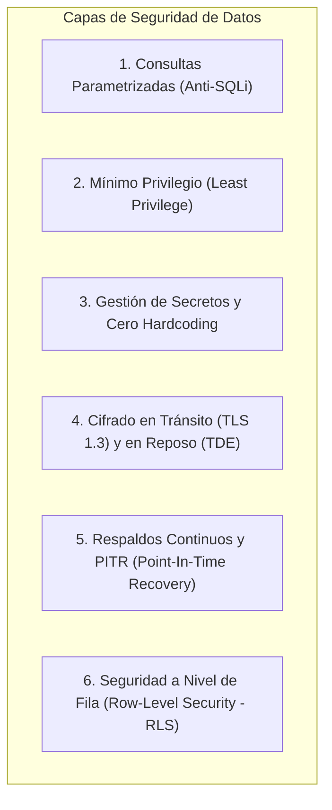

# AegisBank — Estándar de Seguridad de la Capa de Datos (Data Layer Security)

> **Propósito:** Políticas de seguridad, protección de datos y directivas de endurecimiento para sistemas gestores de bases de datos relacionales y vectoriales (PostgreSQL + pgvector local y futuro Azure Database for PostgreSQL).
> **Hito:** v0.12.0 — PostgreSQL + pgvector Vector Data Foundation.

---

## 1. Principios Fundamentales de Seguridad en Bases de Datos Bancarias

---

## 2. Matriz de Controles y Estado de Madurez

| Control de Seguridad | Implementación Local (`LAB-COVERED` / `PROD-PARTIAL`) | Producción Cloud Azure (`AZURE-POSTGRESQL-CLOUD-PENDING`) | Estado de Madurez |
|---|---|---|---|
| **Prevención de SQL Injection** | Consultas 100% parametrizadas mediante `psycopg` (`%(param)s::type`). Cero concatenación de cadenas SQL en queries de usuario. | Mismo estándar en código de aplicación; respaldado por Azure Database for PostgreSQL Query Store y Defender for Cloud. | `LAB-COVERED` |
| **Mínimo Privilegio (*Least Privilege*)** | Usuario no-root (`aegisuser`) restringido a la base de datos `aegisbank_rag` y tabla `rag_chunks`. | Roles RBAC de PostgreSQL + Microsoft Entra ID (Azure AD) sin contraseñas estáticas compartidas. | `LAB-COVERED` / `CLOUD-PENDING` |
| **Gestión de Secretos** | Contraseña inyectada dinámicamente vía variable de entorno `${POSTGRES_PASSWORD}` en Docker Compose. Cero credenciales en Git. | Azure Key Vault con Azure Managed Identity para autenticación passwordless. | `LAB-COVERED` / `CLOUD-PENDING` |
| **Cifrado en Tránsito (*Encryption in Transit*)** | Conexión local en red bridge aislada `aegisbank-net` (localhost). | TLS 1.2/1.3 forzado por defecto con certificados de Microsoft CA. | `LAB-COVERED` / `CLOUD-PENDING` |
| **Cifrado en Reposo (*Encryption at Rest*)** | Volumen local Docker `aegisbank-pgvector-data` protegido por permisos del host. | Transparent Data Encryption (TDE) con claves administradas por el cliente (Customer-Managed Keys - CMK). | `PROD-PARTIAL` / `CLOUD-PENDING` |
| **Respaldos y PITR (*Point-In-Time Recovery*)** | Exportación de dumps lógicos (`pg_dump`) y backups de volumen. | Backups continuos automáticos de WAL (*Write-Ahead Logging*) con retención de 35 días y geo-redundancia. | `PROD-PARTIAL` / `CLOUD-PENDING` |
| **Seguridad a Nivel de Fila (*Row-Level Security - RLS*)** | Filtrado determinista en consultas por columna `status` y `tenant/customer_id`. | Políticas nativas de PostgreSQL `CREATE POLICY` vinculadas al contexto de sesión de la aplicación. | `LAB-COVERED` / `CLOUD-PENDING` |

---

## 3. Prácticas Específicas de Hardening para Búsqueda Vectorial

1. **Aislamiento de Documentos Obsoletos (*Superseded Documents*):**
   - Las consultas vectoriales deben obligatoriamente incluir la cláusula `WHERE status = 'active'`. La similitud semántica nunca anula la vigencia legal o bancaria de un documento.
2. **Validación Estricta de Dimensión de Vectores:**
   - La tabla `rag_chunks` restringe el tipo a `vector(32)`. Cualquier intento de insertar un vector con dimensión distinta es rechazado a nivel de motor de base de datos (`dimension mismatch`).
3. **Parametrización del Operador de Distancia Coseno:**
   - El vector de búsqueda se envía como parámetro de tipo binario/vector mediante `register_vector(conn)` y `%(query_vec)s::vector`, impidiendo inyecciones a través del vector.

---

## 4. Controles de Seguridad en Azure Cosmos DB NoSQL (v0.12.1)

| Control de Seguridad Cosmos DB | Implementación Local (`LOCAL-COSMOS-COVERED`) | Producción Cloud Azure (`COSMOS-CLOUD-PENDING`) |
|---|---|---|
| **Gestión de Llaves de Conexión** | Llave estándar de emulador local públicamente documentada por Microsoft. Cero secretos de producción en código o Git. | Autenticación con **Microsoft Entra ID (Azure AD)** y roles RBAC para Cosmos DB (`Cosmos DB Built-in Data Reader/Contributor`) sin llaves maestras estáticas. |
| **Aislamiento por Clave de Partición** | Partición lógica estricta `/customer_id` que impide que consultas de un cliente lean accidentalmente datos de otro. | Mismo estándar lógico reforzado con Azure Policy y aislamiento de red en VNet / Private Endpoints. |
| **Cifrado en Reposo y en Tránsito** | Contenedor local en red bridge `aegisbank-net`. | Cifrado en reposo automático de Microsoft con Customer-Managed Keys (CMK) en Azure Key Vault + TLS 1.3 forzado. |
| **Procesamiento de Eventos (Change Feed)** | Consumidor idempotente con deduplicación por clave combinada `id:etag` para evitar dobles efectos ante reintentos. | Azure Functions con Cosmos DB Trigger o Change Feed Processor administrado con escalado automático y lease container. |
| **Gobernanza de Datos y TTL** | Expiración automática determinista vía `default_ttl` en datos de sesión y telemetría efímera; prohibido en auditoría bancaria. | Políticas de retención continuas con Azure Cosmos DB Analytical Store (Synapse Link) y backups continuos (30 días PITR). |

---

## 5. Controles de Seguridad en Redis Cache y RediSearch (v0.12.2)

| Control de Seguridad Redis | Implementación Local (`LOCAL-REDIS-COVERED`) | Producción Cloud Azure (`AZURE-MANAGED-REDIS-CLOUD-PENDING`) |
|---|---|---|
| **Aislamiento de Datos Sensibles** | Prohibición estricta de almacenar saldos, cuotas, transacciones o PII en memoria. Solo se cachea conocimiento público y vectores del corpus. | Misma política reforzada con DLP (*Data Loss Prevention*) y reglas de redacción de logs. |
| **Autenticación y Control de Acceso** | Conexión local en loopback / red bridge `aegisbank-net` sin exposición pública. | Autenticación con **Microsoft Entra ID (Azure AD)** y RBAC nativo en Azure Managed Redis; sin contraseñas estáticas en texto plano. |
| **Cifrado en Tránsito y Reposo** | Contenedor local en red bridge `aegisbank-net`. | Cifrado en tránsito TLS 1.2/1.3 obligatorio + Cifrado en disco para persistencia RDB/AOF. |
| **Protección contra Inundación (*Stampede Lock*)** | Bloqueo distribuido single-flight con token único y liberación atómica por script Lua (`RELEASE_LOCK_LUA`). | Bloqueos distribuidos administrados con Redlock o single-flight proxy en Container Apps / AKS. |
| **Gestión de Memoria y Evicción** | Configuración de límites de memoria y política `noeviction` / `volatile-lru` controlada. | Dimensionamiento elástico con Azure Managed Redis (Tiers Memory Optimized / Compute Optimized) y monitoreo de métricas de memoria en Azure Monitor. |
