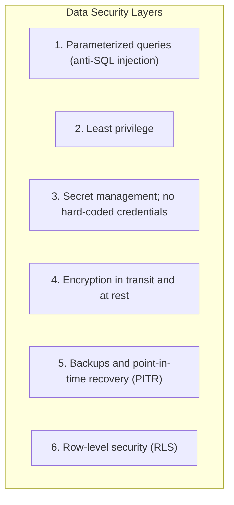

# AegisBank Data-Layer Security Standard

> **Purpose:** Document security policies and hardening guidance for relational and vector data stores (local PostgreSQL + pgvector and the Azure Database for PostgreSQL target).
> **Historical milestone context:** v0.12.0 — PostgreSQL + pgvector Vector Data Foundation. The implementation/status descriptions below are recorded design claims; verify current code, configuration, and evidence before relying on them.

## 1. Database Security Principles

## 2. Recorded Control Matrix

| Control | Local implementation claim | Azure target claim | Recorded status |
|---|---|---|---|
| SQL injection prevention | `psycopg` parameterized queries (`%(param)s::type`); no user-query string concatenation. | Same application standard, with Azure Query Store and Defender for Cloud as additional services. | `LAB-COVERED` |
| Least privilege | Non-root `aegisuser` limited to `aegisbank_rag` and `rag_chunks`. | PostgreSQL roles and Microsoft Entra ID; no shared static passwords. | `LAB-COVERED` / `CLOUD-PENDING` |
| Secret management | Docker Compose injects `${POSTGRES_PASSWORD}`; no credentials in Git. | Azure Key Vault with Managed Identity. | `LAB-COVERED` / `CLOUD-PENDING` |
| Encryption in transit | Local connection on isolated `aegisbank-net` bridge network. | TLS 1.2/1.3 with Microsoft CA certificates. | `LAB-COVERED` / `CLOUD-PENDING` |
| Encryption at rest | Host permissions protect local Docker volume `aegisbank-pgvector-data`. | Transparent Data Encryption (TDE), optionally with customer-managed keys (CMK). | `PROD-PARTIAL` / `CLOUD-PENDING` |
| Backups and PITR | Logical `pg_dump` exports and volume backups. | Continuous WAL backups, 35-day retention, and geo-redundancy. | `PROD-PARTIAL` / `CLOUD-PENDING` |
| Row-level security | Deterministic query filters on `status` and `tenant/customer_id`. | PostgreSQL `CREATE POLICY` rules tied to application session context. | `LAB-COVERED` / `CLOUD-PENDING` |

These status labels are not current execution evidence or a security certification.

## 3. Vector Search Hardening

1. **Exclude superseded documents:** Vector queries should require `WHERE status = 'active'`. Semantic similarity does not determine whether a document is current or authoritative.
2. **Validate vector dimensions:** The documented `rag_chunks` column uses `vector(32)`; the database rejects vectors with a different dimension.
3. **Parameterize distance-search vectors:** The documented `register_vector(conn)` and `%(query_vec)s::vector` pattern passes vectors as parameters rather than interpolating them into SQL.

Verify these constraints in current migrations, queries, and tests.

## 4. Azure Cosmos DB NoSQL (v0.12.1 Design)

| Control | Local emulator claim | Azure target claim |
|---|---|---|
| Connection keys | Publicly documented emulator key only; no production secrets in code/Git. | Microsoft Entra ID and Cosmos DB data-plane RBAC instead of static master keys. |
| Partition isolation | Logical `/customer_id` partition key. | Same logical boundary plus Azure Policy and VNet/Private Endpoint isolation. |
| Encryption | Local container on `aegisbank-net`. | Microsoft-managed encryption at rest, optional CMK, and TLS 1.3. |
| Change Feed | Idempotent consumer deduplicates on combined `id:etag`. | Cosmos DB Trigger or Change Feed Processor with leases and scaling. |
| Retention/TTL | Deterministic `default_ttl` for session/ephemeral telemetry; never for banking audit. | Retention and continuous backups/PITR as configured for the target service. |

## 5. Redis and RediSearch (v0.12.2 Design)

| Control | Local design claim | Azure target claim |
|---|---|---|
| Sensitive data isolation | Do not cache balances, installments, transactions, or PII; cache only public knowledge and corpus vectors. | Same policy with data-loss-prevention and log-redaction controls. |
| Authentication/access | Local loopback or `aegisbank-net`, not publicly exposed. | Microsoft Entra ID and Azure Managed Redis RBAC; no plaintext static passwords. |
| Encryption | Local container on `aegisbank-net`. | TLS 1.2/1.3 and disk encryption for RDB/AOF persistence. |
| Stampede protection | Single-flight lock with unique token and atomic Lua release (`RELEASE_LOCK_LUA`). | Managed distributed locking or single-flight proxy on Container Apps/AKS. |
| Memory/eviction | Controlled memory limits and `noeviction` / `volatile-lru` policy. | Azure Managed Redis sizing and Azure Monitor metrics. |
| Runtime supply chain | The historical record pins `redis:8.10.1-trixie` to an observed digest and rejects floating tags/prereleases. | Validate managed image maintenance and vulnerability posture with current Azure evidence; a local pin does not prove production security. |
