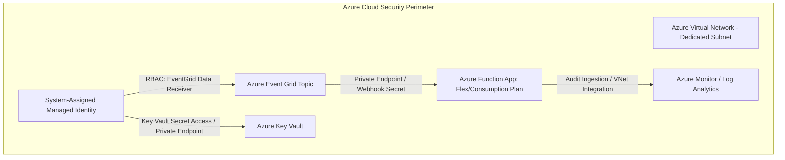

# Arquitectura de Seguridad Serverless y Event Grid en AegisBank

---

## 1. Postura de Seguridad Local (Laboratorio v0.13)

1. **Aislamiento de Credenciales y Secretos:**
   - El archivo `local.settings.json` está estrictamente ignorado en `.gitignore`.
   - Se versiona exclusivamente el archivo plantilla [`local.settings.example.json`](file:///c:/aegisbank-ai-platform-ai-env/aegisbank-ai-platform/functions/aegisbank-events/local.settings.example.json) con valores de desarrollo no confidenciales (`UseDevelopmentStorage=false`).

2. **Datos Estrictamente Sintéticos:**
   - Los eventos de prueba procesados por los triggers contienen exclusivamente identificadores sintéticos (`SR-2026-0001`, `CUST-0001`).
   - Queda prohibida la inclusión de datos financieros reales, tarjetas o PII.

3. **Validación Estricta de Esquemas (Contratos Defensivos):**
   - Todo CloudEvent recibido se valida contra el esquema JSON Schema 2020-12 [`service-request-created-v1.schema.json`](file:///c:/aegisbank-ai-platform-ai-env/aegisbank-ai-platform/contracts/cloudevents/service-request-created-v1.schema.json).
   - Se rechazan cargas útiles malformadas o con propiedades adicionales no autorizadas (`additionalProperties: false`), evitando ataques de *payload poisoning*.

4. **Principio de Mínimo Privilegio en Handlers:**
   - La Azure Function `service_request_event_handler` actúa estrictamente como consumidor reactivo de auditoría y métricas.
   - Tiene **privilegios de solo lectura** respecto al dominio financiero; no ejecuta operaciones de mutación o escritura bancaria (`NEW_BANKING_WRITES = 0`).

---

## 2. Controles de Seguridad Cloud (Planificados para Producción)

Los siguientes controles corresponden a la arquitectura de referencia en **Microsoft Azure** y permanecen en estado `CLOUD-PENDING`:

| Control de Seguridad Cloud | Mecanismo de Implementación | Estado |
|---|---|---|
| **Autenticación sin Contraseñas** | *System-Assigned Managed Identity* para la Function App, eliminando connection strings en archivos de configuración. | `CLOUD-PENDING` |
| **Gobernanza de Secretos** | Integración con **Azure Key Vault** mediante referencias `@Microsoft.KeyVault(...)`. | `CLOUD-PENDING` |
| **Aislamiento de Red** | Integración con **VNet** y **Private Endpoints**, impidiendo el acceso público a endpoints HTTP o triggers. | `CLOUD-PENDING` |
| **Validación de Suscripción Event Grid** | Handshake formal con `ValidationCode` / `ValidationResponse` y tokens de firma HMAC. | `CLOUD-PENDING` |
| **Control de Acceso Basado en Roles** | Asignación estricta de roles RBAC de Azure (`Azure Event Grid Data Receiver`, `Key Vault Secrets User`). | `CLOUD-PENDING` |
