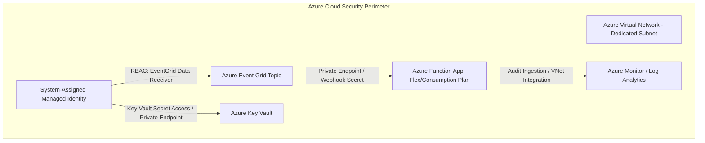

# AegisBank Serverless and Event Grid Security Architecture

---

## 1. Local Security Posture (v0.13 Laboratory)

1. **Credential and secret isolation:**
   - `local.settings.json` is ignored by `.gitignore`.
   - Only the non-secret development template [`local.settings.example.json`](../../functions/aegisbank-events/local.settings.example.json) is versioned (`UseDevelopmentStorage=false`).

2. **Synthetic data only:**
   - Test events processed by triggers use synthetic identifiers only (`SR-2026-0001`, `CUST-0001`).
   - Never include real financial data, payment-card data, or PII.

3. **Strict schema validation (defensive contracts):**
   - Validate every received CloudEvent against the JSON Schema 2020-12 [`service-request-created-v1.schema.json`](../../contracts/cloudevents/service-request-created-v1.schema.json).
   - Reject malformed payloads and unauthorized additional properties (`additionalProperties: false`) to reduce payload-poisoning risk.

4. **Least privilege for handlers:**
   - The `service_request_event_handler` Azure Function is a reactive audit and metrics consumer.
   - It is **read-only** with respect to the financial domain and does not perform banking mutations or writes (`NEW_BANKING_WRITES = 0`).

---

## 2. Cloud Security Controls (Planned for Production)

The following controls belong to the **Microsoft Azure** reference architecture and remain `CLOUD-PENDING`:

| Cloud security control | Implementation mechanism | Status |
|---|---|---|
| **Passwordless authentication** | System-assigned managed identity for the Function App; no connection strings in configuration files. | `CLOUD-PENDING` |
| **Secret governance** | **Azure Key Vault** integration through `@Microsoft.KeyVault(...)` references. | `CLOUD-PENDING` |
| **Network isolation** | **VNet** and **Private Endpoint** integration to prevent public access to HTTP endpoints or triggers. | `CLOUD-PENDING` |
| **Event Grid subscription validation** | Formal handshake using `ValidationCode` / `ValidationResponse` and HMAC signing tokens. | `CLOUD-PENDING` |
| **Role-based access control** | Strict assignment of Azure RBAC roles (`Azure Event Grid Data Receiver`, `Key Vault Secrets User`). | `CLOUD-PENDING` |
